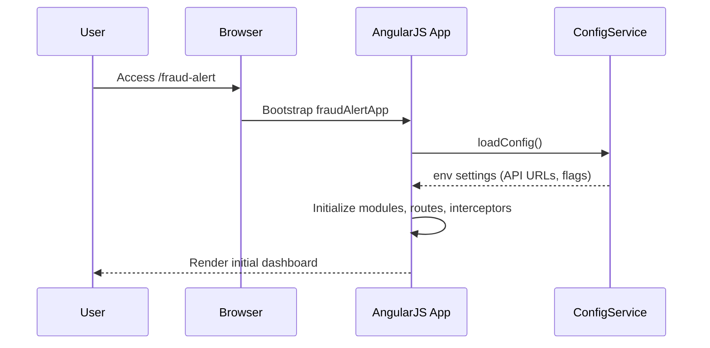
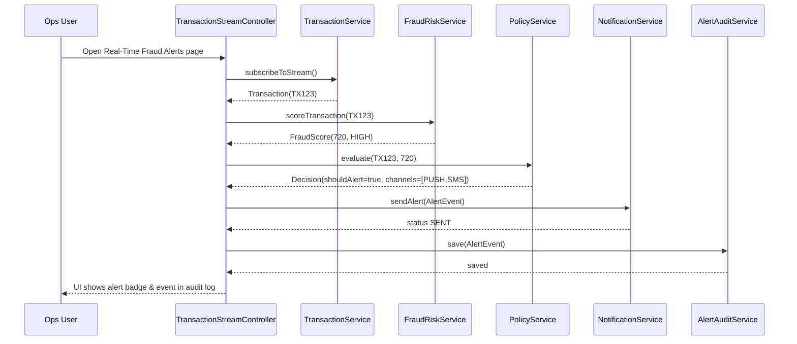
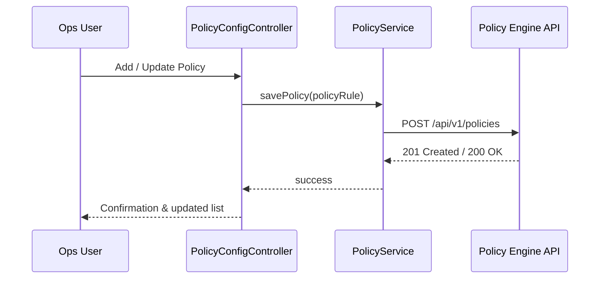
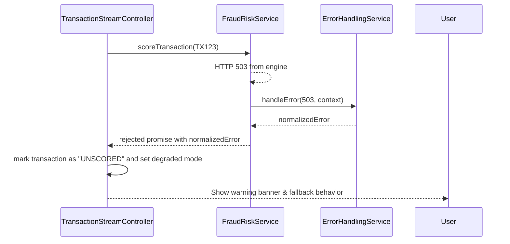

# Low-Level Design (LLD) – Credit Card Fraud Alert System

## 1. Application Architecture

### 1.1 Overview
Enterprise web application for configuring, monitoring, and validating credit card fraud alerts. It provides:
- Real-time visualization and configuration of fraud-risk scoring integration.
- Policy/decision configuration for alert thresholds and routing.
- Notification channel configuration (Push, SMS, Email).

Technology stack:
- AngularJS 1.x (MVC pattern)
- JavaScript ES6 (transpiled where needed to support older browsers if required)
- HTML5, CSS3, Bootstrap
- RESTful APIs (JSON)
- Server-side MVC (e.g., Java/Spring or .NET MVC) assumed for backend – details abstracted but interfaces defined.

### 1.2 AngularJS MVC Mapping

- **Modules**
  - `fraudAlertApp`: Root AngularJS module.
  - Feature modules:
    - `fraudAlert.transactions`: Real-time transaction monitoring & fraud scoring view.
    - `fraudAlert.policies`: Policy/decision configuration.
    - `fraudAlert.notifications`: Notification provider configuration & monitoring.
    - `fraudAlert.shared`: Shared services, models, filters, and directives.

- **Controllers**
  - `TransactionStreamController`: Handles transaction ingestion display, risk scores, and alert triggers.
  - `PolicyConfigController`: Manages fraud policy rules and thresholds.
  - `NotificationConfigController`: Manages notification providers and templates.
  - `AlertDashboardController`: Aggregates alert stats, health indicators, SLA metrics.

- **Services / Factories**
  - `TransactionService`: REST communication with card transaction platform gateway APIs.
  - `FraudRiskService`: REST integration with fraud-risk scoring engine.
  - `PolicyService`: REST integration with policy/decision engine APIs.
  - `NotificationService`: REST integration with notification providers and internal notification orchestration API.
  - `AlertAuditService`: Fetches and persists alert audit logs.
  - `ConfigService`: Loads environment-specific settings (API base URLs, flags).
  - `ErrorHandlingService`: Centralized error handling strategies.
  - `LoggingService`: Client-side logging and telemetry integration.

- **Directives**
  - `transactionStreamPanel`: Reusable panel to render streaming transactions with scores.
  - `riskScoreBadge`: Displays fraud-risk score with severity coloring.
  - `policyRuleEditor`: UI for defining and editing policy rules.
  - `notificationChannelToggle`: UI for enabling/disabling channels.

- **Filters**
  - `riskLevelFilter`: Map numeric score to textual risk levels (Low, Medium, High, Critical).
  - `transactionStatusFilter`: Format transaction status display.

- **Models (Plain JS Objects)**
  - `Transaction`, `FraudScore`, `PolicyRule`, `NotificationChannel`, `AlertEvent`.

- **Configuration Files**
  - `app.module.js`: Root module definitions & bootstrap.
  - `app.routes.js`: UI routing configuration.
  - `app.config.js`: Environment configuration, interceptors.
  - `constants.js`: Static constants (risk thresholds, channel names, etc.).

### 1.3 Recommended Project Folder Structure

```text
/webapp
  /app
    /core
      app.module.js
      app.routes.js
      app.config.js
      constants.js
    /shared
      /services
        transaction.service.js
        fraud-risk.service.js
        policy.service.js
        notification.service.js
        alert-audit.service.js
        config.service.js
        error-handling.service.js
        logging.service.js
      /models
        transaction.model.js
        fraud-score.model.js
        policy-rule.model.js
        notification-channel.model.js
        alert-event.model.js
      /filters
        risk-level.filter.js
        transaction-status.filter.js
      /directives
        transaction-stream-panel.directive.js
        risk-score-badge.directive.js
        policy-rule-editor.directive.js
        notification-channel-toggle.directive.js
    /features
      /transactions
        transaction-stream.controller.js
        transaction-stream.view.html
      /policies
        policy-config.controller.js
        policy-config.view.html
      /notifications
        notification-config.controller.js
        notification-config.view.html
      /alerts
        alert-dashboard.controller.js
        alert-dashboard.view.html
  /assets
    /css
      styles.css
    /js
      lib/
    /img
  index.html
```

## 2. Component Specifications

### 2.1 Module: `fraudAlertApp`
- **Type**: AngularJS Module
- **File**: `app/core/app.module.js`
- **Responsibility**:
  - Define root module and depend on feature modules (`fraudAlert.transactions`, `fraudAlert.policies`, `fraudAlert.notifications`, `fraudAlert.shared`).
- **Public API**: N/A (configuration only).
- **Dependencies**: `ngRoute`, `ngResource`, `ui.bootstrap`, feature modules.

### 2.2 Module: `fraudAlert.transactions`
- **Type**: AngularJS Module
- **File**: `app/features/transactions/transactions.module.js`
- **Responsibility**:
  - Declares components for transaction streaming & fraud scoring UI.

### 2.3 Controller: `TransactionStreamController`
- **Type**: Controller
- **File**: `app/features/transactions/transaction-stream.controller.js`
- **Responsibility**:
  - Manage the view of real-time card transactions.
  - Request fraud-risk scores per transaction via `FraudRiskService`.
  - Apply policy rules (`PolicyService`) to determine suspicious transactions.
  - Initiate alerts via `NotificationService` and record events via `AlertAuditService`.
- **Public Methods**:
  - `initStream()`: Initialize data sources and subscribe to transaction feed.
  - `refreshTransactions()`: Fetch latest transaction batch when fallback from streaming.
  - `evaluateTransaction(transaction)`: Obtain risk score and policy decision.
  - `triggerAlert(transaction, decision)`: Send notification(s) and log audit.
  - `applyFilters(filterCriteria)`: Filter transaction list by risk level, channel, status.
- **Inputs**:
  - Route params (e.g., `accountId`, `cardId`).
  - Filter criteria from view (risk level, date range).
- **Outputs**:
  - Scoped properties:
    - `$scope.transactions`: Array of `Transaction` models.
    - `$scope.streamStatus`: Enum (`CONNECTED`, `DISCONNECTED`, `DEGRADED`).
    - `$scope.alertStats`: Aggregated metrics for triggered alerts.
- **Dependencies (DI)**:
  - `TransactionService`, `FraudRiskService`, `PolicyService`, `NotificationService`, `AlertAuditService`, `ErrorHandlingService`, `LoggingService`, `$scope`, `$interval`, `$q`.

### 2.4 Service: `TransactionService`
- **Type**: Service (factory)
- **File**: `app/shared/services/transaction.service.js`
- **Responsibility**:
  - Retrieve card transaction data from backend gateway.
  - Provide abstractions for real-time stream (WebSocket or long-poll) and batch REST fallback.
- **Public Methods**:
  - `subscribeToStream(params)`: Returns a subscription handle or observable for transaction events.
  - `getTransactions(params)`: Fetch transaction list via REST.
- **Inputs**:
  - `params`: Filter object (cardId, dateRange, riskLevel, page, size).
- **Outputs**:
  - Promise resolving to `Transaction[]` for REST; callback/observable for streaming events.
- **Dependencies**:
  - `$http`, `$q`, `ConfigService`, `ErrorHandlingService`.

### 2.5 Service: `FraudRiskService`
- **Type**: Service (factory)
- **File**: `app/shared/services/fraud-risk.service.js`
- **Responsibility**:
  - Integrate with fraud-risk engine API to score transactions.
- **Public Methods**:
  - `scoreTransaction(transaction)`: Returns `FraudScore`.
  - `batchScore(transactions)`: Returns array of scores keyed by transaction IDs.
- **Inputs**:
  - `transaction` or `transactions[]` (Transaction model objects).
- **Outputs**:
  - Promise resolving to `FraudScore` or `FraudScore[]`.
- **Dependencies**:
  - `$http`, `$q`, `ConfigService`, `ErrorHandlingService`.

### 2.6 Service: `PolicyService`
- **Type**: Service (factory)
- **File**: `app/shared/services/policy.service.js`
- **Responsibility**:
  - Retrieve, evaluate, and update fraud policies from policy/decision engine.
- **Public Methods**:
  - `getPolicies()`: Load applicable policy rules.
  - `evaluate(transaction, fraudScore)`: Call backend or apply local rules to decide if alert is needed.
  - `savePolicy(policyRule)`: Persist rule changes.
- **Inputs**:
  - `transaction`, `fraudScore`, `policyRule`.
- **Outputs**:
  - Decision object: `{ shouldAlert: Boolean, reasonCode: String, channelOverrides: [String] }`.
- **Dependencies**:
  - `$http`, `$q`, `ConfigService`, `ErrorHandlingService`.

### 2.7 Service: `NotificationService`
- **Type**: Service
- **File**: `app/shared/services/notification.service.js`
- **Responsibility**:
  - Interface with notification orchestration backend which fans-out to Push/SMS/Email.
- **Public Methods**:
  - `sendAlert(alertEvent)`: Sends a notification for suspicious transaction.
  - `getNotificationChannels()`: Fetch configured channels.
  - `updateChannel(notificationChannel)`: Enable/disable channel, update templates.
- **Inputs**:
  - `alertEvent` model; `notificationChannel` model.
- **Outputs**:
  - Promise of send result `{status, providerResponses[]}`.
- **Dependencies**:
  - `$http`, `$q`, `ConfigService`, `ErrorHandlingService`, `LoggingService`.

### 2.8 Service: `AlertAuditService`
- **Type**: Service
- **File**: `app/shared/services/alert-audit.service.js`
- **Responsibility**:
  - Persist and fetch alert events for audit and reporting.
- **Public Methods**:
  - `save(alertEvent)`: Persist audit event.
  - `search(criteria)`: Fetch alerts based on filters.
- **Inputs**:
  - `alertEvent`, `criteria`.
- **Outputs**:
  - Promise returning `AlertEvent[]`.
- **Dependencies**:
  - `$http`, `$q`, `ConfigService`, `ErrorHandlingService`.

### 2.9 Controller: `PolicyConfigController`
- **Type**: Controller
- **File**: `app/features/policies/policy-config.controller.js`
- **Responsibility**:
  - Allow operations team to configure fraud policies and thresholds.
- **Public Methods**:
  - `loadPolicies()`, `addPolicy()`, `editPolicy(policy)`, `deletePolicy(policy)`, `saveChanges()`.
- **Dependencies**:
  - `PolicyService`, `$scope`, `ErrorHandlingService`.

### 2.10 Controller: `NotificationConfigController`
- **Type**: Controller
- **File**: `app/features/notifications/notification-config.controller.js`
- **Responsibility**:
  - Manage notification channels and templates.
- **Public Methods**:
  - `loadChannels()`, `toggleChannel(channel)`, `updateTemplate(channel)`, `testNotification(channel)`.
- **Dependencies**:
  - `NotificationService`, `$scope`, `ErrorHandlingService`, `LoggingService`.

### 2.11 Controller: `AlertDashboardController`
- **Type**: Controller
- **File**: `app/features/alerts/alert-dashboard.controller.js`
- **Responsibility**:
  - Display aggregated alert statistics and system health.
- **Public Methods**:
  - `loadMetrics()`, `refresh()`, `viewDetails(alertEvent)`.
- **Dependencies**:
  - `AlertAuditService`, `ConfigService`, `$scope`.

### 2.12 Directives

#### `transactionStreamPanel`
- **File**: `app/shared/directives/transaction-stream-panel.directive.js`
- **Responsibility**: Render streaming/batch transactions with infinite scroll and filters.
- **Scope Bindings**:
  - `transactions` (two-way), `onEvaluate(transaction)`, `streamStatus`.

#### `riskScoreBadge`
- **File**: `app/shared/directives/risk-score-badge.directive.js`
- **Responsibility**: Visual representation of risk score using Bootstrap label classes.
- **Inputs**: `score` (FraudScore).

#### `policyRuleEditor`
- **File**: `app/shared/directives/policy-rule-editor.directive.js`
- **Responsibility**: Rich UI for editing policy rules (threshold sliders, channel selection).
- **Inputs**: `policyRule`, `onSave(rule)`.

#### `notificationChannelToggle`
- **File**: `app/shared/directives/notification-channel-toggle.directive.js`
- **Responsibility**: Toggle enabling/disabling channels with confirmation.
- **Inputs**: `channel`, `onChange(channel)`.

### 2.13 Filters

#### `riskLevelFilter`
- **File**: `app/shared/filters/risk-level.filter.js`
- **Responsibility**: Convert numeric score (0–1000 or model-defined) into `Low/Medium/High/Critical`.

#### `transactionStatusFilter`
- **File**: `app/shared/filters/transaction-status.filter.js`
- **Responsibility**: Present transaction status codes as human-readable strings.

## 3. Component Responsibilities

- **UI Layer (Controllers + Directives + Views)**
  - Controllers own view state, call services to retrieve data, and orchestrate flows.
  - Directives encapsulate reusable UI widgets and DOM manipulation.
  - Bootstrap-based responsive layouts ensure consistent UX.

- **Business Logic (Services)**
  - `FraudRiskService` encapsulates fraud scoring operations and associated retries.
  - `PolicyService` encapsulates alert decision logic, keeping UI layer free of rule complexity.
  - `NotificationService` encapsulates multi-channel notification orchestration, error handling, and logging.
  - `TransactionService` owns transaction retrieval logic & stream subscription.

- **State Management**
  - Controllers maintain scope-local state.
  - Shared application state (e.g., current environment configuration, logged-in user) handled via dedicated services (`ConfigService`, `UserSessionService` if needed).

- **API Communication**
  - All remote calls performed via `$http` using RESTful endpoints.
  - Interceptors in `app.config.js` handle authentication headers, correlation IDs, and error normalization.

- **Validation**
  - Client-side validation of form inputs (policy thresholds, template content) using AngularJS forms and custom directives.
  - Model-level validation functions to guard against invalid objects before sending to APIs.

## 4. Interface Specifications (REST APIs)

### 4.1 Transaction Platform Integration

- **Endpoint**: `/api/v1/transactions`
- **Method**: `GET`
- **Request Query Params**:
  - `cardId` (string, optional)
  - `accountId` (string, optional)
  - `fromDate`, `toDate` (ISO 8601 datetime)
  - `riskLevel` (string: LOW|MEDIUM|HIGH|CRITICAL, optional)
  - `page`, `size` (pagination)
- **Response**:
  ```json
  {
    "transactions": [
      {
        "id": "TX123",
        "cardId": "****1234",
        "amount": 24.99,
        "currency": "USD",
        "merchant": "Online Shop",
        "location": "US",
        "timestamp": "2025-01-01T12:00:00Z",
        "status": "AUTHORIZED"
      }
    ],
    "page": 0,
    "size": 50,
    "totalElements": 350
  }
  ```
- **Error Responses**:
  - `400`: Invalid parameters.
  - `500`: Upstream platform errors.

### 4.2 Fraud-Risk Engine Integration

- **Endpoint**: `/api/v1/fraud-risk/score`
- **Method**: `POST`
- **Request Payload**:
  ```json
  {
    "transactionId": "TX123",
    "cardId": "****1234",
    "amount": 24.99,
    "currency": "USD",
    "merchant": "Online Shop",
    "location": "US",
    "timestamp": "2025-01-01T12:00:00Z",
    "additionalContext": {
      "channel": "ECOM",
      "previousAttempts": 1
    }
  }
  ```
- **Response**:
  ```json
  {
    "transactionId": "TX123",
    "score": 720,
    "riskLevel": "HIGH",
    "modelVersion": "fraud-model-2025.01",
    "explanations": ["velocity_high", "geo_mismatch"]
  }
  ```
- **Error Responses**:
  - `422`: Model cannot score (missing fields).
  - `503`: Fraud engine unavailable.

### 4.3 Policy/Decision Engine Integration

- **Endpoint (evaluation)**: `/api/v1/policies/evaluate`
- **Method**: `POST`
- **Request Payload**:
  ```json
  {
    "transactionId": "TX123",
    "score": 720,
    "riskLevel": "HIGH",
    "customerProfile": {
      "segment": "PREMIUM",
      "preferredChannels": ["PUSH", "EMAIL"]
    }
  }
  ```
- **Response**:
  ```json
  {
    "transactionId": "TX123",
    "shouldAlert": true,
    "reasonCode": "RISK_HIGH_THRESHOLD_CROSSED",
    "alertChannels": ["PUSH", "SMS"],
    "suppressReasons": [],
    "slaSeconds": 5
  }
  ```

- **Endpoint (policies CRUD)**: `/api/v1/policies`
- **Methods**:
  - `GET` – list policies.
  - `POST` – create new policy.
  - `PUT /{policyId}` – update policy.
  - `DELETE /{policyId}` – delete policy.

### 4.4 Notification Providers Integration

- **Endpoint**: `/api/v1/notifications/send`
- **Method**: `POST`
- **Request Payload**:
  ```json
  {
    "transactionId": "TX123",
    "channels": ["PUSH", "SMS"],
    "customerId": "CUST987",
    "message": {
      "title": "Suspicious card transaction detected",
      "body": "A transaction of $24.99 at Online Shop was flagged as suspicious.",
      "templateId": "fraud_alert_v1"
    },
    "metadata": {
      "reasonCode": "RISK_HIGH_THRESHOLD_CROSSED",
      "riskLevel": "HIGH"
    }
  }
  ```
- **Response**:
  ```json
  {
    "transactionId": "TX123",
    "status": "SENT",
    "providerResponses": [
      {"channel": "PUSH", "status": "DELIVERED"},
      {"channel": "SMS", "status": "QUEUED"}
    ]
  }
  ```

### 4.5 Alert Audit API

- **Endpoint**: `/api/v1/alerts`
- **Method**: `POST` to save alert, `GET` to search.

## 5. Data Model Design

### 5.1 `Transaction` Model

- **File**: `app/shared/models/transaction.model.js`
- **Attributes**:
  - `id` (String) – Unique transaction ID.
  - `cardId` (String) – Masked card number.
  - `amount` (Number, float).
  - `currency` (String).
  - `merchant` (String).
  - `location` (String).
  - `timestamp` (Date or ISO string).
  - `status` (String: `AUTHORIZED`, `DECLINED`, `PENDING`).
  - `fraudScore` (`FraudScore` object, optional).
  - `decision` (Decision object from PolicyService, optional).
- **Default Values**:
  - `status = 'AUTHORIZED'` if not provided.
- **Validation Rules**:
  - `amount > 0`.
  - `currency` must be ISO currency code.
  - `cardId` must be masked (no full PAN).
- **State Transitions**:
  - `PENDING -> AUTHORIZED` or `PENDING -> DECLINED`.

### 5.2 `FraudScore` Model

- **Attributes**:
  - `transactionId` (String).
  - `score` (Number, 0–1000).
  - `riskLevel` (String: `LOW|MEDIUM|HIGH|CRITICAL`).
  - `modelVersion` (String).
  - `explanations` (Array of String).
- **Validation**:
  - `score` in valid range; `riskLevel` consistent with thresholds.

### 5.3 `PolicyRule` Model

- **Attributes**:
  - `id` (String).
  - `name` (String).
  - `description` (String).
  - `minScoreForAlert` (Number).
  - `channels` (Array of String).
  - `customerSegmentFilters` (Array of String).
  - `active` (Boolean).
- **Validation**:
  - `minScoreForAlert` within model score range.
  - At least one channel when `active`.

### 5.4 `NotificationChannel` Model

- **Attributes**:
  - `id` (String).
  - `type` (String: `PUSH|SMS|EMAIL`).
  - `enabled` (Boolean).
  - `defaultTemplateId` (String).
  - `rateLimitPerMinute` (Number).
- **Validation**:
  - `rateLimitPerMinute >= 0`.

### 5.5 `AlertEvent` Model

- **Attributes**:
  - `id` (String).
  - `transactionId` (String).
  - `customerId` (String).
  - `channels` (Array of String).
  - `reasonCode` (String).
  - `riskLevel` (String).
  - `createdAt` (Date).
  - `status` (String: `PENDING|SENT|FAILED`).
- **State Transitions**:
  - `PENDING -> SENT` or `PENDING -> FAILED`.

## 6. Data Flow

### 6.1 End-to-End Flow

1. **User Action**: Operations user opens "Real-Time Fraud Alerts" page.
2. **View Initialization**: `transaction-stream.view.html` loads, bootstraps `TransactionStreamController`.
3. **Controller**: `TransactionStreamController.initStream()` calls `TransactionService.subscribeToStream()`.
4. **Service**: `TransactionService` establishes WebSocket or polling to backend, emits `Transaction` objects.
5. **Controller**: On each transaction event, controller calls `FraudRiskService.scoreTransaction(transaction)`.
6. **Service**: `FraudRiskService` calls `/fraud-risk/score` API; returns `FraudScore`.
7. **Controller**: Calls `PolicyService.evaluate(transaction, fraudScore)`.
8. **Service**: `PolicyService` calls `/policies/evaluate` or applies local rules, returns decision.
9. **Controller**: If `decision.shouldAlert`, constructs `AlertEvent` and calls `NotificationService.sendAlert(alertEvent)`.
10. **Service**: `NotificationService` calls `/notifications/send`; on success/failure, uses `AlertAuditService.save(alertEvent)`.
11. **UI Update**: Controller updates `$scope.transactions` with updated status, risk level; `riskScoreBadge` shows severity; `transactionStreamPanel` updates view.
12. **Error Handling**: Errors encountered in scoring or policy evaluation displayed via global error banner; fallback to degraded mode if stream fails.

## 7. Sequence Diagrams (Mermaid)

### 7.1 Application Initialization



### 7.2 Primary User Workflow – Real-Time Alerting



### 7.3 Service/API Interactions – Policy CRUD



### 7.4 Error Handling Scenario – Fraud Engine Down



## 8. Implementation Details

### 8.1 AngularJS Implementation Approach

- Use `angular.module` to define root and feature modules.
- Controllers use controller-as syntax (`vm`) where feasible for cleaner scope.
- Services implemented as factories returning ES6-compatible objects.

### 8.2 JavaScript ES6 Patterns

- Use `const` and `let` instead of `var` inside services and controllers (transpiled if needed).
- Arrow functions for callbacks.
- Promises (`$q`) integrated with ES6-style chaining.

### 8.3 Dependency Injection

- Use explicit `$inject` arrays for minification safety.
- Centralize common dependencies (e.g., `ConfigService`) in shared module.

### 8.4 Business Logic Flow

- Keep risk evaluation and decisions inside services; controllers orchestrate flows.
- Real-time evaluation is stateless, while configurations and audits are persisted server-side.

### 8.5 Validation Logic

- Form validations implemented via AngularJS built-in validators plus custom directives for thresholds.
- Pre-submit validation in controllers calls model methods like `Transaction.validate()` when needed.

### 8.6 State Management Approach

- Scope-level state for each view.
- Global flags (e.g., `degradedMode`) stored in a shared service.

### 8.7 DOM Interaction

- DOM changes wrapped into directives; controllers should not call `document.querySelector` directly.
- Use AngularJS binding and `ng-repeat`, `ng-if`, `ng-class`.

### 8.8 API Integration

- `$http` calls wrapped in services; base URLs derived from `ConfigService`.
- HTTP interceptors add authentication tokens, trace IDs, and log timing metrics via `LoggingService`.

## 9. Configuration

### 9.1 AngularJS Configuration Files

- `app.config.js`:
  - Configure `$routeProvider` with routes:
    - `/transactions`, `/policies`, `/notifications`, `/alerts`.
  - Configure `$httpProvider.interceptors`.
- `constants.js`:
  - Risk thresholds, default channels, SLA limits.

### 9.2 Environment Properties

- Load from `/config/env-{env}.json` via `ConfigService`:
  - `transactionApiBaseUrl`
  - `fraudRiskApiBaseUrl`
  - `policyApiBaseUrl`
  - `notificationApiBaseUrl`
  - Logging and telemetry endpoints.

### 9.3 Feature Flags

- Example flags:
  - `enableRealTimeStream`: switch between streaming and polling.
  - `enableAdvancedPolicyRules`: enable complex rule UI.

### 9.4 Logging & Telemetry

- `LoggingService` sends client-side events (page views, API latency, error codes) to telemetry backend.

## 10. Error Handling and Resiliency

- Central `ErrorHandlingService` normalizes errors to a standard format.
- Automatic retries with exponential backoff for transient errors (HTTP 5xx) in `FraudRiskService` and `NotificationService`.
- Circuit breaker logic: when fraud engine repeatedly fails, switch to `degradedMode` and avoid spamming API.
- UI banners indicate degraded state; operations can monitor via dashboard.

## 11. Security Considerations

- **Input Validation & Sanitization**:
  - Escape all user-input fields using AngularJS bindings (`ng-bind`) to prevent injection.
  - Use server-side validation for policies and templates; client-side validation as first defense.
- **XSS Prevention**:
  - Avoid `ng-bind-html` except when content is sanitized via `$sanitize`.
  - Content from APIs encoded in HTML-safe manner.
- **CSRF Protection**:
  - Rely on server-side CSRF tokens; AngularJS `$http` interceptor injects token into requests.
- **Secure API Communication**:
  - All endpoints served over HTTPS.
  - Use secure cookies or tokens; tokens stored in memory (not localStorage) where possible.
- **Authentication & Authorization**:
  - Integrate with enterprise SSO; controllers hide features based on user roles (e.g., Policy admin vs. Viewer).
- **Sensitive Data Handling**:
  - Mask card numbers (display and API payloads) – PAN never stored on client.
- **Audit Logging**:
  - All policy changes and alert decisions recorded via `AlertAuditService` and server-side audit trail.
