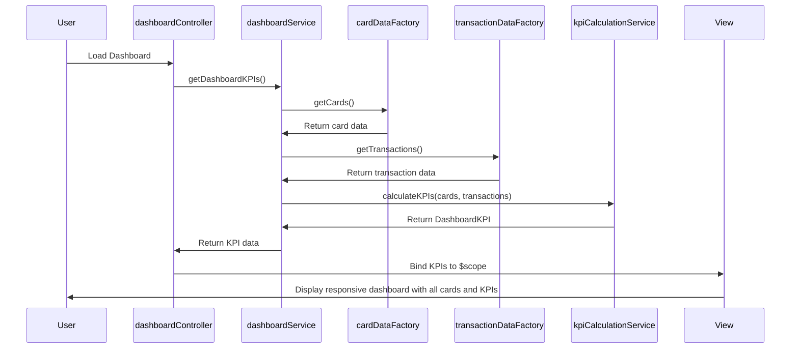

# Low-Level Design: Credit Card Analysis Dashboard
**Epic ID:** QE-7434

---

## a. Architecture Mapping

- **Dashboard Service** → AngularJS Service (`dashboardService`) - orchestrates data retrieval and KPI calculations
- **Card Data Repository** → AngularJS Factory (`cardDataFactory`) - fetches card details from internal repository
- **Transaction Data Store** → AngularJS Factory (`transactionDataFactory`) - retrieves transaction history
- **KPI Calculation Engine** → AngularJS Service (`kpiCalculationService`) - computes monthly spend, limits, available credit, outstanding amounts
- **Web Application Layer** → AngularJS Module (`creditCardDashboardModule`) with Controller (`dashboardController`)

**Folder Structure:**
```
app/
├── modules/
│   └── credit-card-dashboard/
│       ├── controllers/
│       ├── services/
│       ├── factories/
│       └── views/
├── shared/
│   └── components/
└── assets/
```

---

## b. Component Specifications

| Name | Artifact Type | Responsibility | Key Dependencies |
|------|---------------|----------------|------------------|
| creditCardDashboardModule | Module | Root module for credit card dashboard | ngRoute, ngResource |
| dashboardController | Controller | Manages dashboard view and coordinates KPI display | dashboardService, $scope |
| dashboardService | Service | Orchestrates data retrieval and aggregation across cards | cardDataFactory, transactionDataFactory, kpiCalculationService |
| cardDataFactory | Factory | Fetches card details (limits, card numbers, types) from repository | $http, $q |
| transactionDataFactory | Factory | Retrieves transaction history for KPI calculations | $http, $q |
| kpiCalculationService | Service | Computes monthly spend, total limits, available credit, outstanding amounts | $filter |
| cardSummaryDirective | Directive | Renders individual card summary with KPIs | Bootstrap grid |
| responsiveLayoutDirective | Directive | Ensures responsive layout across devices | $window, Bootstrap |

---

## c. Data Model

**CreditCard**
- `cardId`: String
- `cardNumber`: String (masked)
- `cardType`: String (Visa/MasterCard/Amex)
- `creditLimit`: Number
- `outstandingAmount`: Number
- `availableCredit`: Number

**Transaction**
- `transactionId`: String
- `cardId`: String
- `amount`: Number
- `transactionDate`: Date
- `merchantName`: String
- `category`: String

**DashboardKPI**
- `totalMonthlySpend`: Number
- `totalCreditLimit`: Number
- `totalAvailableCredit`: Number
- `totalOutstandingAmount`: Number
- `cardCount`: Number
- `cards`: Array[CreditCard]

---

## d. Data Flow

User accesses dashboard → dashboardController initializes and calls dashboardService.getDashboardKPIs() → dashboardService requests card data from cardDataFactory and transaction data from transactionDataFactory → kpiCalculationService processes retrieved data to compute monthly spend (current month transactions sum), total credit limit (sum across all cards), available credit (sum of limits minus outstanding), and outstanding amounts → dashboardService returns DashboardKPI object to dashboardController → controller binds data to $scope → cardSummaryDirective renders each card with KPIs in responsive grid → responsiveLayoutDirective adjusts layout based on device viewport.

---

## e. Primary Sequence Diagram



---

## f. Implementation Notes

- Use AngularJS dependency injection for all components to ensure modularity and testability
- Leverage ES6 promises ($q) for asynchronous data retrieval from factories
- Apply Bootstrap responsive grid system with AngularJS directives for device-agnostic layout
- Implement MVC pattern: dashboardController manages view logic, services handle business logic, factories manage data access
- Use AngularJS $filter service in kpiCalculationService for date-based transaction filtering (current month)

---

## g. Error Handling

Centralized try/catch blocks in service layer with user notification via Bootstrap alerts; factory-level error handling returns rejected promises for controller consumption.

---

## h. Security Notes

Standard input validation and secure API calls assumed; card numbers masked in UI; no external banking integration required.