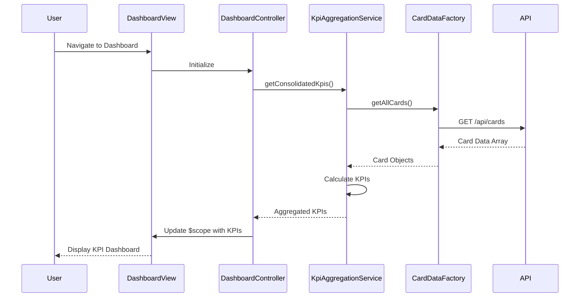

# Low-Level Design: Credit Card Analysis Dashboard
**Epic ID:** QE-7445

## a. Architecture Mapping

- **Dashboard Module** → AngularJS Module (`creditCardDashboardModule`)
- **Dashboard UI** → AngularJS Controller (`DashboardController`) + HTML Template (`dashboard.html`)
- **KPI Aggregation Service** → AngularJS Service (`KpiAggregationService`)
- **Card Data Provider** → AngularJS Factory (`CardDataFactory`)
- **REST API Integration** → AngularJS `$http` service with interceptors

**Folder Structure:**
```
/app
  /modules
    /dashboard
      dashboard.module.js
      dashboard.controller.js
      dashboard.html
  /services
    kpi-aggregation.service.js
  /factories
    card-data.factory.js
  /models
    card.model.js
/assets
  /css
    dashboard.css
```

## b. Component Specifications

| Name | Artifact Type | Responsibility | Key Dependencies |
|------|---------------|----------------|------------------|
| creditCardDashboardModule | Module | Root module for dashboard feature | angular, ui.router |
| DashboardController | Controller | Manages dashboard state and KPI display logic | KpiAggregationService, $scope |
| KpiAggregationService | Service | Aggregates and calculates KPIs from card data | CardDataFactory, $q |
| CardDataFactory | Factory | Fetches card data from REST API | $http, API_CONFIG |
| dashboard.html | View | Responsive UI template with Bootstrap grid | Bootstrap CSS, AngularJS directives |
| Card | Model | JS object representing card with limit, balance, spend | None |

## c. Data Model

**Card Model:**
```javascript
{
  cardId: String,
  cardName: String,
  creditLimit: Number,
  availableCredit: Number,
  outstandingAmount: Number,
  monthlySpend: Number
}
```

**KPI Aggregation Model:**
```javascript
{
  totalCreditLimit: Number,
  totalAvailableCredit: Number,
  totalOutstandingAmount: Number,
  totalMonthlySpend: Number,
  cardCount: Number
}
```

## d. Data Flow

User navigates to dashboard → DashboardController initializes and calls KpiAggregationService.getConsolidatedKpis() → KpiAggregationService invokes CardDataFactory.getAllCards() → CardDataFactory makes REST API call via $http → API returns card array → KpiAggregationService aggregates KPIs (sum credit limits, available credit, outstanding amounts, monthly spend) → Aggregated KPIs bound to $scope → View renders KPI cards using Bootstrap responsive grid → UI updates reactively on data changes.

## e. Primary Sequence Diagram



## f. Implementation Notes

- Use AngularJS 1.x dependency injection for all services and controllers with explicit array notation to avoid minification issues
- Implement ES6 classes for service logic with Babel transpilation; use arrow functions for promise chains
- Bootstrap 3.x grid system (col-xs/sm/md/lg) for responsive KPI card layout across devices
- REST API calls via $http with promise-based error handling; use $q.all for parallel card data fetching if needed
- MVC pattern: Controller manages view state, Service handles business logic, Factory abstracts API communication

## g. Error Handling

HTTP interceptor captures API errors; controller displays user-friendly error messages via Bootstrap alert components; failed KPI calculations default to zero with warning indicator.

## h. Security Notes

Standard input validation and secure API calls assumed; card data masked in UI to hide sensitive identifiers.