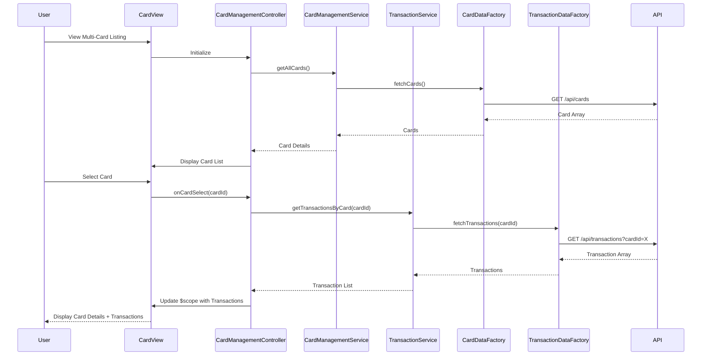

# Low-Level Design: Multi-Card Management and Transaction View
**Epic ID:** QE-7446

## a. Architecture Mapping

- **User Interface** → AngularJS Controller (`CardManagementController`) + HTML Template (`card-management.html`)
- **Dashboard Controller** → AngularJS Controller (extends base dashboard controller)
- **Card Management Service** → AngularJS Service (`CardManagementService`)
- **Transaction Service** → AngularJS Service (`TransactionService`)
- **Data Source Integration** → AngularJS Factory (`CardDataFactory`, `TransactionDataFactory`)

**Folder Structure:**
```
/app
  /modules
    /card-management
      card-management.module.js
      card-management.controller.js
      card-management.html
  /services
    card-management.service.js
    transaction.service.js
  /factories
    transaction-data.factory.js
  /models
    transaction.model.js
/assets
  /css
    card-management.css
```

## b. Component Specifications

| Name | Artifact Type | Responsibility | Key Dependencies |
|------|---------------|----------------|------------------|
| cardManagementModule | Module | Root module for card and transaction management | angular, ui.router, creditCardDashboardModule |
| CardManagementController | Controller | Manages card selection, detail display, and transaction list | CardManagementService, TransactionService, $scope |
| CardManagementService | Service | Retrieves and manages card details (limit, available credit, outstanding) | CardDataFactory, $q |
| TransactionService | Service | Fetches and filters transaction data by card | TransactionDataFactory, $q |
| TransactionDataFactory | Factory | Makes REST API calls for transaction data | $http, API_CONFIG |
| card-management.html | View | Multi-card listing with transaction table using Bootstrap | Bootstrap CSS, ng-repeat |
| Transaction | Model | JS object with date, amount, category | None |

## c. Data Model

**Card Detail Model:**
```javascript
{
  cardId: String,
  cardName: String,
  creditLimit: Number,
  availableCredit: Number,
  outstandingAmount: Number
}
```

**Transaction Model:**
```javascript
{
  transactionId: String,
  cardId: String,
  date: Date,
  amount: Number,
  category: String,
  description: String
}
```

## d. Data Flow

User views multi-card listing → CardManagementController calls CardManagementService.getAllCards() → Service fetches card details via CardDataFactory → Cards displayed in UI list → User selects a card → Controller invokes TransactionService.getTransactionsByCard(cardId) → TransactionService calls TransactionDataFactory → Factory makes REST API call GET /api/transactions?cardId=X → API returns transaction array → Transactions bound to $scope and rendered in Bootstrap table → User views card KPIs alongside transaction history in unified interface.

## e. Primary Sequence Diagram



## f. Implementation Notes

- Use AngularJS ui-router for state management; define states for card listing and card detail views
- Implement ES6 promises with $q for asynchronous service calls; use .then() chaining for sequential data loading
- Bootstrap table component with ng-repeat for transaction list rendering; implement client-side sorting/filtering with orderBy and filter
- REST API integration via $http service with query parameters for card-specific transaction filtering
- MVC separation: Controller orchestrates view logic, Services handle business rules, Factories abstract API layer

## g. Error Handling

HTTP interceptor-based error handling with user notification via Bootstrap modals; transaction load failures display inline error message with retry option.

## h. Security Notes

Requires token-based auth via existing SSO; sensitive card identifiers masked in UI; transaction data filtered server-side by authenticated user context.