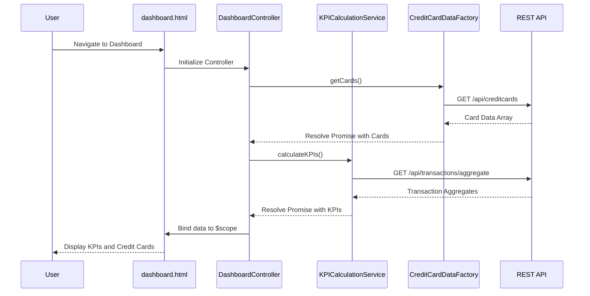

# Low-Level Design: QE-7462 - Dashboard KPIs and Credit Card Overview

## a. Architecture Mapping

- **Dashboard Module** → AngularJS Module (`app.dashboard`)
- **User Interface Layer** → HTML5 view templates with Bootstrap grid (`dashboard.html`)
- **Dashboard Controller** → AngularJS Controller (`DashboardController`)
- **KPI Calculation Service** → AngularJS Service (`KPICalculationService`)
- **Credit Card Data Service** → AngularJS Factory (`CreditCardDataFactory`)
- **Mock Data Source** → REST API endpoints or AngularJS Constant/Value for mock data

**Recommended Folder Structure:**
```
app/
├── modules/
│   └── dashboard/
│       ├── dashboard.module.js
│       ├── dashboard.controller.js
│       ├── dashboard.html
│       └── dashboard.routes.js
├── services/
│   ├── kpi-calculation.service.js
│   └── creditcard-data.factory.js
├── models/
│   └── creditcard.model.js
└── assets/
    └── css/dashboard.css
```

## b. Component Specifications

| Name | Artifact Type | Responsibility | Key Dependencies |
|------|---------------|----------------|------------------|
| `app.dashboard` | Module | Encapsulates all dashboard-related components and routing | `ngRoute`, `app.services` |
| `DashboardController` | Controller | Orchestrates dashboard view, fetches KPIs and card data, manages UI state | `KPICalculationService`, `CreditCardDataFactory`, `$scope` |
| `KPICalculationService` | Service | Computes Monthly Spend, Outstanding Amount from transaction data | `$http`, `$q` |
| `CreditCardDataFactory` | Factory | Retrieves credit card details (masked card number, issuer, limits, balances) | `$http`, `$q` |
| `dashboard.html` | View Template | Renders KPI cards (Monthly Spend, Total Credit Limit, Available Credit, Outstanding) and credit card list with Bootstrap responsive grid | Bootstrap CSS, AngularJS directives |
| `dashboard.routes.js` | Config | Defines routing for dashboard landing page | `$routeProvider` |

## c. Data Model

**CreditCard Model:**
```javascript
{
  cardId: String,
  cardNumberMasked: String,
  issuer: String,
  creditLimit: Number,
  currentBalance: Number,
  availableCredit: Number,
  cardType: String
}
```

**KPI Model:**
```javascript
{
  monthlySpend: Number,
  totalCreditLimit: Number,
  totalAvailableCredit: Number,
  totalOutstanding: Number
}
```

## d. Data Flow

User navigates to dashboard route → AngularJS router loads `dashboard.html` and instantiates `DashboardController` → Controller invokes `CreditCardDataFactory.getCards()` and `KPICalculationService.calculateKPIs()` → Both services make REST API calls to backend endpoints (or retrieve mock data) → Services return promises resolved with credit card array and KPI object → Controller binds data to `$scope` → View updates with KPI cards and credit card list using Bootstrap responsive grid and AngularJS data binding → UI renders responsively across devices.

## e. Primary Sequence Diagram



## f. Implementation Notes

- Use AngularJS 1.x module pattern with dependency injection for all services and controllers
- Implement Factory pattern for `CreditCardDataFactory` to maintain singleton instance and caching
- Use `$http` service with promise-based API calls; aggregate KPIs server-side for performance
- Apply Bootstrap 3.x responsive grid (col-xs/sm/md/lg) for mobile-first dashboard layout
- Leverage AngularJS `$q` service for promise chaining when dependent data loads are required

## g. Error Handling

HTTP interceptor-based error handling with user-friendly notifications via Bootstrap alerts or toast messages on API failures.

## h. Security Notes

Requires token-based authentication via existing SSO; all API calls include auth headers with masked card data returned from backend.