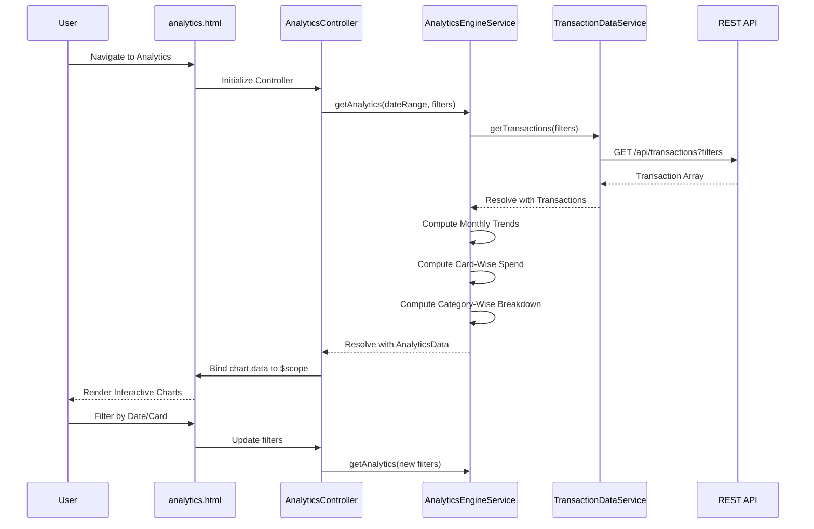

# Low-Level Design: QE-7463 - Spending Analytics and Insights

## a. Architecture Mapping

- **Analytics Module** → AngularJS Module (`app.analytics`)
- **Analytics UI** → HTML5 view templates with chart containers (`analytics.html`)
- **Analytics Controller** → AngularJS Controller (`AnalyticsController`)
- **Analytics Engine** → AngularJS Service (`AnalyticsEngineService`)
- **Transaction Data Module** → AngularJS Service (`TransactionDataService`)
- **Dashboard KPI Module** → AngularJS Service (`KPICalculationService`) - reused from dashboard
- **Visualization Library** → Chart.js or Angular-Chart.js directive wrapper

**Recommended Folder Structure:**
```
app/
├── modules/
│   └── analytics/
│       ├── analytics.module.js
│       ├── analytics.controller.js
│       ├── analytics.html
│       └── analytics.routes.js
├── services/
│   ├── analytics-engine.service.js
│   ├── transaction-data.service.js
│   └── kpi-calculation.service.js
├── directives/
│   └── chart-wrapper.directive.js
└── assets/
    └── css/analytics.css
```

## b. Component Specifications

| Name | Artifact Type | Responsibility | Key Dependencies |
|------|---------------|----------------|------------------|
| `app.analytics` | Module | Encapsulates analytics visualization and computation logic | `ngRoute`, `chart.js`, `app.services` |
| `AnalyticsController` | Controller | Manages analytics view state, requests computed analytics, formats data for charts | `AnalyticsEngineService`, `$scope`, `$filter` |
| `AnalyticsEngineService` | Service | Performs calculations for monthly trends, card-wise analysis, category-wise breakdowns | `TransactionDataService`, `KPICalculationService`, `$q` |
| `TransactionDataService` | Service | Retrieves transaction data with filters (date range, card, category) | `$http`, `$q` |
| `analytics.html` | View Template | Renders interactive charts (line for trends, bar for card-wise, pie/donut for categories) with Bootstrap layout | Chart.js, Bootstrap, AngularJS directives |
| `chartWrapper` | Directive | Encapsulates Chart.js rendering logic for reusable chart components | Chart.js library |

## c. Data Model

**AnalyticsData Model:**
```javascript
{
  monthlyTrends: Array<{month: String, amount: Number}>,
  cardWiseSpend: Array<{cardId: String, cardName: String, amount: Number}>,
  categoryWiseSpend: Array<{category: String, amount: Number, percentage: Number}>
}
```

**Category Enum:**
```javascript
[
  "Food & Dining",
  "Fuel",
  "Shopping",
  "Travel",
  "Entertainment",
  "Utilities",
  "Healthcare",
  "Education",
  "Miscellaneous"
]
```

## d. Data Flow

User navigates to analytics view → `AnalyticsController` initializes and calls `AnalyticsEngineService.getAnalytics()` with date range filters → Engine retrieves raw transaction data via `TransactionDataService` and aggregate KPIs via `KPICalculationService` → Engine computes monthly trends (group by month), card-wise totals (group by card), and category-wise breakdowns (group by 9 predefined categories) → Computed analytics returned to controller → Controller formats data for Chart.js configuration objects → View renders line chart (monthly trends), bar chart (card-wise), and donut chart (category-wise) using chart directive → User interactions (date filter, card selection) trigger controller methods that re-invoke engine with new parameters.

## e. Primary Sequence Diagram



## f. Implementation Notes

- Use Chart.js library with Angular-Chart.js directive wrapper for declarative chart binding in templates
- Implement caching in `AnalyticsEngineService` using `$cacheFactory` for frequently accessed date ranges
- Use ES6 array methods (map, reduce, filter) for efficient client-side aggregation of transaction data
- Apply AngularJS `$filter` service for date formatting and currency display in chart labels
- Leverage Chart.js responsive configuration and Bootstrap grid for mobile-optimized chart rendering

## g. Error Handling

HTTP interceptor captures API errors; controller displays user-friendly error messages via Bootstrap alert components with retry option.

## h. Security Notes

Standard input validation and secure API calls assumed; category data is read-only enum to prevent injection attacks.