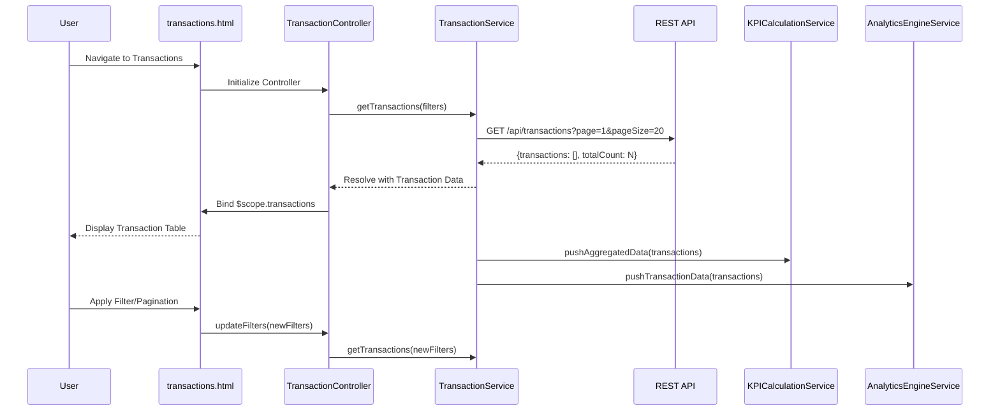

# Low-Level Design: QE-7464 - Transaction Management and Tracking

## a. Architecture Mapping

- **Transaction Module** → AngularJS Module (`app.transactions`)
- **User Interface** → HTML5 view templates with transaction table (`transactions.html`)
- **Transaction Controller** → AngularJS Controller (`TransactionController`)
- **Transaction Service** → AngularJS Service (`TransactionService`)
- **Transaction Data Repository** → REST API endpoints for transaction CRUD operations
- **Dashboard KPI Module** → AngularJS Service (`KPICalculationService`) - integration point
- **Analytics Module** → AngularJS Service (`AnalyticsEngineService`) - integration point

**Recommended Folder Structure:**
```
app/
├── modules/
│   └── transactions/
│       ├── transactions.module.js
│       ├── transactions.controller.js
│       ├── transactions.html
│       ├── transaction-detail.html
│       └── transactions.routes.js
├── services/
│   └── transaction.service.js
├── models/
│   └── transaction.model.js
└── assets/
    └── css/transactions.css
```

## b. Component Specifications

| Name | Artifact Type | Responsibility | Key Dependencies |
|------|---------------|----------------|------------------|
| `app.transactions` | Module | Encapsulates transaction listing, detail view, and data management | `ngRoute`, `app.services` |
| `TransactionController` | Controller | Manages transaction list view, pagination, filtering, and detail navigation | `TransactionService`, `$scope`, `$routeParams` |
| `TransactionService` | Service | Retrieves, filters, and paginates transaction data; pushes aggregates to KPI and Analytics modules | `$http`, `$q`, `KPICalculationService`, `AnalyticsEngineService` |
| `transactions.html` | View Template | Renders paginated transaction table with filters (card, date range, category) using Bootstrap table | Bootstrap, AngularJS directives |
| `transaction-detail.html` | View Template | Displays detailed view of single transaction (merchant, amount, date, category, card) | Bootstrap, AngularJS directives |
| `transactions.routes.js` | Config | Defines routes for transaction list and detail views | `$routeProvider` |

## c. Data Model

**Transaction Model:**
```javascript
{
  transactionId: String,
  cardId: String,
  merchantName: String,
  amount: Number,
  transactionDate: Date,
  category: String,
  description: String,
  status: String
}
```

**TransactionFilter Model:**
```javascript
{
  cardId: String,
  startDate: Date,
  endDate: Date,
  category: String,
  page: Number,
  pageSize: Number
}
```

## d. Data Flow

User navigates to transactions view → AngularJS router loads `transactions.html` and instantiates `TransactionController` → Controller calls `TransactionService.getTransactions(filters)` with default pagination (page 1, pageSize 20) → Service makes REST API call to `/api/transactions` with query parameters → API returns paginated transaction array with total count → Service resolves promise with transaction data → Controller binds data to `$scope.transactions` → View renders Bootstrap table with transaction rows → User applies filters (card, date, category) or clicks pagination → Controller updates filter object and re-invokes service → Service simultaneously pushes aggregated data to `KPICalculationService` and `AnalyticsEngineService` for downstream module updates → User clicks transaction row to view details → Controller navigates to detail route with transactionId.

## e. Primary Sequence Diagram



## f. Implementation Notes

- Implement pagination using AngularJS `ng-repeat` with `limitTo` and custom pagination directive or UI Bootstrap pagination component
- Use `$http` service with query parameter serialization for RESTful transaction retrieval with filters
- Apply AngularJS `$filter` for client-side date formatting and currency display in transaction table
- Implement debouncing on filter inputs using `ng-model-options="{debounce: 300}"` to reduce API calls
- Use AngularJS `$broadcast` or event emitter pattern for pushing transaction aggregates to KPI and Analytics services

## g. Error Handling

HTTP interceptor-based error handling with try/catch in service methods; user notifications via Bootstrap alert components on API failures.

## h. Security Notes

Requires token-based auth via existing SSO; transaction data filtered by authenticated user context on backend to prevent unauthorized access.