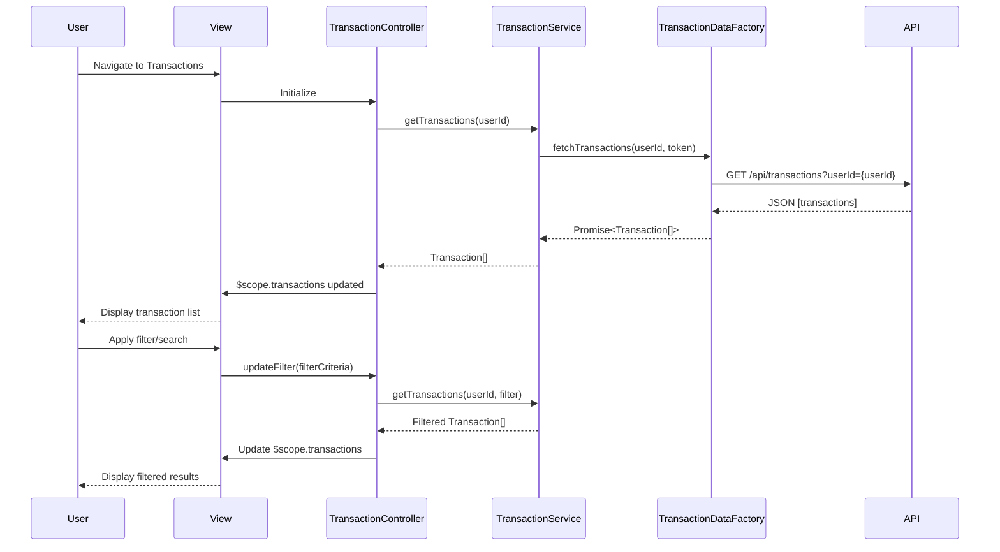

# Low-Level Design: Transaction Management and Tracking
**Epic ID:** QE-7465  
**Application Stack:** AngularJS 1.x, JavaScript ES6, HTML5, CSS3, Bootstrap, REST APIs, MVC Architecture

---

## a. Architecture Mapping

**Component to Artifact Mapping:**
- User Interface → AngularJS Module (`transactionModule`) + View Templates (HTML5/Bootstrap)
- Transaction Management Service → AngularJS Service (`TransactionService`)
- Transaction Data Service Integration → AngularJS Factory (`TransactionDataFactory`)
- Search & Filter Logic → AngularJS Controller (`TransactionController`)
- User Authentication → AngularJS Service (`AuthService`)

**Recommended Folder Structure:**
```
app/
├── modules/
│   └── transactions/
│       ├── controllers/
│       │   └── transactionController.js
│       ├── services/
│       │   └── transactionService.js
│       ├── factories/
│       │   └── transactionDataFactory.js
│       ├── views/
│       │   ├── transaction-list.html
│       │   └── transaction-detail.html
│       └── transactionModule.js
├── shared/
│   └── services/
│       └── authService.js
└── assets/
    ├── css/
    └── js/
```

---

## b. Component Specifications

| Component Name | Artifact Type | Responsibility | Key Dependencies |
|----------------|---------------|----------------|------------------|
| transactionModule | Module | Registers all transaction-related components and routing | angular, ui.router |
| TransactionController | Controller | Manages transaction list UI state, search/filter logic, pagination | TransactionService, $scope, $filter |
| TransactionService | Service | Business logic for transaction operations, data transformation | TransactionDataFactory, AuthService |
| TransactionDataFactory | Factory | REST API calls to transaction data service endpoints | $http, $q, API_CONFIG |
| AuthService | Service | User authentication and token management | $http, $window |
| transaction-list.html | View | Displays transaction table with search/filter controls | Bootstrap, AngularJS directives |
| transaction-detail.html | View | Shows detailed transaction information | Bootstrap, AngularJS directives |

---

## c. Data Model

**Transaction Model:**
```javascript
class Transaction {
  id: String              // Unique transaction identifier
  cardId: String          // Associated credit card ID
  date: Date              // Transaction date
  amount: Number          // Transaction amount (decimal)
  merchant: String        // Merchant name
  category: String        // Spending category
  description: String     // Transaction description
  status: String          // Status: 'posted', 'pending'
}
```

**TransactionFilter Model:**
```javascript
class TransactionFilter {
  cardId: String          // Filter by card
  startDate: Date         // Date range start
  endDate: Date           // Date range end
  category: String        // Filter by category
  searchTerm: String      // Text search
  minAmount: Number       // Minimum amount
  maxAmount: Number       // Maximum amount
}
```

---

## d. Data Flow

User navigates to transaction list view → TransactionController initializes and calls TransactionService.getTransactions() → TransactionService invokes TransactionDataFactory.fetchTransactions() with user token from AuthService → Factory makes REST API call to Transaction Data Service → API returns JSON array of transactions → Factory transforms response and returns promise → Service applies any business rules and caches data → Controller receives data, applies filters/search if any, and binds to $scope → View renders transaction table using ng-repeat with Bootstrap styling → User applies search/filter → Controller updates filter model and re-queries service → UI updates reactively.

---

## e. Primary Sequence Diagram



---

## f. Implementation Notes

- Use AngularJS dependency injection for all services, factories, and controllers to ensure testability and modularity.
- Implement TransactionDataFactory using $http service with promise-based API; use $q for error handling and chaining.
- Apply AngularJS filters (e.g., $filter('date'), $filter('currency')) in controller for date formatting and amount display.
- Use ui.router for state management with lazy-loaded transaction module and nested views for list/detail.
- Implement client-side pagination using AngularJS directives (e.g., ui-bootstrap pagination) to handle large transaction sets efficiently.

---

## g. Error Handling

HTTP interceptor captures API errors; TransactionService handles errors with try/catch, logs to console, and displays user-friendly notifications via Bootstrap alerts.

---

## h. Security Notes

Requires token-based auth via existing SSO; AuthService injects JWT token in all API request headers; standard input validation applied.

---

**End of LLD Document**