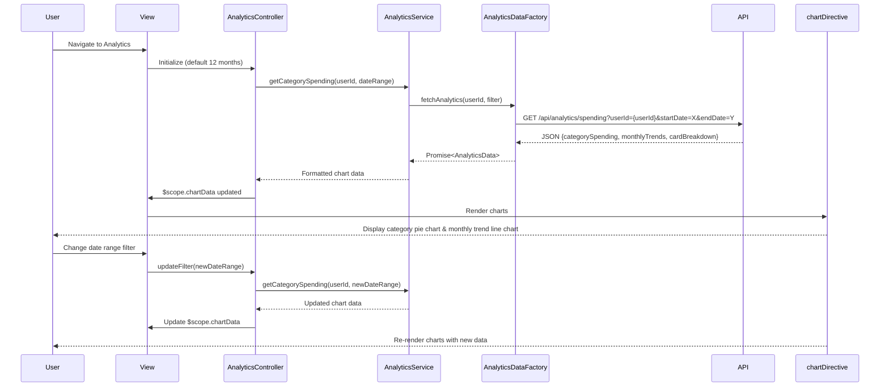

# Low-Level Design: Spending Analytics and Insights
**Epic ID:** QE-7466  
**Application Stack:** AngularJS 1.x, JavaScript ES6, HTML5, CSS3, Bootstrap, REST APIs, MVC Architecture

---

## a. Architecture Mapping

**Component to Artifact Mapping:**
- User Interface → AngularJS Module (`analyticsModule`) + View Templates (HTML5/Bootstrap)
- Analytics Service → AngularJS Service (`AnalyticsService`)
- Analytics Engine Integration → AngularJS Factory (`AnalyticsDataFactory`)
- Visualization Rendering → AngularJS Directive (`chartDirective`) + Chart.js/D3.js library
- Category & Trend Logic → AngularJS Controller (`AnalyticsController`)
- Transaction Data Integration → AngularJS Factory (`TransactionDataFactory`)

**Recommended Folder Structure:**
```
app/
├── modules/
│   └── analytics/
│       ├── controllers/
│       │   └── analyticsController.js
│       ├── services/
│       │   └── analyticsService.js
│       ├── factories/
│       │   └── analyticsDataFactory.js
│       ├── directives/
│       │   └── chartDirective.js
│       ├── views/
│       │   ├── spending-analytics.html
│       │   └── category-breakdown.html
│       └── analyticsModule.js
├── shared/
│   └── factories/
│       └── transactionDataFactory.js
└── assets/
    ├── css/
    └── libs/
        └── chart.min.js
```

---

## b. Component Specifications

| Component Name | Artifact Type | Responsibility | Key Dependencies |
|----------------|---------------|----------------|------------------|
| analyticsModule | Module | Registers analytics components, routing, and chart library integration | angular, ui.router, chart.js |
| AnalyticsController | Controller | Manages analytics UI state, date range selection, chart data binding | AnalyticsService, $scope, $filter |
| AnalyticsService | Service | Aggregates spending data by category/month/card, computes trends | AnalyticsDataFactory, TransactionDataFactory |
| AnalyticsDataFactory | Factory | REST API calls to analytics engine for pre-computed insights | $http, $q, API_CONFIG |
| TransactionDataFactory | Factory | Fetches raw transaction data for client-side aggregation | $http, $q, API_CONFIG |
| chartDirective | Directive | Renders interactive charts (pie, bar, line) using Chart.js | Chart.js, $timeout |
| spending-analytics.html | View | Main analytics dashboard with category and monthly trend charts | Bootstrap, chartDirective |
| category-breakdown.html | View | Detailed category-wise spending table and card-wise analysis | Bootstrap, AngularJS filters |

---

## c. Data Model

**CategorySpending Model:**
```javascript
class CategorySpending {
  category: String        // Category name (Food & Dining, Fuel, etc.)
  amount: Number          // Total spend in category
  percentage: Number      // Percentage of total spend
  transactionCount: Number // Number of transactions
}
```

**MonthlyTrend Model:**
```javascript
class MonthlyTrend {
  month: String           // Month identifier (YYYY-MM)
  totalSpend: Number      // Total spending for the month
  categoryBreakdown: Array<CategorySpending> // Spending per category
}
```

**CardSpending Model:**
```javascript
class CardSpending {
  cardId: String          // Credit card identifier
  cardName: String        // Card display name
  totalSpend: Number      // Total spend on this card
  categoryBreakdown: Array<CategorySpending> // Category spending per card
}
```

**AnalyticsFilter Model:**
```javascript
class AnalyticsFilter {
  startDate: Date         // Analysis period start
  endDate: Date           // Analysis period end
  cardIds: Array<String>  // Selected cards for analysis
  categories: Array<String> // Selected categories
}
```

---

## d. Data Flow

User navigates to analytics view → AnalyticsController initializes with default date range (last 12 months) → Controller calls AnalyticsService.getCategorySpending() and getMonthlyTrends() → AnalyticsService checks cache, then invokes AnalyticsDataFactory.fetchAnalytics() with filter parameters → Factory makes REST API call to Analytics Engine → API returns aggregated spending data (category totals, monthly trends, card breakdown) → Service transforms data into chart-ready format and caches results → Controller receives data and binds to $scope → chartDirective watches $scope.chartData and renders interactive Chart.js visualizations → User selects different date range or card filter → Controller updates filter and re-queries service → Charts re-render with updated data.

---

## e. Primary Sequence Diagram



---

## f. Implementation Notes

- Use AngularJS dependency injection for all components; integrate Chart.js via chartDirective with isolated scope for reusability.
- Implement AnalyticsService with in-memory caching (using $cacheFactory) to avoid redundant API calls for the same date range.
- Use ES6 Array methods (map, reduce, filter) in AnalyticsService for client-side data aggregation and transformation.
- Apply AngularJS $filter('currency') and $filter('number') for consistent formatting of amounts and percentages in views.
- Implement responsive chart rendering using Chart.js responsive configuration and Bootstrap grid for multi-device support.

---

## g. Error Handling

HTTP interceptor handles API errors; AnalyticsService uses try/catch blocks, logs errors, and displays user notifications via Bootstrap toast/alert components.

---

## h. Security Notes

Requires token-based auth via existing SSO; API requests include JWT token in headers; standard input validation and secure API calls assumed.

---

**End of LLD Document**