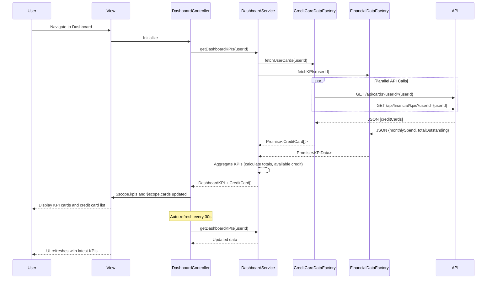

# Low-Level Design: Dashboard KPIs and Credit Card Overview
**Epic ID:** QE-7467  
**Application Stack:** AngularJS 1.x, JavaScript ES6, HTML5, CSS3, Bootstrap, REST APIs, MVC Architecture

---

## a. Architecture Mapping

**Component to Artifact Mapping:**
- User Interface → AngularJS Module (`dashboardModule`) + View Templates (HTML5/Bootstrap)
- Dashboard Service → AngularJS Service (`DashboardService`)
- Financial Calculation Engine Integration → AngularJS Factory (`FinancialDataFactory`)
- KPI Display Logic → AngularJS Controller (`DashboardController`)
- Credit Card Data Integration → AngularJS Factory (`CreditCardDataFactory`)
- User Authentication → AngularJS Service (`AuthService`)

**Recommended Folder Structure:**
```
app/
├── modules/
│   └── dashboard/
│       ├── controllers/
│       │   └── dashboardController.js
│       ├── services/
│       │   └── dashboardService.js
│       ├── factories/
│       │   ├── financialDataFactory.js
│       │   └── creditCardDataFactory.js
│       ├── views/
│       │   ├── dashboard-overview.html
│       │   └── card-list.html
│       └── dashboardModule.js
├── shared/
│   └── services/
│       └── authService.js
└── assets/
    ├── css/
    │   └── dashboard.css
    └── images/
```

---

## b. Component Specifications

| Component Name | Artifact Type | Responsibility | Key Dependencies |
|----------------|---------------|----------------|------------------|
| dashboardModule | Module | Registers dashboard components, routing, and module dependencies | angular, ui.router |
| DashboardController | Controller | Manages dashboard UI state, KPI data binding, card selection | DashboardService, $scope, $interval |
| DashboardService | Service | Aggregates KPIs (monthly spend, credit limits, outstanding), manages refresh logic | FinancialDataFactory, CreditCardDataFactory, AuthService |
| FinancialDataFactory | Factory | REST API calls to financial calculation engine for KPI computation | $http, $q, API_CONFIG |
| CreditCardDataFactory | Factory | Fetches user credit card details and balances from repository | $http, $q, API_CONFIG |
| AuthService | Service | User authentication, token management, and session handling | $http, $window |
| dashboard-overview.html | View | Displays KPI cards (monthly spend, credit limit, available credit, outstanding) | Bootstrap cards, AngularJS directives |
| card-list.html | View | Lists all user credit cards with individual card KPIs | Bootstrap list-group, ng-repeat |

---

## c. Data Model

**CreditCard Model:**
```javascript
class CreditCard {
  cardId: String          // Unique card identifier
  cardName: String        // Card display name (e.g., "Visa Gold")
  cardNumber: String      // Masked card number (e.g., "****1234")
  creditLimit: Number     // Total credit limit
  currentBalance: Number  // Current outstanding balance
  availableCredit: Number // Calculated: creditLimit - currentBalance
  monthlySpend: Number    // Spend in current month
  status: String          // Status: 'active', 'blocked', 'inactive'
}
```

**DashboardKPI Model:**
```javascript
class DashboardKPI {
  totalMonthlySpend: Number      // Aggregated monthly spend across all cards
  totalCreditLimit: Number       // Sum of all card credit limits
  totalAvailableCredit: Number   // Sum of available credit across all cards
  totalOutstanding: Number       // Sum of outstanding balances
  cardCount: Number              // Number of active cards
  lastUpdated: Date              // Timestamp of last data refresh
}
```

---

## d. Data Flow

User navigates to dashboard → DashboardController initializes and calls DashboardService.getDashboardKPIs() → DashboardService invokes CreditCardDataFactory.fetchUserCards() and FinancialDataFactory.fetchKPIs() in parallel using $q.all() → Factories make REST API calls with user token from AuthService → APIs return credit card details and pre-computed KPI data → Factories return promises with transformed data → DashboardService aggregates data (calculates totals, available credit) and caches result → Controller receives aggregated KPIs and card list, binds to $scope → View renders KPI cards and card list using Bootstrap grid and ng-repeat → $interval triggers auto-refresh every 30 seconds → Service re-fetches data and updates $scope → UI reflects updated KPIs without page reload.

---

## e. Primary Sequence Diagram



---

## f. Implementation Notes

- Use AngularJS dependency injection for all services, factories, and controllers to ensure modularity and testability.
- Implement real-time refresh using $interval service (30-second polling); cancel interval on $scope.$on('$destroy') to prevent memory leaks.
- Use $q.all() in DashboardService to parallelize API calls to CreditCardDataFactory and FinancialDataFactory for faster load times.
- Apply AngularJS filters ($filter('currency'), $filter('number')) in view templates for consistent formatting of financial data.
- Implement responsive Bootstrap grid (col-md-3 for KPI cards, col-xs-12 for mobile) to ensure dashboard adapts to mobile and desktop screens.

---

## g. Error Handling

HTTP interceptor captures API failures; DashboardService handles errors with try/catch, logs to console, and displays Bootstrap alert notifications to users.

---

## h. Security Notes

Requires token-based auth via existing SSO; AuthService injects JWT token in all API request headers; standard input validation and secure API calls assumed.

---

**End of LLD Document**