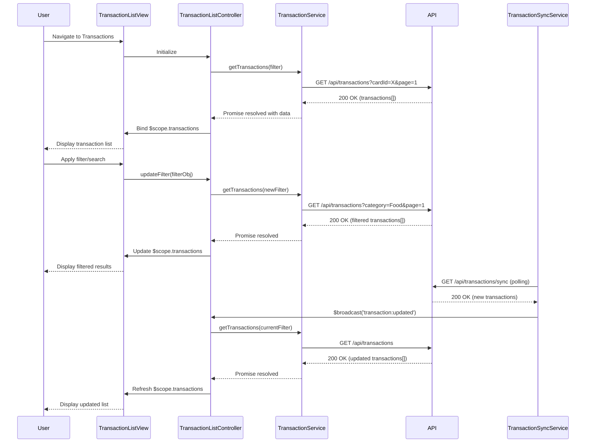

# Low-Level Design: Transaction Management and Display
**Epic ID:** QE-7468

---

## a. Architecture Mapping

- **User Interface** → AngularJS Module (`ccTransactionModule`) with Controller (`TransactionListController`) and Directive (`transactionCard`)
- **Transaction Management Service** → AngularJS Service (`TransactionService`) for business logic and API orchestration
- **Transaction Data Repository** → REST API integration via `$http` service with caching using `CacheFactory`
- **Data Synchronization Service** → Backend REST endpoint consumed by `TransactionSyncService` (AngularJS Factory)
- **Dashboard KPIs Module / Analytics Module** → Event-based communication using `$rootScope.$broadcast` for data updates

**Recommended Folder Structure:**
```
app/
├── modules/
│   └── transactions/
│       ├── controllers/
│       │   └── transactionListController.js
│       ├── services/
│       │   ├── transactionService.js
│       │   └── transactionSyncService.js
│       ├── directives/
│       │   └── transactionCard.js
│       ├── views/
│       │   └── transaction-list.html
│       └── transactionModule.js
├── models/
│   └── transaction.model.js
└── shared/
    └── services/
        └── apiService.js
```

---

## b. Component Specifications

| Component Name | Artifact Type | Responsibility | Key Dependencies |
|----------------|---------------|----------------|------------------|
| `ccTransactionModule` | Module | Root module for transaction management features | `ngRoute`, `ngResource`, `ui.bootstrap` |
| `TransactionListController` | Controller | Manages transaction list view, pagination, search/filter state | `TransactionService`, `$scope`, `$filter` |
| `TransactionService` | Service | Fetches, filters, and manages transaction data; handles API calls | `$http`, `$q`, `CacheFactory`, `apiService` |
| `TransactionSyncService` | Factory | Polls or listens for transaction updates from external sources | `$http`, `$interval`, `TransactionService` |
| `transactionCard` | Directive | Renders individual transaction card with details | None (isolated scope) |
| `apiService` | Service | Centralized REST API base URL and headers configuration | `$http` |
| `Transaction` | Model/Factory | Represents transaction data structure with validation methods | None |

---

## c. Data Model

**Transaction Model (`Transaction`)**

```javascript
{
  id: String,
  cardId: String,
  date: Date,
  merchant: String,
  amount: Number,
  currency: String,
  category: String, // One of 9 predefined categories
  description: String,
  status: String, // e.g., 'posted', 'pending'
  cardLast4: String
}
```

**TransactionFilter Model**

```javascript
{
  cardId: String,
  category: String,
  dateFrom: Date,
  dateTo: Date,
  searchTerm: String,
  page: Number,
  pageSize: Number
}
```

---

## d. Data Flow

User navigates to transaction list view → `TransactionListController` initializes and calls `TransactionService.getTransactions()` with filter/pagination params → `TransactionService` sends GET request to `/api/transactions` via `$http` → Backend returns paginated JSON array of transactions → Service caches response and returns promise → Controller binds data to `$scope.transactions` → View renders transaction list using `ng-repeat` with `transactionCard` directive for each item → User applies search/filter → Controller updates filter object and re-invokes service → Updated transaction list re-renders → `TransactionSyncService` periodically polls `/api/transactions/sync` and broadcasts `transaction:updated` event → Controller listens and refreshes data, notifying Dashboard KPIs and Analytics modules.

---

## e. Primary Sequence Diagram



---

## f. Implementation Notes

- Use AngularJS Dependency Injection for all services, controllers, and factories to ensure testability and modularity.
- Implement pagination using `ui.bootstrap.pagination` directive with server-side pagination support via query params (`page`, `pageSize`).
- Cache transaction data using `$cacheFactory` with TTL to reduce redundant API calls; invalidate cache on sync events.
- Use ES6 classes for model definitions and arrow functions in service methods for cleaner syntax and lexical `this` binding.
- Integrate REST API calls through a centralized `apiService` that handles base URL, authentication headers, and error interceptors.

---

## g. Error Handling

HTTP interceptor registered at module config captures API errors (4xx/5xx), logs to console, and displays user-friendly notifications via `toastr` or Bootstrap alerts; controller-level try/catch for sync operations.

---

## h. Security Notes

Requires token-based authentication via existing SSO; API requests include JWT in Authorization header managed by `apiService` interceptor.

---

**End of Document**