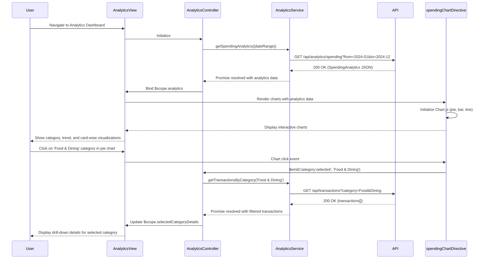

# Low-Level Design: Spending Analytics and Visualization
**Epic ID:** QE-7469

---

## a. Architecture Mapping

- **User Interface** → AngularJS Module (`ccAnalyticsModule`) with Controller (`AnalyticsController`) and Directive (`spendingChart`)
- **Analytics Service** → AngularJS Service (`AnalyticsService`) for aggregation logic and API orchestration
- **Data Aggregation Engine** → Backend REST API consumed via `$http`; client-side aggregation helper in `DataAggregationUtil` (Factory)
- **Transaction Data Service** → Shared `TransactionService` from Transaction Management module
- **Categorization Engine** → Backend categorization API; client-side category mapping in `CategoryService` (Service)
- **Visualization Renderer** → Chart.js or D3.js wrapped in AngularJS directive (`spendingChart`, `trendChart`)

**Recommended Folder Structure:**
```
app/
├── modules/
│   └── analytics/
│       ├── controllers/
│       │   └── analyticsController.js
│       ├── services/
│       │   ├── analyticsService.js
│       │   ├── categoryService.js
│       │   └── dataAggregationUtil.js
│       ├── directives/
│       │   ├── spendingChart.js
│       │   └── trendChart.js
│       ├── views/
│       │   └── analytics-dashboard.html
│       └── analyticsModule.js
├── models/
│   └── spendingAnalytics.model.js
└── shared/
    └── services/
        └── transactionService.js
```

---

## b. Component Specifications

| Component Name | Artifact Type | Responsibility | Key Dependencies |
|----------------|---------------|----------------|------------------|
| `ccAnalyticsModule` | Module | Root module for spending analytics and visualization | `ngRoute`, `chart.js`, `ccTransactionModule` |
| `AnalyticsController` | Controller | Manages analytics view state, user interactions, and data binding | `AnalyticsService`, `CategoryService`, `$scope` |
| `AnalyticsService` | Service | Fetches aggregated spending data from API; orchestrates data flow | `$http`, `$q`, `TransactionService`, `DataAggregationUtil` |
| `CategoryService` | Service | Provides category definitions and mapping logic for 9 predefined categories | None |
| `DataAggregationUtil` | Factory | Client-side utility for aggregating transaction data by category, month, and card | `CategoryService` |
| `spendingChart` | Directive | Renders category-wise and card-wise spending charts (pie/bar) using Chart.js | `chart.js` |
| `trendChart` | Directive | Renders monthly spend trend line chart using Chart.js | `chart.js` |
| `SpendingAnalytics` | Model/Factory | Represents aggregated spending data structure | None |

---

## c. Data Model

**SpendingAnalytics Model (`SpendingAnalytics`)**

```javascript
{
  categorySpend: [
    { category: String, amount: Number, percentage: Number }
  ], // 9 categories: Food & Dining, Fuel, Shopping, Travel, Entertainment, Utilities, Healthcare, Education, Miscellaneous
  monthlyTrend: [
    { month: String, totalSpend: Number }
  ],
  cardWiseSpend: [
    { cardId: String, cardName: String, totalSpend: Number }
  ],
  totalSpend: Number,
  periodStart: Date,
  periodEnd: Date
}
```

**Category Model**

```javascript
{
  id: String,
  name: String, // e.g., 'Food & Dining'
  icon: String, // CSS class or icon identifier
  color: String // Hex color for chart rendering
}
```

---

## d. Data Flow

User navigates to analytics view → `AnalyticsController` initializes and calls `AnalyticsService.getSpendingAnalytics(dateRange)` → `AnalyticsService` requests transaction data from `TransactionService` or directly from `/api/analytics/spending` → Backend returns aggregated data (category totals, monthly trends, card-wise breakdown) → Service processes response using `DataAggregationUtil` if needed → Controller binds `SpendingAnalytics` model to `$scope.analytics` → View renders interactive charts via `spendingChart` and `trendChart` directives passing data attributes → Chart.js generates responsive visualizations (pie chart for categories, bar chart for card-wise, line chart for trends) → User interacts with chart (hover, click) to drill down → Directive emits event to controller → Controller updates filter/detail view and re-renders relevant chart section.

---

## e. Primary Sequence Diagram



---

## f. Implementation Notes

- Use Chart.js library wrapped in AngularJS directives for rendering; configure responsive options and animation settings in directive link function.
- Implement `CategoryService` as a constant provider with predefined category array (9 categories) including name, icon, and color mappings.
- Use `DataAggregationUtil` factory with ES6 methods (reduce, map, filter) to process raw transaction arrays into aggregated structures when backend doesn't provide pre-aggregated data.
- Leverage AngularJS `$watch` in chart directives to re-render charts when `$scope.analytics` data changes due to date range or filter updates.
- Optimize large dataset rendering by implementing pagination or lazy loading for drill-down transaction lists; use virtual scrolling if transaction count exceeds 500.

---

## g. Error Handling

HTTP interceptor captures API errors; analytics-specific errors display fallback message in chart area with retry button; client-side aggregation errors caught with try/catch and logged.

---

## h. Security Notes

Standard input validation and secure API calls assumed; JWT token authentication enforced via shared `apiService` interceptor.

---

**End of Document**