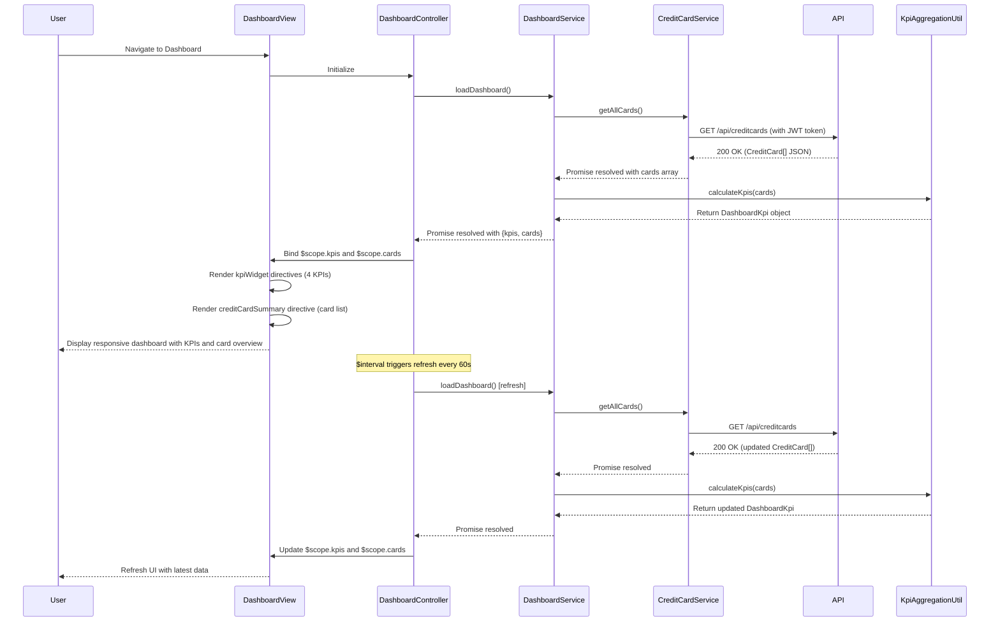

# Low-Level Design: Dashboard KPIs and Credit Card Overview
**Epic ID:** QE-7470

---

## a. Architecture Mapping

- **User Interface Layer** → AngularJS Module (`ccDashboardModule`) with Controller (`DashboardController`) and Directive (`kpiWidget`, `creditCardSummary`)
- **Dashboard Service** → AngularJS Service (`DashboardService`) for orchestrating KPI data retrieval and aggregation
- **Credit Card Data Service** → AngularJS Service (`CreditCardService`) consuming REST API via `$http`
- **Authentication Service** → Shared `AuthService` (Service) managing SSO token and user session
- **Data Aggregation Engine** → Backend REST API for aggregated KPIs; client-side helper `KpiAggregationUtil` (Factory) for multi-card calculations
- **Credit Card Data Sources** → External REST API endpoints integrated via `CreditCardService`

**Recommended Folder Structure:**
```
app/
├── modules/
│   └── dashboard/
│       ├── controllers/
│       │   └── dashboardController.js
│       ├── services/
│       │   ├── dashboardService.js
│       │   ├── creditCardService.js
│       │   └── kpiAggregationUtil.js
│       ├── directives/
│       │   ├── kpiWidget.js
│       │   └── creditCardSummary.js
│       ├── views/
│       │   └── dashboard.html
│       └── dashboardModule.js
├── models/
│   ├── creditCard.model.js
│   └── dashboardKpi.model.js
└── shared/
    └── services/
        └── authService.js
```

---

## b. Component Specifications

| Component Name | Artifact Type | Responsibility | Key Dependencies |
|----------------|---------------|----------------|------------------|
| `ccDashboardModule` | Module | Root module for dashboard and KPI features | `ngRoute`, `ui.bootstrap`, `ccSharedModule` |
| `DashboardController` | Controller | Manages dashboard state, KPI data binding, and user interactions | `DashboardService`, `AuthService`, `$scope`, `$interval` |
| `DashboardService` | Service | Fetches and aggregates KPI data from multiple sources; handles refresh logic | `CreditCardService`, `KpiAggregationUtil`, `$http`, `$q` |
| `CreditCardService` | Service | Retrieves credit card details, balances, limits, and outstanding amounts from API | `$http`, `$q`, `apiService` |
| `AuthService` | Service | Manages user authentication state and SSO token for secure API calls | `$http`, `$window` (localStorage) |
| `KpiAggregationUtil` | Factory | Client-side utility for calculating total credit limit, available credit, outstanding, and monthly spend across cards | None |
| `kpiWidget` | Directive | Renders individual KPI card (e.g., Total Credit Limit) with value and trend indicator | None (isolated scope) |
| `creditCardSummary` | Directive | Renders multi-card overview table/list with card-specific details | None (isolated scope) |
| `CreditCard` | Model/Factory | Represents credit card data structure with computed properties | None |
| `DashboardKpi` | Model/Factory | Represents aggregated KPI data structure | None |

---

## c. Data Model

**CreditCard Model (`CreditCard`)**

```javascript
{
  id: String,
  cardNumber: String, // Masked, e.g., '**** **** **** 1234'
  cardName: String,
  cardType: String, // e.g., 'Visa', 'MasterCard'
  creditLimit: Number,
  availableCredit: Number,
  outstandingAmount: Number,
  monthlySpend: Number,
  dueDate: Date,
  status: String // e.g., 'active', 'blocked'
}
```

**DashboardKpi Model (`DashboardKpi`)**

```javascript
{
  totalCreditLimit: Number,
  totalAvailableCredit: Number,
  totalOutstanding: Number,
  totalMonthlySpend: Number,
  cardCount: Number,
  lastUpdated: Date
}
```

---

## d. Data Flow

User authenticates via SSO → `AuthService` stores JWT token → User navigates to dashboard → `DashboardController` initializes and calls `DashboardService.loadDashboard()` → `DashboardService` invokes `CreditCardService.getAllCards()` → `CreditCardService` sends GET request to `/api/creditcards` with auth token → API returns array of `CreditCard` objects → Service passes data to `KpiAggregationUtil.calculateKpis(cards)` → Utility computes aggregated KPIs (sum of limits, available credit, outstanding, monthly spend) → `DashboardService` returns `DashboardKpi` model → Controller binds `$scope.kpis` and `$scope.cards` → View renders KPI widgets using `kpiWidget` directive and card list using `creditCardSummary` directive → Bootstrap grid ensures responsive layout → `$interval` in controller triggers periodic refresh (e.g., every 60 seconds) by re-invoking `DashboardService.loadDashboard()` → Updated data re-renders UI.

---

## e. Primary Sequence Diagram



---

## f. Implementation Notes

- Use AngularJS Dependency Injection for all services and controllers; register `DashboardService` as singleton to maintain state across route changes if needed.
- Implement responsive layout using Bootstrap grid system (col-xs, col-sm, col-md, col-lg) to ensure dashboard adapts to desktop, tablet, and mobile viewports.
- Use `$interval` service in controller for periodic data refresh; ensure interval is cancelled on `$scope.$on('$destroy')` to prevent memory leaks.
- Leverage ES6 arrow functions and template literals in services for cleaner code; use `Array.reduce()` in `KpiAggregationUtil` for efficient aggregation.
- Integrate `CreditCardService` with centralized `apiService` that injects JWT token from `AuthService` into all HTTP request headers via interceptor.

---

## g. Error Handling

HTTP interceptor captures API errors (401, 403, 500); displays Bootstrap alert or toastr notification; retry logic in `DashboardService` for transient failures; controller handles promise rejections gracefully.

---

## h. Security Notes

Requires token-based auth via existing SSO; JWT token stored in localStorage and injected into API requests via `AuthService` interceptor; sensitive card data masked in UI.

---

**End of Document**