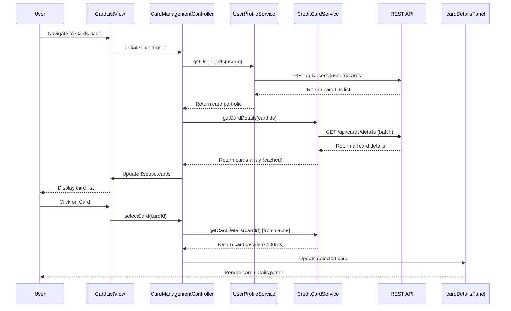

# Low-Level Design: QE-7471 - Multiple Credit Card Management

## a. Architecture Mapping

- **Multi-Card UI** → AngularJS View Template (HTML5 + Bootstrap) with ng-repeat for card list rendering
- **Card Management Controller** → AngularJS Controller (`CardManagementController`) managing card portfolio state and user interactions
- **Credit Card Data Service** → AngularJS Service (`CreditCardService`) wrapping REST API calls for card data retrieval
- **User Profile Service** → AngularJS Service (`UserProfileService`) managing user-card associations via REST API
- **Card Selection Handler** → Controller method with event binding for card switching logic
- **Card Details Renderer** → AngularJS Directive (`cardDetailsPanel`) for rendering individual card information

**Recommended Folder Structure:**
```
app/
├── modules/
│   └── cards/
│       ├── cards.module.js
│       ├── controllers/
│       │   └── card-management.controller.js
│       ├── services/
│       │   ├── credit-card.service.js
│       │   └── user-profile.service.js
│       ├── directives/
│       │   └── card-details-panel.directive.js
│       └── views/
│           ├── card-list.html
│           └── card-details.html
├── shared/
│   └── services/
│       └── http-interceptor.service.js
└── assets/
    ├── css/
    └── js/
```

## b. Component Specifications

| Name | Artifact Type | Responsibility | Key Dependencies |
|------|---------------|----------------|------------------|
| CardsModule | AngularJS Module | Entry point module for multi-card management feature | angular, ngRoute, ngResource |
| CardManagementController | Controller | Orchestrates card list display, selection, and portfolio state management | CreditCardService, UserProfileService, $scope |
| CreditCardService | Service/Factory | Fetches card details (limits, balances, status) from REST API with caching for sub-100ms switching | $http, $q, CacheFactory |
| UserProfileService | Service/Factory | Retrieves user's card portfolio and manages card-user associations | $http, $q |
| cardDetailsPanel | Directive | Renders individual card details including limits, balances, spend analysis, and outstanding amounts | CreditCardService, $filter |
| CardSelectionHandler | Controller Method | Handles card switching events, updates selected card state, triggers detail rendering | $scope, CreditCardService |
| HttpInterceptor | Service | Handles API request/response interception for error handling and token injection | $q, $injector |

## c. Data Model

**CreditCard (JavaScript ES6 Class/Object):**
```javascript
{
  cardId: String,
  cardNumber: String,           // Masked format: **** **** **** 1234
  cardHolderName: String,
  cardType: String,             // e.g., Visa, Mastercard, Amex
  creditLimit: Number,
  currentBalance: Number,
  availableCredit: Number,      // Calculated: creditLimit - currentBalance
  outstandingAmount: Number,
  status: String,               // Active, Blocked, Expired
  expiryDate: String,           // Format: MM/YY
  monthlySpend: Number,
  lastUpdated: Date
}
```

**UserCardPortfolio (JavaScript Object):**
```javascript
{
  userId: String,
  cards: Array<CreditCard>,     // Array of CreditCard objects
  selectedCardId: String,       // Currently selected card
  totalCards: Number
}
```

## d. Data Flow

User logs into the application → Multi-Card UI view loads and CardManagementController initializes → Controller calls UserProfileService.getUserCards() to fetch user's card portfolio → UserProfileService makes REST API call to backend → Card IDs are retrieved and passed to CreditCardService.getCardDetails() which fetches detailed information for all cards (with caching enabled) → Controller populates $scope.cards array → View renders card list using ng-repeat with Bootstrap card components → User clicks on a card → CardSelectionHandler method updates $scope.selectedCard → cardDetailsPanel directive re-renders with selected card's comprehensive details (limits, balances, spend, outstanding) fetched from cache (sub-100ms) → UI updates instantly showing card-wise analysis and comparison data.

## e. Primary Sequence Diagram



## f. Implementation Notes

- Use AngularJS $cacheFactory to implement in-memory caching for card data with TTL strategy to achieve sub-100ms card switching performance
- Implement lazy loading for card details using ng-if to optimize initial page load and maintain UI performance with 10+ cards
- Use AngularJS Dependency Injection (DI) to inject services into controllers; define services as singletons using .service() or .factory() pattern
- Leverage ES6 Promises ($q service) for asynchronous REST API calls with proper error handling and chaining
- Implement card list rendering with ng-repeat track by cardId for efficient DOM manipulation and Bootstrap grid for responsive layout

## g. Error Handling

HTTP interceptor-based error handling with user-friendly notifications via Angular-toastr for API failures and network errors.

## h. Security Notes

Requires token-based authentication via existing SSO; card numbers must be masked in UI; all API calls include authorization headers.