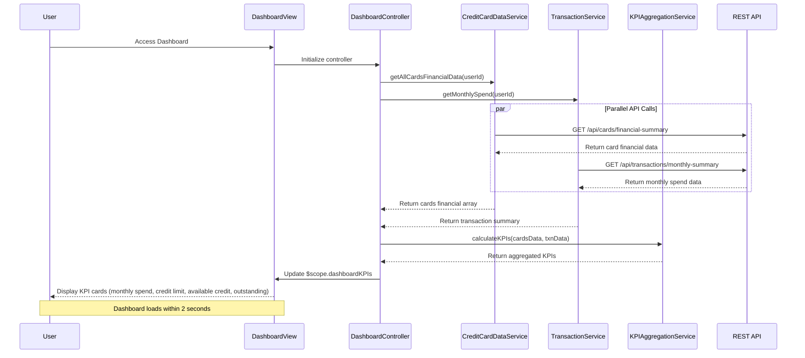

# Low-Level Design: QE-7472 - Dashboard KPIs and Financial Overview

## a. Architecture Mapping

- **User Dashboard UI** → AngularJS View Template (HTML5 + Bootstrap) with KPI card components and responsive grid layout
- **Dashboard Controller** → AngularJS Controller (`DashboardController`) orchestrating parallel data fetching and KPI aggregation
- **Credit Card Data Service** → AngularJS Service (`CreditCardDataService`) for retrieving card balances and credit limits via REST API
- **Transaction Service** → AngularJS Service (`TransactionService`) for calculating monthly spend and outstanding amounts via REST API
- **KPI Aggregation Module** → AngularJS Service (`KPIAggregationService`) performing client-side data consolidation and calculations

**Recommended Folder Structure:**
```
app/
├── modules/
│   └── dashboard/
│       ├── dashboard.module.js
│       ├── controllers/
│       │   └── dashboard.controller.js
│       ├── services/
│       │   ├── credit-card-data.service.js
│       │   ├── transaction.service.js
│       │   └── kpi-aggregation.service.js
│       └── views/
│           └── dashboard.html
├── shared/
│   ├── components/
│   │   └── kpi-card/
│   │       ├── kpi-card.directive.js
│   │       └── kpi-card.html
│   └── services/
│       └── http-interceptor.service.js
└── assets/
    ├── css/
    └── js/
```

## b. Component Specifications

| Name | Artifact Type | Responsibility | Key Dependencies |
|------|---------------|----------------|------------------|
| DashboardModule | AngularJS Module | Entry point for dashboard feature with routing configuration | angular, ngRoute |
| DashboardController | Controller | Orchestrates parallel API calls, manages dashboard state, triggers KPI aggregation | CreditCardDataService, TransactionService, KPIAggregationService, $q, $scope |
| CreditCardDataService | Service/Factory | Fetches card balances and credit limits from REST API | $http, $q |
| TransactionService | Service/Factory | Retrieves monthly spend and outstanding amounts from REST API | $http, $q |
| KPIAggregationService | Service/Factory | Aggregates data across all cards, calculates total credit limit, available credit, and consolidated metrics | None (pure calculation logic) |
| kpiCard | Directive | Reusable component for rendering individual KPI metrics with icon, value, and label | $filter |
| HttpInterceptor | Service | Handles API errors, token injection, and response transformation | $q, $injector |

## c. Data Model

**DashboardKPIs (JavaScript Object):**
```javascript
{
  monthlySpend: Number,           // Total spend across all cards for current month
  totalCreditLimit: Number,       // Sum of credit limits across all cards
  availableCredit: Number,        // Calculated: totalCreditLimit - totalOutstanding
  totalOutstanding: Number,       // Sum of outstanding amounts across all cards
  lastRefreshed: Date,
  cardCount: Number               // Number of active cards
}
```

**CardFinancialData (JavaScript Object):**
```javascript
{
  cardId: String,
  creditLimit: Number,
  currentBalance: Number,
  outstandingAmount: Number
}
```

**MonthlyTransactionSummary (JavaScript Object):**
```javascript
{
  cardId: String,
  monthlySpend: Number,
  transactionCount: Number,
  month: String                   // Format: YYYY-MM
}
```

## d. Data Flow

User navigates to dashboard → DashboardController initializes and triggers parallel API calls using $q.all() → CreditCardDataService.getAllCardsFinancialData() fetches card balances and limits via GET /api/cards/financial-summary → TransactionService.getMonthlySpend() fetches current month's spend and outstanding amounts via GET /api/transactions/monthly-summary → Both promises resolve and data is passed to KPIAggregationService.calculateKPIs() → Service aggregates data across all cards: sums credit limits, calculates total outstanding, computes available credit (limit - outstanding), and totals monthly spend → Aggregated KPIs are bound to $scope.dashboardKPIs → Dashboard view renders KPI cards using kpiCard directive with Bootstrap responsive grid → Real-time refresh is achieved via $interval polling or WebSocket updates triggering the same data flow.

## e. Primary Sequence Diagram



## f. Implementation Notes

- Use $q.all() to execute parallel REST API calls to CreditCardDataService and TransactionService for optimal 2-second load time
- Implement real-time refresh using $interval service with configurable polling interval (default 30 seconds) or WebSocket integration for push updates
- Use AngularJS filters ($filter('currency')) for consistent financial data formatting across all KPI displays
- Leverage Bootstrap grid system (col-xs, col-sm, col-md, col-lg) for responsive dashboard layout across desktop, tablet, and mobile
- Implement client-side data validation in KPIAggregationService to ensure 99.9% accuracy by checking for null/undefined values and data type consistency

## g. Error Handling

HTTP interceptor captures API failures; graceful degradation shows cached data with warning banner; user notifications via Angular-toastr.

## h. Security Notes

Requires token-based auth via existing SSO; sensitive financial data transmitted over HTTPS; API responses validated for data integrity.