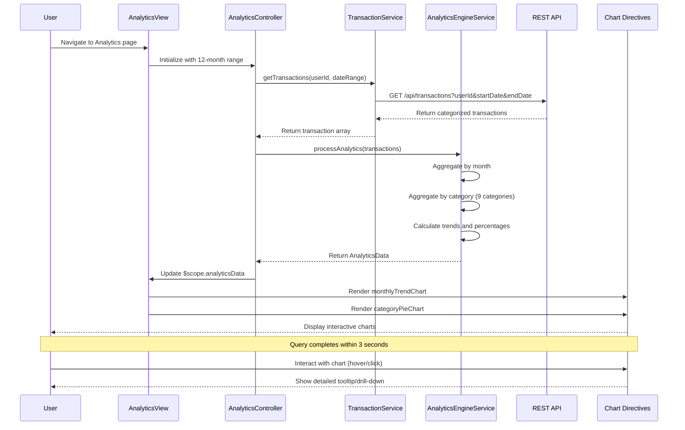

# Low-Level Design: QE-7473 - Spending Analytics and Insights

## a. Architecture Mapping

- **User Interface** → AngularJS View Template (HTML5 + Bootstrap) with chart containers and interactive controls
- **Analytics Controller** → AngularJS Controller (`AnalyticsController`) managing analytics state, filters, and chart data binding
- **Transaction Service** → AngularJS Service (`TransactionService`) fetching transaction data and categorization via REST API
- **Analytics Engine** → AngularJS Service (`AnalyticsEngineService`) performing client-side data aggregation, trend calculation, and category breakdown
- **Data Visualization Layer** → AngularJS Directives wrapping Chart.js library (`monthlyTrendChart`, `categoryPieChart`) for interactive visualizations

**Recommended Folder Structure:**
```
app/
├── modules/
│   └── analytics/
│       ├── analytics.module.js
│       ├── controllers/
│       │   └── analytics.controller.js
│       ├── services/
│       │   ├── transaction.service.js
│       │   └── analytics-engine.service.js
│       ├── directives/
│       │   ├── monthly-trend-chart.directive.js
│       │   └── category-pie-chart.directive.js
│       └── views/
│           └── analytics.html
├── shared/
│   └── services/
│       └── http-interceptor.service.js
└── assets/
    ├── css/
    └── js/
        └── chart.min.js
```

## b. Component Specifications

| Name | Artifact Type | Responsibility | Key Dependencies |
|------|---------------|----------------|------------------|
| AnalyticsModule | AngularJS Module | Entry point for spending analytics feature with routing and Chart.js integration | angular, ngRoute, chart.js |
| AnalyticsController | Controller | Manages analytics view state, date range filters, fetches transaction data, triggers analytics processing | TransactionService, AnalyticsEngineService, $scope, $filter |
| TransactionService | Service/Factory | Retrieves transaction data with category information from REST API for specified date range | $http, $q |
| AnalyticsEngineService | Service/Factory | Aggregates transactions by month and category, calculates trends, generates chart-ready data structures | None (pure computation) |
| monthlyTrendChart | Directive | Renders interactive line/bar chart showing monthly spend trends over 12 months using Chart.js | chart.js, $timeout |
| categoryPieChart | Directive | Renders interactive pie/donut chart showing category-wise spending breakdown across 9 categories | chart.js, $timeout |
| HttpInterceptor | Service | Handles API request/response interception for error handling and performance monitoring | $q, $injector |

## c. Data Model

**Transaction (JavaScript Object):**
```javascript
{
  transactionId: String,
  cardId: String,
  amount: Number,
  category: String,              // One of: Food & Dining, Fuel, Shopping, Travel, Entertainment, Utilities, Healthcare, Education, Miscellaneous
  merchantName: String,
  transactionDate: Date,
  description: String
}
```

**MonthlyTrendData (JavaScript Object):**
```javascript
{
  month: String,                 // Format: MMM YYYY (e.g., Jan 2024)
  totalSpend: Number,
  transactionCount: Number
}
```

**CategorySpendData (JavaScript Object):**
```javascript
{
  category: String,              // Food & Dining, Fuel, Shopping, Travel, Entertainment, Utilities, Healthcare, Education, Miscellaneous
  totalSpend: Number,
  percentage: Number,            // Percentage of total spend
  transactionCount: Number
}
```

**AnalyticsData (JavaScript Object):**
```javascript
{
  monthlyTrends: Array<MonthlyTrendData>,      // 12 months of data
  categoryBreakdown: Array<CategorySpendData>,  // 9 categories
  totalSpend: Number,
  dateRange: { startDate: Date, endDate: Date }
}
```

## d. Data Flow

User navigates to analytics page → AnalyticsController initializes with default 12-month date range → Controller calls TransactionService.getTransactions(userId, dateRange) → Service makes REST API call GET /api/transactions?userId=X&startDate=Y&endDate=Z → Pre-categorized transaction data is returned → AnalyticsController passes transaction array to AnalyticsEngineService.processAnalytics() → Service aggregates transactions by month (creating MonthlyTrendData array) and by category (creating CategorySpendData array with percentage calculations) → Processed data is bound to $scope.analyticsData → monthlyTrendChart directive watches $scope.analyticsData.monthlyTrends and renders interactive line chart using Chart.js → categoryPieChart directive watches $scope.analyticsData.categoryBreakdown and renders interactive pie chart → User interacts with charts (hover, click) to view detailed breakdowns → Charts respond with tooltips and drill-down capabilities.

## e. Primary Sequence Diagram



## f. Implementation Notes

- Integrate Chart.js library via AngularJS directives with two-way data binding using $scope.$watch for reactive chart updates when data changes
- Implement AnalyticsEngineService using ES6 Array methods (map, reduce, filter) for efficient client-side aggregation and trend calculation
- Use AngularJS $http service with query parameters for date range filtering; implement response caching to improve performance for repeated queries
- Leverage Chart.js responsive configuration and Bootstrap grid for cross-device compatibility (desktop, tablet, mobile)
- Implement lazy loading for chart libraries using $ocLazyLoad to optimize initial page load time and meet 3-second query performance requirement

## g. Error Handling

HTTP interceptor-based error handling with try/catch blocks in AnalyticsEngineService; user notifications via Angular-toastr for API failures.

## h. Security Notes

Standard input validation and secure API calls assumed; transaction data access controlled via user authentication token.