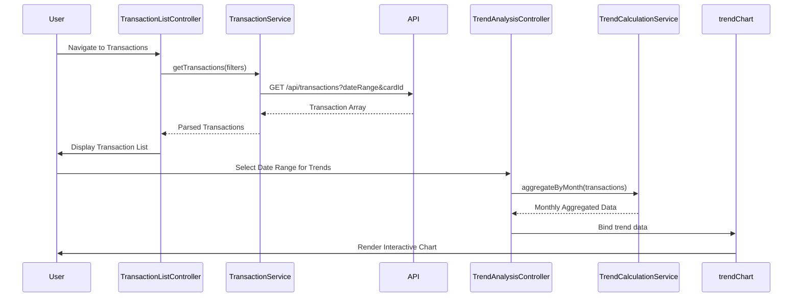

# Low-Level Design: QE-7474 - Monthly Spend Trends and Transaction Management

## a. Architecture Mapping

- **AngularJS Module**: `creditCard.transactions` - Main module for transaction management and trend analysis
- **Controllers**: `TransactionListController` - Manages transaction listing, filtering, and pagination; `TrendAnalysisController` - Handles monthly spend trend visualization
- **Services**: `TransactionService` - REST API integration for transaction data retrieval; `TrendCalculationService` - Client-side trend aggregation and date calculations
- **Directives**: `transactionList` - Reusable transaction table component; `trendChart` - Monthly spend trend chart directive
- **Filters**: `dateRangeFilter` - Filter transactions by date range; `cardFilter` - Filter by specific credit card

**Recommended Folder Structure:**
```
/app
  /modules
    /transactions
      /controllers
      /services
      /directives
      /views
      /filters
```

## b. Component Specifications

| Component Name | Artifact Type | Responsibility | Key Dependencies |
|---|---|---|---|
| TransactionListController | Controller | Manages transaction list display, pagination, and filtering | TransactionService, $scope, $filter |
| TrendAnalysisController | Controller | Orchestrates trend visualization and date range selection | TrendCalculationService, TransactionService, $scope |
| TransactionService | Factory | REST API calls to fetch transaction history and aggregated data | $http, $q, AuthService |
| TrendCalculationService | Service | Aggregates transactions by month and calculates spending trends | moment.js or native Date utilities |
| transactionList | Directive | Renders responsive transaction table with sort/filter capabilities | TransactionService |
| trendChart | Directive | Renders interactive line/bar chart for monthly spend trends | Chart.js or D3.js, TrendCalculationService |
| dateRangeFilter | Filter | Filters transaction array by start and end date | - |
| cardFilter | Filter | Filters transactions by selected credit card ID | - |

## c. Data Model

**Transaction Object:**
```javascript
{
  id: String,
  cardId: String,
  merchantName: String,
  amount: Number,
  currency: String,
  transactionDate: Date,
  postingDate: Date,
  category: String,
  status: String // 'posted', 'pending'
}
```

**TrendData Object:**
```javascript
{
  month: String, // 'YYYY-MM'
  totalSpend: Number,
  transactionCount: Number,
  cardBreakdown: Array // [{cardId, amount}]
}
```

## d. Data Flow

User navigates to transaction view → TransactionListController initializes and calls TransactionService.getTransactions() with filters (date range, cardId) → Service makes REST API call to /api/transactions → Response parsed and bound to $scope.transactions → View renders transaction list via transactionList directive → For trend analysis, user selects date range → TrendAnalysisController calls TrendCalculationService.aggregateByMonth() → Service groups transactions by posting month and calculates totals → trendChart directive receives aggregated data and renders interactive chart → User interactions (filtering, sorting) trigger $scope updates and view re-renders.

## e. Primary Sequence Diagram



## f. Implementation Notes

- Use AngularJS $http service with interceptors for authentication token injection and error handling
- Implement pagination using limitTo filter and custom pagination directive to handle large transaction volumes
- Leverage AngularJS $filter service for client-side date range and card filtering to reduce API calls
- Use Chart.js or D3.js wrapped in AngularJS directive for responsive trend visualizations
- Apply dependency injection pattern for all services and controllers to enable testability

## g. Error Handling

HTTP interceptor captures API errors (4xx, 5xx) and displays user-friendly notifications via a global notification service; client-side validation with try/catch for date parsing and aggregation logic.

## h. Security Notes

Requires token-based authentication via existing SSO; all API calls include Authorization header with JWT token; transaction data encrypted in transit via HTTPS.