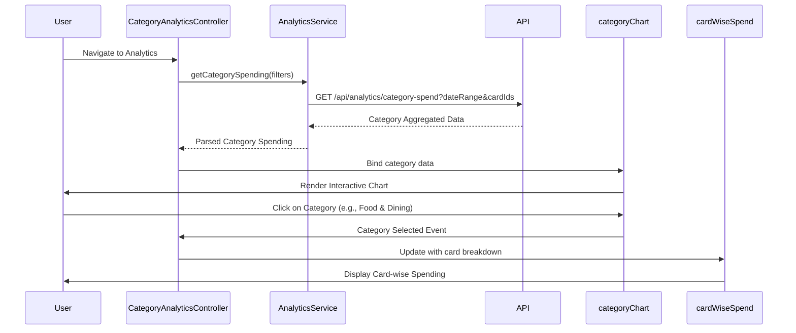

# Low-Level Design: QE-7475 - Category-wise Spend Analysis and Insights

## a. Architecture Mapping

- **AngularJS Module**: `creditCard.analytics` - Main module for category-wise spend analysis
- **Controllers**: `CategoryAnalyticsController` - Manages category selection, filtering, and visualization orchestration
- **Services**: `AnalyticsService` - REST API integration for categorized spending data; `CategoryService` - Manages category definitions and mappings
- **Directives**: `categoryChart` - Interactive pie/bar chart for category breakdown; `cardWiseSpend` - Card-specific spending visualization
- **Filters**: `categoryFilter` - Filter by spending category; `amountRangeFilter` - Filter by spend amount range

**Recommended Folder Structure:**
```
/app
  /modules
    /analytics
      /controllers
      /services
      /directives
      /views
      /filters
```

## b. Component Specifications

| Component Name | Artifact Type | Responsibility | Key Dependencies |
|---|---|---|---|
| CategoryAnalyticsController | Controller | Orchestrates category analysis, date range selection, and chart rendering | AnalyticsService, CategoryService, $scope |
| AnalyticsService | Factory | Fetches categorized spending data from REST API | $http, $q, AuthService |
| CategoryService | Service | Provides category definitions and mapping logic | - |
| categoryChart | Directive | Renders interactive pie/bar chart for category-wise spending | Chart.js, AnalyticsService |
| cardWiseSpend | Directive | Displays spending breakdown by card for selected category | AnalyticsService |
| categoryFilter | Filter | Filters spending data by category name | - |
| amountRangeFilter | Filter | Filters by minimum and maximum spend amount | - |

## c. Data Model

**CategorySpend Object:**
```javascript
{
  category: String, // 'Food & Dining', 'Fuel', etc.
  totalAmount: Number,
  transactionCount: Number,
  percentage: Number,
  cardBreakdown: Array // [{cardId, cardName, amount}]
}
```

**AnalyticsFilter Object:**
```javascript
{
  dateRange: {start: Date, end: Date},
  cardIds: Array, // Selected card IDs
  categories: Array // Selected categories
}
```

## d. Data Flow

User navigates to analytics view → CategoryAnalyticsController initializes and calls AnalyticsService.getCategorySpending(filters) → Service makes REST API call to /api/analytics/category-spend with date range and card filters → API returns pre-aggregated category spending data → Controller calculates percentages and binds to $scope.categoryData → categoryChart directive receives data and renders interactive pie/bar chart → User clicks on category → Controller filters cardBreakdown and updates cardWiseSpend directive → Drill-down view displays card-specific spending for selected category.

## e. Primary Sequence Diagram



## f. Implementation Notes

- Use AngularJS factory pattern for AnalyticsService with promise-based API calls using $q
- Implement Chart.js wrapped in AngularJS directive with two-way data binding for interactive filtering
- Apply AngularJS $watch on filter objects to trigger automatic API calls when date range or card selection changes
- Use ng-repeat with track by for efficient rendering of card breakdown lists
- Cache category definitions in CategoryService using AngularJS value/constant for performance

## g. Error Handling

HTTP interceptor-based error handling with fallback to cached data if available; user notifications via toastr or custom notification service.

## h. Security Notes

Standard input validation and secure API calls assumed; token-based authentication required for all analytics endpoints.