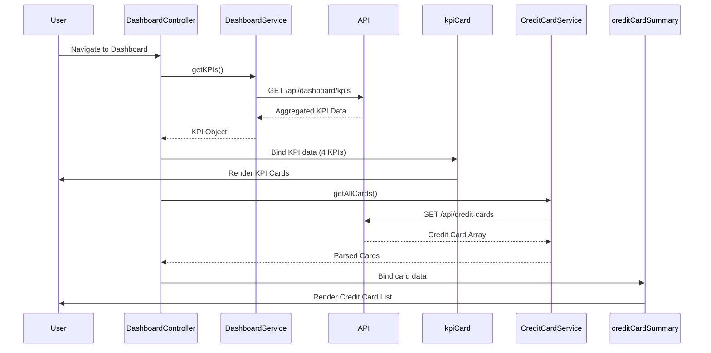

# Low-Level Design: QE-7476 - Dashboard KPIs and Credit Card Overview

## a. Architecture Mapping

- **AngularJS Module**: `creditCard.dashboard` - Main module for dashboard KPI display
- **Controllers**: `DashboardController` - Manages KPI fetching, aggregation, and display; `CreditCardListController` - Handles multiple credit card view
- **Services**: `DashboardService` - REST API integration for KPI data; `CreditCardService` - Fetches credit card details and balances
- **Directives**: `kpiCard` - Reusable KPI display component; `creditCardSummary` - Individual credit card summary card
- **Filters**: `currencyFormat` - Formats amounts with currency symbols; `creditUtilization` - Calculates credit utilization percentage

**Recommended Folder Structure:**
```
/app
  /modules
    /dashboard
      /controllers
      /services
      /directives
      /views
      /filters
```

## b. Component Specifications

| Component Name | Artifact Type | Responsibility | Key Dependencies |
|---|---|---|---|
| DashboardController | Controller | Orchestrates KPI data fetching and aggregation across all cards | DashboardService, CreditCardService, $scope, $interval |
| CreditCardListController | Controller | Manages display of multiple credit cards with individual details | CreditCardService, $scope |
| DashboardService | Factory | Fetches aggregated KPI data from REST API | $http, $q, AuthService |
| CreditCardService | Factory | Retrieves credit card details, limits, and balances | $http, $q, AuthService |
| kpiCard | Directive | Renders individual KPI with icon, label, and value | - |
| creditCardSummary | Directive | Displays credit card summary with limit, available, and outstanding | CreditCardService |
| currencyFormat | Filter | Formats numeric amounts with currency symbol and locale | - |
| creditUtilization | Filter | Calculates and formats credit utilization percentage | - |

## c. Data Model

**KPIData Object:**
```javascript
{
  monthlySpend: Number,
  totalCreditLimit: Number,
  availableCredit: Number,
  outstandingAmount: Number,
  lastUpdated: Date
}
```

**CreditCard Object:**
```javascript
{
  cardId: String,
  cardNumber: String, // Masked (e.g., '**** **** **** 1234')
  cardName: String,
  creditLimit: Number,
  availableCredit: Number,
  outstandingAmount: Number,
  monthlySpend: Number,
  dueDate: Date
}
```

## d. Data Flow

User authenticates and navigates to dashboard → DashboardController initializes and calls DashboardService.getKPIs() → Service makes REST API call to /api/dashboard/kpis → API returns aggregated KPI data (monthly spend, total limit, available credit, outstanding) → Controller binds data to $scope.kpis → kpiCard directives render each KPI with responsive layout → Simultaneously, CreditCardListController calls CreditCardService.getAllCards() → API returns array of credit card objects → creditCardSummary directives render individual card details → $interval service triggers periodic refresh every 5 minutes to update KPIs with real-time data.

## e. Primary Sequence Diagram



## f. Implementation Notes

- Use AngularJS $interval service for periodic KPI refresh (every 5 minutes) with automatic cleanup on $scope.$destroy
- Implement responsive grid layout using Bootstrap classes (col-md-3 for KPI cards, col-md-6 for credit card summaries)
- Apply AngularJS one-time binding (::) for static card details to improve performance with large card lists
- Use AngularJS $http caching for credit card details to reduce redundant API calls
- Implement loading states using ng-show/ng-hide with spinner directives during API calls

## g. Error Handling

HTTP interceptor captures API failures and displays error notification; graceful degradation shows cached data if refresh fails.

## h. Security Notes

Requires token-based auth via existing SSO; credit card numbers masked on client-side; all API calls over HTTPS with PCI-DSS compliant data handling.