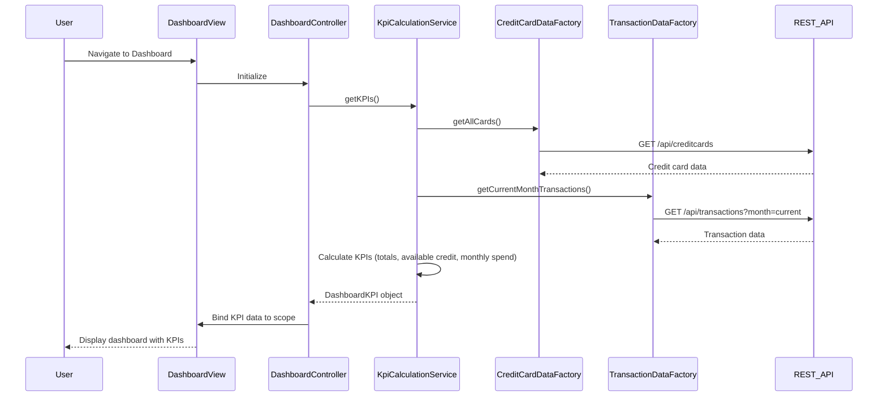

# Low-Level Design: QE-7483 - Dashboard KPIs and Credit Card Overview

## a. Architecture Mapping

- **Dashboard Module** → AngularJS Module (`app.dashboard`)
- **Dashboard Controller** → AngularJS Controller (`DashboardController`)
- **KPI Calculation Service** → AngularJS Service (`KpiCalculationService`)
- **Credit Card Data Service** → AngularJS Factory (`CreditCardDataFactory`)
- **Dashboard View** → HTML5 Template with Bootstrap grid (`dashboard.html`)
- **KPI Display Directive** → AngularJS Directive (`kpiCard`)

**Recommended Folder Structure:**
```
/app
  /dashboard
    dashboard.module.js
    dashboard.controller.js
    dashboard.html
    /services
      kpi-calculation.service.js
      credit-card-data.factory.js
    /directives
      kpi-card.directive.js
```

## b. Component Specifications

| Component Name | Artifact Type | Responsibility | Key Dependencies |
|----------------|---------------|----------------|------------------|
| DashboardModule | Module | Registers dashboard feature module and dependencies | angular, ui.router, app.core |
| DashboardController | Controller | Orchestrates dashboard view, fetches KPI data, manages state | KpiCalculationService, CreditCardDataFactory, $scope |
| KpiCalculationService | Service | Performs real-time calculations for available credit, monthly spend, totals | CreditCardDataFactory, TransactionDataFactory |
| CreditCardDataFactory | Factory | Fetches credit card details, limits, balances via REST API | $http, API_CONFIG |
| TransactionDataFactory | Factory | Retrieves current month transaction data for spend calculation | $http, API_CONFIG |
| KpiCardDirective | Directive | Renders individual KPI card with icon, label, value, and styling | None |
| DashboardView | HTML Template | Displays consolidated dashboard with responsive Bootstrap grid | Bootstrap CSS, kpiCard directive |

## c. Data Model

**CreditCard Object:**
```javascript
{
  cardId: String,
  cardNumber: String,
  cardType: String,
  creditLimit: Number,
  outstandingAmount: Number,
  availableCredit: Number,
  cardHolderName: String,
  expiryDate: String
}
```

**DashboardKPI Object:**
```javascript
{
  totalCreditLimit: Number,
  totalAvailableCredit: Number,
  totalOutstanding: Number,
  monthlySpend: Number,
  numberOfCards: Number,
  creditUtilization: Number
}
```

**Transaction Object (for monthly spend):**
```javascript
{
  transactionId: String,
  cardId: String,
  amount: Number,
  transactionDate: Date,
  merchantName: String
}
```

## d. Data Flow

User navigates to dashboard → DashboardController initializes and calls KpiCalculationService.getKPIs() → Service invokes CreditCardDataFactory.getAllCards() and TransactionDataFactory.getCurrentMonthTransactions() in parallel → REST API calls return credit card details and transaction data → KpiCalculationService aggregates totals (sum of credit limits, outstanding amounts), calculates available credit (limit - outstanding) and monthly spend (sum of current month transactions) → Calculated KPI object returned to DashboardController → Controller binds data to $scope → View renders KPI cards using kpiCard directive with Bootstrap responsive grid, displaying all metrics with sub-2-second load time.

## e. Primary Sequence Diagram



## f. Implementation Notes

- Use AngularJS Dependency Injection for all services and factories; register with module.service() and module.factory()
- Implement parallel API calls using $q.all() to optimize load time and meet sub-2-second NFR
- Apply ES6 classes for services with constructor-based DI pattern for cleaner code structure
- Use Bootstrap grid system (col-xs-*, col-sm-*, col-md-*) for responsive KPI card layout across devices
- Implement API endpoints with RESTful conventions; use $http service with promise-based error handling

## g. Error Handling

HTTP interceptor-based error handling with user-friendly notifications via toastr or custom alert directive for API failures.

## h. Security Notes

Requires token-based authentication via existing SSO; API calls include Authorization header with JWT token.