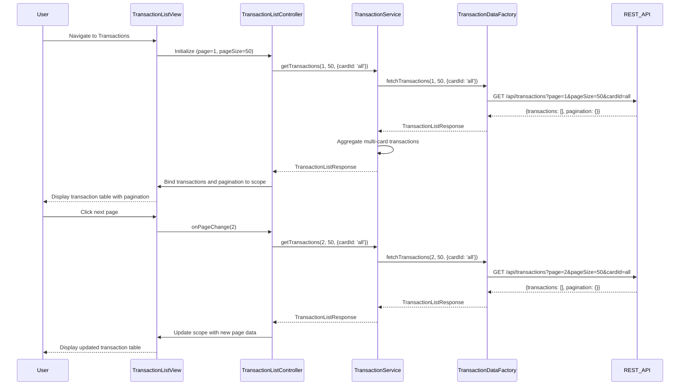

# Low-Level Design: QE-7485 - Transaction Management and Tracking

## a. Architecture Mapping

- **Transaction Module** → AngularJS Module (`app.transactions`)
- **Transaction List Controller** → AngularJS Controller (`TransactionListController`)
- **Transaction Detail Controller** → AngularJS Controller (`TransactionDetailController`)
- **Transaction Service** → AngularJS Service (`TransactionService`)
- **Transaction Data Factory** → AngularJS Factory (`TransactionDataFactory`)
- **Pagination Directive** → AngularJS Directive (`transactionPagination`)
- **Transaction List View** → HTML5 Template with Bootstrap table (`transaction-list.html`)
- **Transaction Detail View** → HTML5 Template (`transaction-detail.html`)

**Recommended Folder Structure:**
```
/app
  /transactions
    transactions.module.js
    transaction-list.controller.js
    transaction-detail.controller.js
    transaction-list.html
    transaction-detail.html
    /services
      transaction.service.js
      transaction-data.factory.js
    /directives
      transaction-pagination.directive.js
```

## b. Component Specifications

| Component Name | Artifact Type | Responsibility | Key Dependencies |
|----------------|---------------|----------------|------------------|
| TransactionsModule | Module | Registers transaction feature module and routing | angular, ui.router, app.core |
| TransactionListController | Controller | Manages transaction list view, pagination, filtering, multi-card aggregation | TransactionService, $scope, $stateParams |
| TransactionDetailController | Controller | Displays detailed view of a single transaction | TransactionService, $scope, $stateParams |
| TransactionService | Service | Orchestrates transaction retrieval, caching, and aggregation logic | TransactionDataFactory, $q |
| TransactionDataFactory | Factory | Fetches paginated transaction data from REST API with query parameters | $http, API_CONFIG |
| TransactionPaginationDirective | Directive | Renders pagination controls and handles page navigation events | None |
| TransactionListView | HTML Template | Displays transaction table with columns for date, merchant, amount, card, status | Bootstrap CSS, transactionPagination directive |
| TransactionDetailView | HTML Template | Shows comprehensive transaction details including metadata | Bootstrap CSS |

## c. Data Model

**Transaction Object:**
```javascript
{
  transactionId: String,
  cardId: String,
  cardName: String,
  merchantName: String,
  merchantCategory: String,
  amount: Number,
  currency: String,
  transactionDate: Date,
  postingDate: Date,
  status: String,
  description: String,
  referenceNumber: String
}
```

**PaginationMetadata Object:**
```javascript
{
  currentPage: Number,
  pageSize: Number,
  totalRecords: Number,
  totalPages: Number,
  hasNextPage: Boolean,
  hasPreviousPage: Boolean
}
```

**TransactionListResponse Object:**
```javascript
{
  transactions: Array<Transaction>,
  pagination: PaginationMetadata
}
```

## d. Data Flow

User navigates to transaction list view → TransactionListController initializes with default pagination (page 1, 50 records per page) → Controller calls TransactionService.getTransactions(page, pageSize, filters) → Service invokes TransactionDataFactory.fetchTransactions() with query parameters → REST API call GET /api/transactions?page=1&pageSize=50&cardId=all returns paginated transaction array and metadata → TransactionService aggregates transactions from multiple cards if 'all cards' filter is active → Service returns TransactionListResponse to controller → Controller binds transactions array and pagination metadata to $scope → TransactionListView renders Bootstrap table with transaction rows and TransactionPaginationDirective at bottom → User clicks pagination control or transaction row → Controller updates page or navigates to TransactionDetailController → Detail view displays full transaction information retrieved from cache or API.

## e. Primary Sequence Diagram



## f. Implementation Notes

- Use ui.router for state management with parameters for page number and filters; define states for list and detail views
- Implement server-side pagination with query parameters (page, pageSize) to handle high-volume transaction datasets efficiently
- Apply AngularJS $http service with promise chaining for API calls; use response interceptors for consistent error handling
- Use Bootstrap table-responsive class for mobile-friendly transaction table rendering
- Cache current page transactions in TransactionService using simple object cache to avoid re-fetching on back navigation

## g. Error Handling

HTTP interceptor-based approach with try/catch in service layer; display user-friendly error messages via notification service on API failures.

## h. Security Notes

Requires token-based auth via existing SSO; all API requests include Authorization header with JWT token for secure transaction data access.