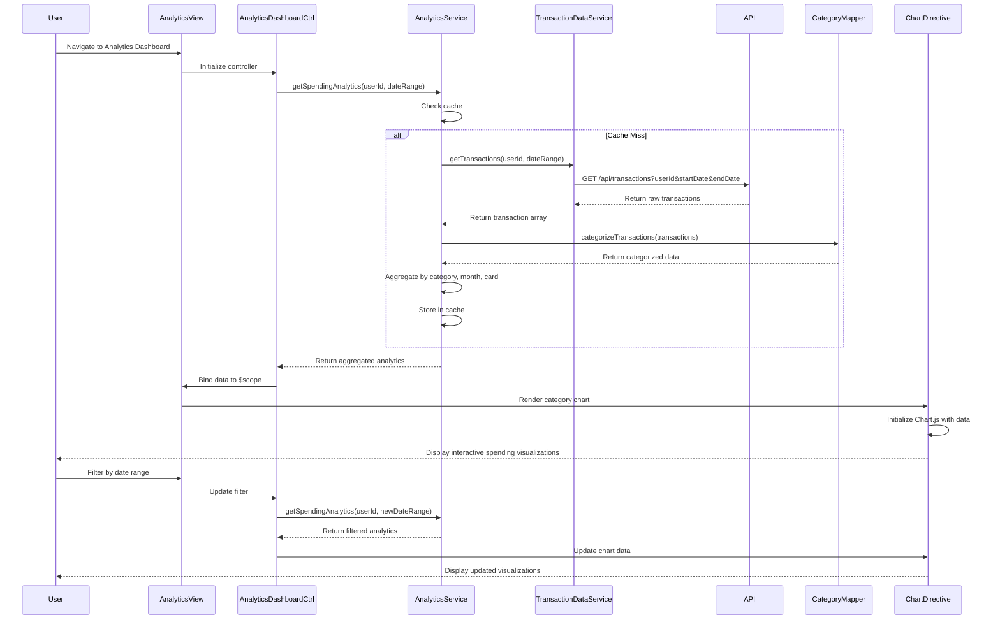

# Low-Level Design: QE-7498 - Spending Analytics and Insights

## a. Architecture Mapping

**AngularJS Artifacts:**
- **Module**: `creditCard.analytics` - Root module for analytics feature
- **Controller**: `AnalyticsDashboardController` - Manages analytics view state and user interactions
- **Service**: `AnalyticsService` - Handles data aggregation and API calls to Analytics Engine
- **Service**: `TransactionDataService` - Retrieves raw transaction data from backend
- **Directive**: `spendingChart` - Reusable chart component for category/trend visualizations
- **Factory**: `CategoryMapper` - Maps transactions to 9 predefined spending categories

**Folder Structure:**
```
app/
├── modules/
│   └── analytics/
│       ├── analytics.module.js
│       ├── controllers/
│       │   └── analytics-dashboard.controller.js
│       ├── services/
│       │   ├── analytics.service.js
│       │   └── transaction-data.service.js
│       ├── directives/
│       │   └── spending-chart.directive.js
│       ├── factories/
│       │   └── category-mapper.factory.js
│       └── views/
│           └── analytics-dashboard.html
```

## b. Component Specifications

| Component Name | Artifact Type | Responsibility | Key Dependencies |
|----------------|---------------|----------------|------------------|
| `creditCard.analytics` | Module | Root module registration and routing config | `ngRoute`, `chart.js` |
| `AnalyticsDashboardController` | Controller | Manages view state, handles user filter interactions, coordinates data loading | `AnalyticsService`, `$scope`, `$q` |
| `AnalyticsService` | Service | Aggregates spending data by category/month/card, caches results for <1.5s render | `TransactionDataService`, `$http`, `$cacheFactory` |
| `TransactionDataService` | Service | Fetches raw transaction data from REST API with date range filtering | `$http`, `API_CONFIG` |
| `spendingChart` | Directive | Renders interactive responsive charts using Chart.js library | `chart.js`, isolate scope bindings |
| `CategoryMapper` | Factory | Maps transaction merchant/description to 9 predefined categories | None (pure function) |

## c. Data Model

**SpendingAnalytics (JS Object):**
```javascript
{
  userId: String,
  dateRange: { startDate: Date, endDate: Date },
  categoryBreakdown: [
    { category: String, amount: Number, percentage: Number, transactionCount: Number }
  ],
  monthlyTrends: [
    { month: String, totalSpend: Number, categoryData: Array }
  ],
  cardWiseAnalysis: [
    { cardId: String, cardName: String, totalSpend: Number, topCategories: Array }
  ],
  totalSpend: Number,
  averageMonthlySpend: Number
}
```

**Categories (Enum):**
```javascript
['Food & Dining', 'Fuel', 'Shopping', 'Travel', 'Entertainment', 'Utilities', 'Healthcare', 'Education', 'Miscellaneous']
```

## d. Data Flow

User navigates to analytics dashboard → `AnalyticsDashboardController` initializes and calls `AnalyticsService.getSpendingAnalytics()` with default 12-month range → Service checks cache, if miss calls `TransactionDataService.getTransactions()` REST API → Raw transactions are processed by `CategoryMapper` to assign categories → `AnalyticsService` aggregates data into category breakdown, monthly trends, and card-wise analysis → Aggregated data returned to controller and cached → Controller binds data to scope → `spendingChart` directives render interactive visualizations using Chart.js → User interacts with filters (date range, card selection) triggering controller to re-fetch/re-aggregate data → Charts update reactively.

## e. Primary Sequence Diagram



## f. Implementation Notes

- Use AngularJS DI to inject services into controllers; register all artifacts in `creditCard.analytics` module with proper dependency array syntax to avoid minification issues
- Implement `$cacheFactory` in `AnalyticsService` with 5-minute TTL to meet <1.5s rendering NFR and reduce API calls
- Use ES6 arrow functions and `const`/`let` in services; leverage `Array.map()`, `.reduce()`, `.filter()` for data aggregation logic
- Integrate Chart.js via custom directive with isolate scope (`scope: { data: '=', options: '=' }`) for reusability across category, trend, and card-wise charts
- REST API calls use `$http` with promise chaining; implement pagination (`limit=1000, offset`) for transaction retrieval to handle large datasets efficiently

## g. Error Handling

HTTP interceptor captures API errors (4xx/5xx), displays user-friendly toast notifications via `toastr`, and logs errors to console; controller uses `$q.reject()` for promise error propagation.

## h. Security Notes

Requires token-based authentication via existing SSO; all API calls include Authorization header with JWT token validated server-side.