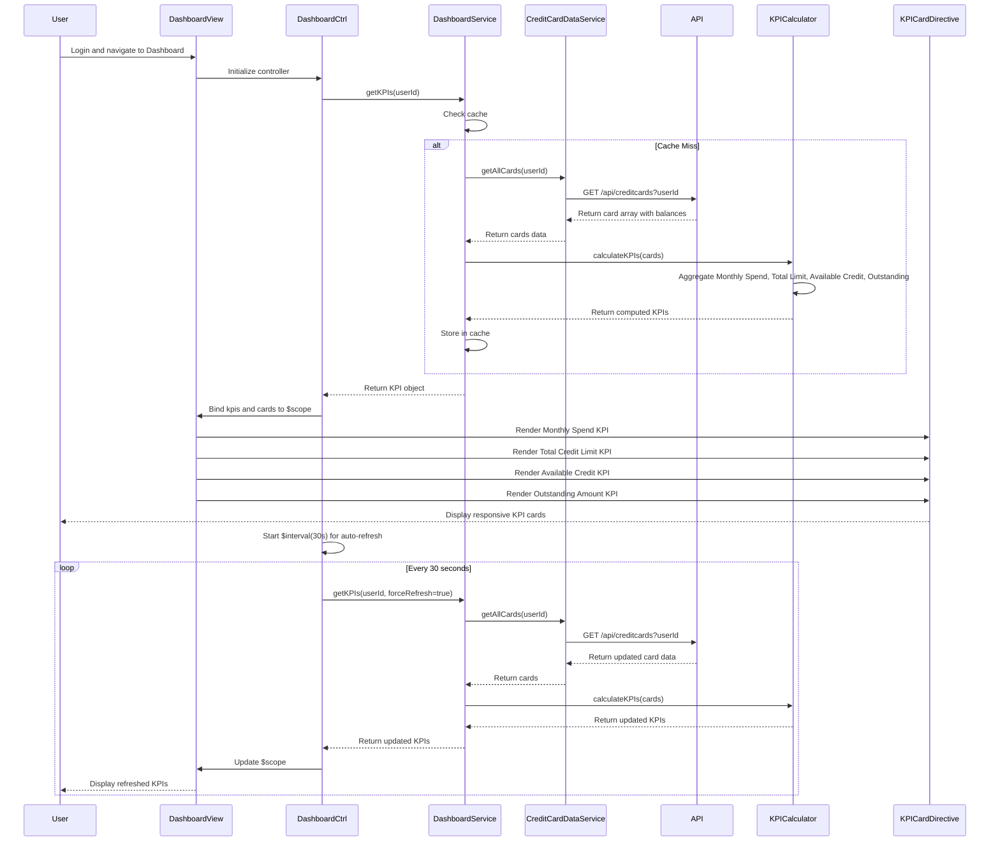

# Low-Level Design: QE-7499 - Dashboard KPIs and Credit Card Overview

## a. Architecture Mapping

**AngularJS Artifacts:**
- **Module**: `creditCard.dashboard` - Root module for dashboard feature
- **Controller**: `DashboardController` - Manages dashboard state and KPI display logic
- **Service**: `DashboardService` - Orchestrates KPI data retrieval and aggregation
- **Service**: `CreditCardDataService` - Fetches credit card details, balances, and limits from backend
- **Directive**: `kpiCard` - Reusable component for displaying individual KPI metrics
- **Factory**: `KPICalculator` - Computes aggregated KPIs from raw card data

**Folder Structure:**
```
app/
├── modules/
│   └── dashboard/
│       ├── dashboard.module.js
│       ├── controllers/
│       │   └── dashboard.controller.js
│       ├── services/
│       │   ├── dashboard.service.js
│       │   └── credit-card-data.service.js
│       ├── directives/
│       │   └── kpi-card.directive.js
│       ├── factories/
│       │   └── kpi-calculator.factory.js
│       └── views/
│           └── dashboard.html
```

## b. Component Specifications

| Component Name | Artifact Type | Responsibility | Key Dependencies |
|----------------|---------------|----------------|------------------|
| `creditCard.dashboard` | Module | Root module registration, routing, and dependency declaration | `ngRoute`, `ui.bootstrap` |
| `DashboardController` | Controller | Initializes dashboard, manages refresh logic, handles real-time updates | `DashboardService`, `$scope`, `$interval` |
| `DashboardService` | Service | Aggregates KPI data from multiple cards, implements caching for <2s load | `CreditCardDataService`, `KPICalculator`, `$q`, `$cacheFactory` |
| `CreditCardDataService` | Service | Fetches card details (balance, limit, outstanding) via REST API | `$http`, `API_CONFIG` |
| `kpiCard` | Directive | Displays individual KPI with icon, value, label, and trend indicator | Bootstrap CSS, isolate scope |
| `KPICalculator` | Factory | Computes Monthly Spend, Total Credit Limit, Available Credit, Outstanding Amount | None (pure computation) |

## c. Data Model

**DashboardKPI (JS Object):**
```javascript
{
  userId: String,
  kpis: {
    monthlySpend: { value: Number, currency: String, trend: String },
    totalCreditLimit: { value: Number, currency: String },
    availableCredit: { value: Number, currency: String, percentage: Number },
    outstandingAmount: { value: Number, currency: String, dueDate: Date }
  },
  cards: [
    {
      cardId: String,
      cardName: String,
      cardNumber: String,
      creditLimit: Number,
      availableCredit: Number,
      outstandingBalance: Number,
      currentMonthSpend: Number
    }
  ],
  lastUpdated: Date
}
```

## d. Data Flow

User logs in and navigates to dashboard → `DashboardController` initializes and calls `DashboardService.getKPIs(userId)` → Service checks cache (5-min TTL), if miss calls `CreditCardDataService.getAllCards(userId)` REST API → Raw card data retrieved → `KPICalculator` computes aggregated metrics: sum all card limits for Total Credit Limit, sum available credit, sum outstanding amounts, sum current month transactions for Monthly Spend → Aggregated KPIs returned to controller and cached → Controller binds data to `$scope.kpis` and `$scope.cards` → `kpiCard` directives render each KPI with responsive Bootstrap grid → `$interval` triggers auto-refresh every 30 seconds to update KPIs in near real-time → UI updates reactively via two-way binding.

## e. Primary Sequence Diagram



## f. Implementation Notes

- Use AngularJS DI with explicit array notation for all controllers/services to ensure minification safety
- Implement `$cacheFactory` in `DashboardService` with 5-minute TTL to meet <2s page load NFR; use `forceRefresh` flag to bypass cache on manual refresh
- Use ES6 `const`/`let`, template literals, and arrow functions in service layer; leverage `Array.reduce()` for KPI aggregation logic
- Implement responsive layout using Bootstrap grid (`col-xs-12 col-sm-6 col-md-3`) for KPI cards to support desktop/tablet/mobile
- Use `$interval` service for real-time refresh (30s interval); ensure proper cleanup in controller `$destroy` event to prevent memory leaks

## g. Error Handling

HTTP interceptor catches API failures, displays error toast using `toastr` library, and falls back to cached data if available; controller handles promise rejections with user-friendly messages.

## h. Security Notes

Requires token-based auth via existing SSO; JWT token included in Authorization header for all API requests; sensitive card data (full card number) masked in UI display.