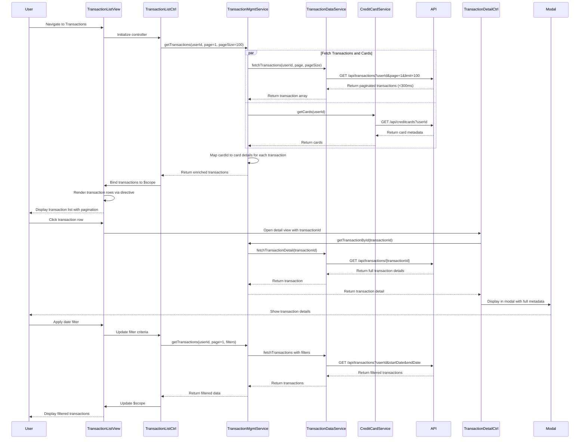

# Low-Level Design: QE-7500 - Transaction Management and Viewing

## a. Architecture Mapping

**AngularJS Artifacts:**
- **Module**: `creditCard.transactions` - Root module for transaction management feature
- **Controller**: `TransactionListController` - Manages transaction list view, pagination, and filtering
- **Controller**: `TransactionDetailController` - Manages individual transaction detail modal/view
- **Service**: `TransactionManagementService` - Orchestrates transaction retrieval and card mapping
- **Service**: `TransactionDataService` - Handles REST API calls for transaction data
- **Service**: `CreditCardService` - Retrieves card information for transaction-card mapping
- **Directive**: `transactionRow` - Reusable row component for transaction list display
- **Filter**: `transactionFilter` - Custom filter for client-side transaction filtering by date/amount/category

**Folder Structure:**
```
app/
├── modules/
│   └── transactions/
│       ├── transactions.module.js
│       ├── controllers/
│       │   ├── transaction-list.controller.js
│       │   └── transaction-detail.controller.js
│       ├── services/
│       │   ├── transaction-management.service.js
│       │   ├── transaction-data.service.js
│       │   └── credit-card.service.js
│       ├── directives/
│       │   └── transaction-row.directive.js
│       ├── filters/
│       │   └── transaction.filter.js
│       └── views/
│           ├── transaction-list.html
│           └── transaction-detail.html
```

## b. Component Specifications

| Component Name | Artifact Type | Responsibility | Key Dependencies |
|----------------|---------------|----------------|------------------|
| `creditCard.transactions` | Module | Root module registration, routing configuration for list and detail views | `ngRoute`, `ui.bootstrap` |
| `TransactionListController` | Controller | Manages transaction list state, pagination (100 per page), filter application | `TransactionManagementService`, `$scope`, `$location` |
| `TransactionDetailController` | Controller | Displays detailed view of single transaction with full metadata | `TransactionManagementService`, `$routeParams`, `$uibModal` |
| `TransactionManagementService` | Service | Aggregates transactions from multiple cards, maps card details to transactions | `TransactionDataService`, `CreditCardService`, `$q` |
| `TransactionDataService` | Service | Fetches paginated transaction data via REST API with <300ms latency requirement | `$http`, `API_CONFIG` |
| `CreditCardService` | Service | Retrieves card metadata (name, last 4 digits) for display in transaction list | `$http`, `API_CONFIG` |
| `transactionRow` | Directive | Renders individual transaction row with date, merchant, amount, category, card | Isolate scope, click handler for detail view |
| `transactionFilter` | Filter | Filters transactions by date range, amount range, category, or card | None (pure function) |

## c. Data Model

**Transaction (JS Object):**
```javascript
{
  transactionId: String,
  userId: String,
  cardId: String,
  cardName: String,
  cardLastFour: String,
  date: Date,
  merchantName: String,
  merchantCategory: String,
  amount: Number,
  currency: String,
  transactionType: String,
  status: String,
  description: String,
  metadata: Object
}
```

**TransactionListResponse (API Response):**
```javascript
{
  transactions: Array<Transaction>,
  totalCount: Number,
  pageSize: Number,
  currentPage: Number,
  hasMore: Boolean
}
```

## d. Data Flow

User authenticates and navigates to transaction list → `TransactionListController` initializes with default pagination (page 1, 100 records) → Controller calls `TransactionManagementService.getTransactions(userId, page, pageSize)` → Service validates session then calls `TransactionDataService.fetchTransactions()` REST API with pagination params → Simultaneously calls `CreditCardService.getCards(userId)` to retrieve card metadata → API returns transaction array within 300ms → Service maps cardId to card details (name, last 4 digits) for each transaction → Aggregated data returned to controller → Controller binds to `$scope.transactions` → `transactionRow` directives render each transaction in responsive table → User clicks transaction row → `TransactionDetailController` opens modal with full transaction details → User applies filters (date/category) → `transactionFilter` processes client-side filtering → View updates reactively.

## e. Primary Sequence Diagram



## f. Implementation Notes

- Use AngularJS DI with explicit array notation for minification safety; register all artifacts in `creditCard.transactions` module
- Implement server-side pagination with `limit` and `offset` query params to handle 10,000+ transactions per user efficiently
- Use ES6 `Promise.all()` in `TransactionManagementService` to parallelize transaction and card data fetching for optimal performance
- Leverage `ui-bootstrap` pagination directive for client-side pagination controls; implement infinite scroll as enhancement
- REST API calls via `$http` must complete within 300ms NFR; implement request timeout configuration and retry logic for failed requests

## g. Error Handling

HTTP interceptor captures API errors (network failures, 4xx/5xx responses), logs to console, and displays user-friendly error messages via `toastr`; controller uses `try/catch` with `$q.reject()` for promise error propagation.

## h. Security Notes

Requires token-based authentication via existing SSO; all API calls include JWT token in Authorization header; transaction data encrypted in transit (TLS 1.2+) and at rest (AES-256); sensitive card numbers masked in UI.