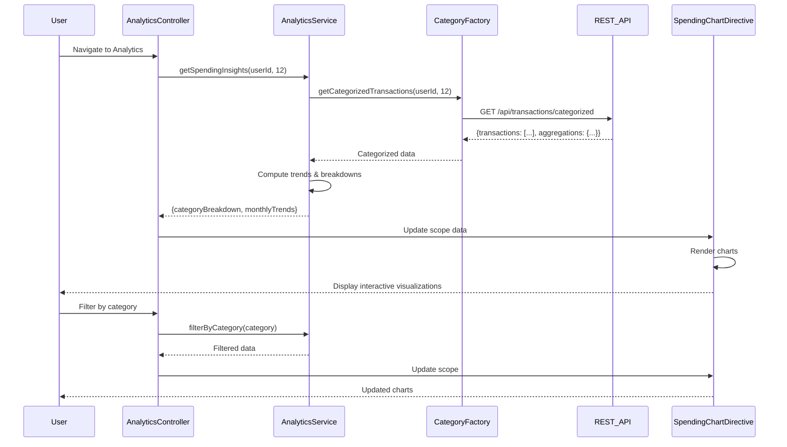

# Low-Level Design: QE-7507 - Analytics and Spending Insights

## a. Architecture Mapping

- **Analytics UI** → AngularJS Module (`app.analytics`) with Controller (`AnalyticsController`)
- **Visualization Engine** → AngularJS Directive (`spendingChart`) wrapping charting library (Chart.js/D3.js)
- **Analytics Service** → AngularJS Service (`AnalyticsService`) for data fetching and aggregation
- **Transaction Categorization Service** → REST API integration via Factory (`CategoryService`)
- **Data Aggregation Engine** → Backend REST API consumed by `AnalyticsService`

**Folder Structure:**
```
/app
  /modules
    /analytics
      analytics.module.js
      analytics.controller.js
      analytics.service.js
      analytics.html
  /directives
    spending-chart.directive.js
  /factories
    category.factory.js
  /models
    transaction.model.js
```

## b. Component Specifications

| Name | Artifact Type | Responsibility | Key Dependencies |
|------|---------------|----------------|------------------|
| AnalyticsModule | Module | Register analytics feature components | angular, ui.router |
| AnalyticsController | Controller | Manage analytics view state, handle user interactions | AnalyticsService, $scope |
| AnalyticsService | Service | Fetch and cache spending data, compute trends | $http, CategoryFactory, $q |
| CategoryFactory | Factory | Retrieve categorized transactions from REST API | $http, TransactionModel |
| SpendingChartDirective | Directive | Render interactive category/trend charts | Chart.js/D3.js, $timeout |
| TransactionModel | Model | Define transaction data structure with category | None |

## c. Data Model

**Transaction Model:**
```javascript
{
  id: String,
  userId: String,
  cardId: String,
  amount: Number,
  category: String, // Food & Dining, Fuel, Shopping, Travel, Entertainment, Utilities, Healthcare, Education, Miscellaneous
  date: Date,
  description: String
}
```

**Aggregated Spending Model:**
```javascript
{
  categoryBreakdown: Array<{category: String, total: Number, percentage: Number}>,
  monthlyTrends: Array<{month: String, total: Number}>,
  period: {start: Date, end: Date}
}
```

## d. Data Flow

User navigates to analytics view → AnalyticsController initializes and calls AnalyticsService.getSpendingInsights() → Service requests categorized transactions from CategoryFactory (REST API: GET /api/transactions/categorized?userId={id}&months=12) → Backend returns pre-aggregated data → AnalyticsService computes category totals and monthly trends client-side if needed → Controller updates $scope with aggregated data → SpendingChartDirective watches scope changes and renders interactive charts using Chart.js → User filters by category/month triggering controller method → Service re-aggregates filtered data → Charts update reactively.

## e. Primary Sequence Diagram



## f. Implementation Notes

- Use AngularJS Dependency Injection to inject AnalyticsService and CategoryFactory into controllers/directives
- Leverage ES6 classes for service definitions with arrow functions for promise chaining
- Implement client-side caching in AnalyticsService using $cacheFactory for 12-month data (5-min TTL)
- REST API integration via $http with interceptors for auth token injection
- Use Chart.js with angular-chart.js wrapper for declarative chart binding to scope data

## g. Error Handling

HTTP interceptor captures API errors; AnalyticsService wraps promises with try/catch, displays user-friendly notifications via toastr/modal on failure.

## h. Security Notes

Requires token-based auth via existing SSO; userId validated server-side on all API requests.