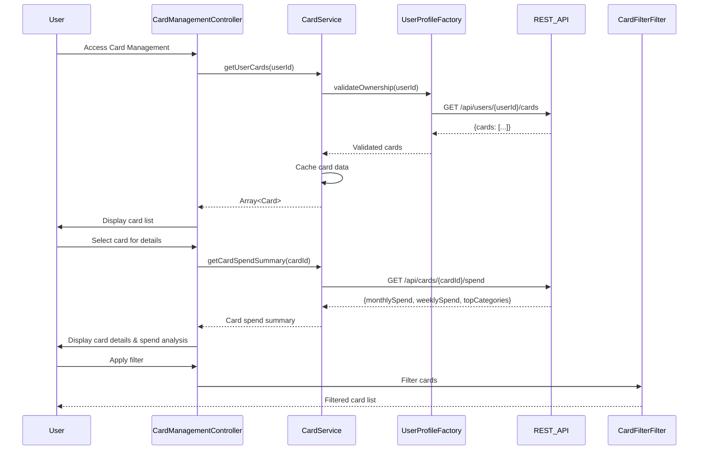

# Low-Level Design: QE-7508 - Multiple Credit Card Management and Monitoring

## a. Architecture Mapping

- **User Interface** → AngularJS Module (`app.cardManagement`) with Controller (`CardManagementController`)
- **Card Management Service** → AngularJS Service (`CardService`) for card CRUD and spend analysis
- **User Profile Service** → REST API integration via Factory (`UserProfileFactory`)
- **Card Data Repository** → Backend REST API consumed by `CardService`
- **Spend Analysis Engine** → Backend REST API endpoint for card-wise analytics

**Folder Structure:**
```
/app
  /modules
    /card-management
      card-management.module.js
      card-management.controller.js
      card.service.js
      card-list.html
      card-detail.html
  /factories
    user-profile.factory.js
  /models
    card.model.js
  /filters
    card-filter.filter.js
```

## b. Component Specifications

| Name | Artifact Type | Responsibility | Key Dependencies |
|------|---------------|----------------|------------------|
| CardManagementModule | Module | Register card management components | angular, ui.router |
| CardManagementController | Controller | Manage card list/detail views, handle filtering and comparison | CardService, $scope, $state |
| CardService | Service | Fetch user cards, retrieve card-wise spend, cache card data | $http, UserProfileFactory, $q, $cacheFactory |
| UserProfileFactory | Factory | Validate card ownership via REST API | $http |
| CardModel | Model | Define card data structure | None |
| CardFilterFilter | Filter | Filter cards by name, type, or spend threshold | None |

## c. Data Model

**Card Model:**
```javascript
{
  cardId: String,
  userId: String,
  cardName: String,
  cardType: String, // Visa, Mastercard, Amex
  creditLimit: Number,
  outstandingAmount: Number,
  availableCredit: Number,
  lastFourDigits: String,
  expiryDate: Date
}
```

**Card Spend Summary Model:**
```javascript
{
  cardId: String,
  monthlySpend: Number,
  weeklySpend: Number,
  topCategories: Array<{category: String, amount: Number}>
}
```

## d. Data Flow

User navigates to card management view → CardManagementController calls CardService.getUserCards(userId) → Service validates ownership via UserProfileFactory (REST API: GET /api/users/{userId}/cards) → Backend returns list of cards (sub-1-second) → CardService caches card data → Controller populates $scope.cards → User selects card for details → Controller calls CardService.getCardSpendSummary(cardId) → Service requests spend data (REST API: GET /api/cards/{cardId}/spend) → Backend returns pre-computed spend metrics → Controller updates detail view → User applies filter → CardFilterFilter processes $scope.cards → Filtered list displayed.

## e. Primary Sequence Diagram



## f. Implementation Notes

- Use AngularJS DI to inject CardService and UserProfileFactory into controllers
- Implement CardService as ES6 class with $cacheFactory for card data (10-min TTL)
- REST API calls via $http with promise-based error handling using $q
- Use ui-router for state management between card list and detail views
- CardFilterFilter implemented as custom AngularJS filter for client-side filtering

## g. Error Handling

HTTP interceptor for global error handling; CardService uses try/catch with promise rejection, displays error modals for API failures.

## h. Security Notes

Token-based auth via existing SSO; server-side validation ensures userId matches authenticated user before returning card data.