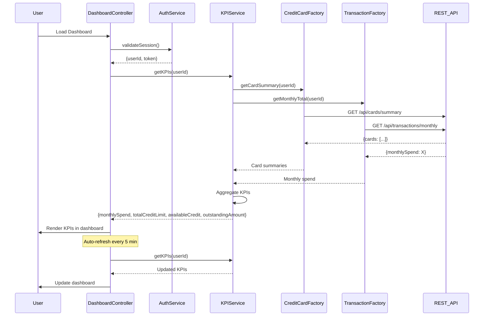

# Low-Level Design: QE-7509 - Dashboard and KPI Management

## a. Architecture Mapping

- **User Web/Mobile Client** → AngularJS SPA with responsive Bootstrap layout
- **Authentication Service** → AngularJS Service (`AuthService`) wrapping SSO integration
- **Dashboard UI Component** → AngularJS Module (`app.dashboard`) with Controller (`DashboardController`)
- **KPI Aggregation Service** → AngularJS Service (`KPIService`) for fetching aggregated metrics
- **Credit Card Data Service** → REST API integration via Factory (`CreditCardFactory`)
- **Transaction Data Service** → REST API integration via Factory (`TransactionFactory`)

**Folder Structure:**
```
/app
  /modules
    /dashboard
      dashboard.module.js
      dashboard.controller.js
      dashboard.html
  /services
    kpi.service.js
    auth.service.js
  /factories
    credit-card.factory.js
    transaction.factory.js
  /models
    kpi.model.js
```

## b. Component Specifications

| Name | Artifact Type | Responsibility | Key Dependencies |
|------|---------------|----------------|------------------|
| DashboardModule | Module | Register dashboard components | angular, ui.router, ui.bootstrap |
| DashboardController | Controller | Manage dashboard state, trigger KPI refresh | KPIService, AuthService, $scope, $interval |
| KPIService | Service | Fetch and aggregate KPI data, handle caching | $http, CreditCardFactory, TransactionFactory, $q |
| AuthService | Service | Handle user authentication and token management | $http, $window |
| CreditCardFactory | Factory | Retrieve card balances and limits from REST API | $http |
| TransactionFactory | Factory | Retrieve transaction totals from REST API | $http |
| KPIModel | Model | Define KPI data structure | None |

## c. Data Model

**KPI Model:**
```javascript
{
  userId: String,
  monthlySpend: Number,
  totalCreditLimit: Number,
  availableCredit: Number,
  outstandingAmount: Number,
  lastUpdated: Date
}
```

**Card Summary Model:**
```javascript
{
  cardId: String,
  creditLimit: Number,
  outstandingAmount: Number
}
```

## d. Data Flow

User accesses dashboard → AuthService validates session and retrieves userId → DashboardController calls KPIService.getKPIs(userId) → Service requests card data via CreditCardFactory (REST API: GET /api/cards/summary?userId={id}) and transaction totals via TransactionFactory (REST API: GET /api/transactions/monthly?userId={id}) in parallel using $q.all → Backend returns cached/pre-computed data (sub-2-seconds) → KPIService aggregates: totalCreditLimit = sum(card.creditLimit), outstandingAmount = sum(card.outstandingAmount), availableCredit = totalCreditLimit - outstandingAmount → Service returns KPI object to controller → Controller updates $scope.kpis → Dashboard renders KPIs in responsive Bootstrap grid → $interval triggers auto-refresh every 5 minutes.

## e. Primary Sequence Diagram



## f. Implementation Notes

- Use AngularJS DI for service injection; AuthService manages JWT token in $window.sessionStorage
- KPIService implements client-side caching with 5-min TTL using $cacheFactory
- Parallel API calls via $q.all for sub-2-second load time
- REST API integration via $http with Authorization header interceptor
- Use Bootstrap responsive grid (col-xs/sm/md/lg) for mobile/desktop layout; $interval for auto-refresh

## g. Error Handling

HTTP interceptor captures 401/403 for auth failures, redirects to login; KPIService uses promise rejection with user notification via toastr.

## h. Security Notes

Requires token-based auth via existing SSO; AuthService injects JWT in all API requests via HTTP interceptor.