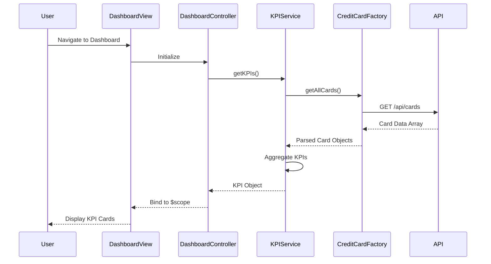

# Low-Level Design: Dashboard KPIs and Financial Overview
**Epic ID:** QE-7528

## a. Architecture Mapping

- **Dashboard Module** → AngularJS Module (`app.dashboard`)
- **Dashboard Controller** → AngularJS Controller (`DashboardController`)
- **KPI Calculation Service** → AngularJS Service (`KPIService`)
- **Credit Card Data Service** → AngularJS Factory (`CreditCardFactory`)
- **Authentication Service** → AngularJS Service (`AuthService`)

**Recommended Folder Structure:**
```
/app
  /modules
    /dashboard
      dashboard.module.js
      dashboard.controller.js
      dashboard.html
  /services
    kpi.service.js
    creditcard.factory.js
    auth.service.js
  /models
    creditcard.model.js
```

## b. Component Specifications

| Component Name | Artifact Type | Responsibility | Key Dependencies |
|----------------|---------------|----------------|------------------|
| DashboardModule | Module | Bootstrap dashboard feature module | angular, ui.router |
| DashboardController | Controller | Manage dashboard state, fetch and display KPIs | KPIService, CreditCardFactory |
| KPIService | Service | Calculate monthly spend, available credit, outstanding amount | CreditCardFactory, $q |
| CreditCardFactory | Factory | Fetch credit card data from REST API | $http, AuthService |
| AuthService | Service | Validate user authentication and manage tokens | $http, $window |
| DashboardView | HTML Template | Render KPI cards with responsive Bootstrap layout | Bootstrap CSS, AngularJS directives |

## c. Data Model

**CreditCard Model:**
```javascript
{
  cardId: String,
  cardNumber: String (masked),
  cardHolderName: String,
  creditLimit: Number,
  availableCredit: Number,
  outstandingAmount: Number,
  monthlySpend: Number,
  lastUpdated: Date
}
```

**KPI Model:**
```javascript
{
  totalCreditLimit: Number,
  totalAvailableCredit: Number,
  totalOutstanding: Number,
  totalMonthlySpend: Number,
  cardCount: Number
}
```

## d. Data Flow

User navigates to the dashboard view, triggering DashboardController initialization. The controller calls KPIService.getKPIs(), which invokes CreditCardFactory.getAllCards() to fetch all user credit cards via REST API (GET /api/cards). AuthService injects the auth token in the request header. Upon receiving card data, KPIService aggregates monthly spend, credit limits, available credit, and outstanding amounts across all cards. The computed KPI object is returned to the controller, which binds it to $scope, updating the dashboard view with responsive Bootstrap cards displaying each KPI metric.

## e. Primary Sequence Diagram



## f. Implementation Notes

- Use AngularJS 1.x module pattern with dependency injection for all services and controllers
- Leverage ES6 classes for service definitions with arrow functions for promise chaining
- Implement $http interceptor for automatic auth token injection and response error handling
- Use Bootstrap grid system (col-md-3) for responsive KPI card layout across devices
- Cache card data in KPIService for 60 seconds to minimize API calls and meet 2-second load time NFR

## g. Error Handling

HTTP interceptor captures API errors; user-facing notifications displayed via Bootstrap alerts with retry option.

## h. Security Notes

Requires token-based auth via existing SSO; auth token injected in all API requests via $http interceptor.