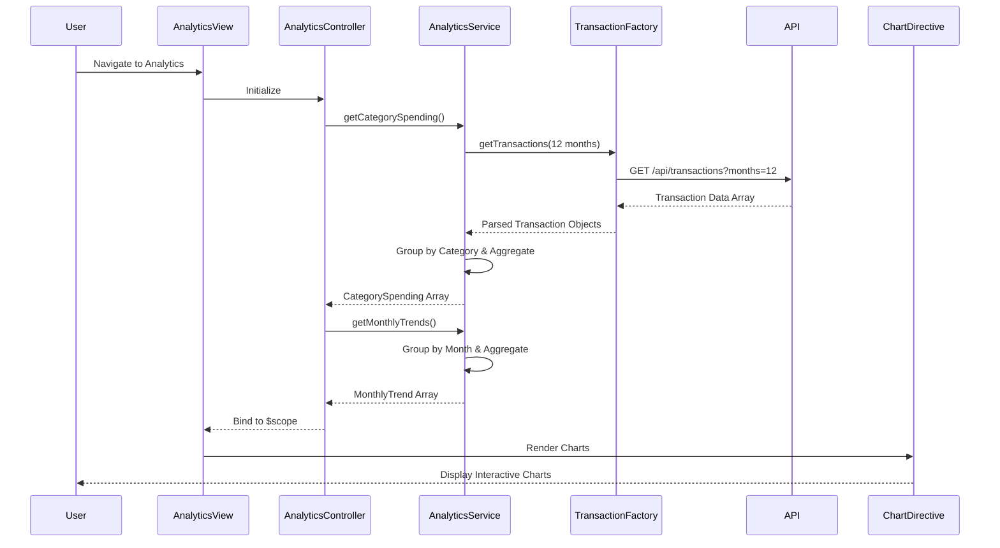

# Low-Level Design: Spending Analytics and Insights
**Epic ID:** QE-7529

## a. Architecture Mapping

- **Analytics Module** → AngularJS Module (`app.analytics`)
- **Analytics Controller** → AngularJS Controller (`AnalyticsController`)
- **Analytics Service** → AngularJS Service (`AnalyticsService`)
- **Transaction Data Service** → AngularJS Factory (`TransactionFactory`)
- **Chart Directive** → AngularJS Directive (`chartDirective`)

**Recommended Folder Structure:**
```
/app
  /modules
    /analytics
      analytics.module.js
      analytics.controller.js
      analytics.html
  /services
    analytics.service.js
    transaction.factory.js
  /directives
    chart.directive.js
  /models
    transaction.model.js
```

## b. Component Specifications

| Component Name | Artifact Type | Responsibility | Key Dependencies |
|----------------|---------------|----------------|------------------|
| AnalyticsModule | Module | Bootstrap analytics feature module | angular, ui.router, chart.js |
| AnalyticsController | Controller | Manage analytics state, fetch and display spending data | AnalyticsService, TransactionFactory |
| AnalyticsService | Service | Process category-wise and monthly trend analytics | TransactionFactory, $q |
| TransactionFactory | Factory | Fetch transaction data from REST API | $http, AuthService |
| ChartDirective | Directive | Render interactive charts using Chart.js library | chart.js, $timeout |
| AnalyticsView | HTML Template | Display category breakdown and trend charts with Bootstrap layout | Bootstrap CSS, chartDirective |

## c. Data Model

**Transaction Model:**
```javascript
{
  transactionId: String,
  cardId: String,
  amount: Number,
  category: String, // Food & Dining, Fuel, Shopping, Travel, Entertainment, Utilities, Healthcare, Education, Miscellaneous
  date: Date,
  description: String
}
```

**CategorySpending Model:**
```javascript
{
  category: String,
  totalAmount: Number,
  percentage: Number,
  transactionCount: Number
}
```

**MonthlyTrend Model:**
```javascript
{
  month: String, // YYYY-MM
  totalSpend: Number
}
```

## d. Data Flow

User navigates to the analytics view, triggering AnalyticsController initialization. The controller calls AnalyticsService.getCategorySpending() and AnalyticsService.getMonthlyTrends(). Both methods invoke TransactionFactory.getTransactions() to fetch transaction data via REST API (GET /api/transactions?months=12). AnalyticsService processes the raw transaction array, grouping by category and aggregating amounts for category-wise spending, and grouping by month for trend analysis. The processed data objects are returned to the controller, which binds them to $scope. ChartDirective watches the bound data and renders interactive pie chart (category) and line chart (trends) using Chart.js, updating the analytics view.

## e. Primary Sequence Diagram



## f. Implementation Notes

- Use AngularJS 1.x module pattern with dependency injection for services, controllers, and directives
- Leverage ES6 array methods (map, filter, reduce) for efficient transaction data processing
- Integrate Chart.js library via custom AngularJS directive with two-way data binding for reactivity
- Implement lazy loading for Chart.js library to optimize initial page load performance
- Use $timeout in ChartDirective to defer chart rendering until DOM is ready, ensuring 1-second render NFR

## g. Error Handling

HTTP interceptor captures API errors; fallback displays "No data available" message with retry button in analytics view.

## h. Security Notes

Standard input validation and secure API calls assumed; auth token injected via existing $http interceptor.