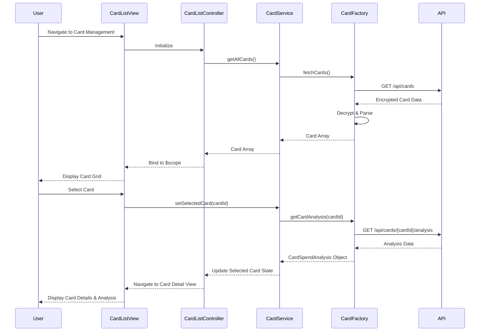

# Low-Level Design: Multiple Credit Card Management
**Epic ID:** QE-7530

## a. Architecture Mapping

- **Card Management Module** → AngularJS Module (`app.cardManagement`)
- **Card List Controller** → AngularJS Controller (`CardListController`)
- **Card Detail Controller** → AngularJS Controller (`CardDetailController`)
- **Card Service** → AngularJS Service (`CardService`)
- **Card Factory** → AngularJS Factory (`CardFactory`)
- **Card Selection Directive** → AngularJS Directive (`cardSelectorDirective`)

**Recommended Folder Structure:**
```
/app
  /modules
    /cardManagement
      cardManagement.module.js
      cardList.controller.js
      cardDetail.controller.js
      cardList.html
      cardDetail.html
  /services
    card.service.js
    card.factory.js
  /directives
    cardSelector.directive.js
  /models
    card.model.js
```

## b. Component Specifications

| Component Name | Artifact Type | Responsibility | Key Dependencies |
|----------------|---------------|----------------|------------------|
| CardManagementModule | Module | Bootstrap card management feature module | angular, ui.router |
| CardListController | Controller | Display list of all user credit cards, handle card selection | CardService, CardFactory |
| CardDetailController | Controller | Display detailed view and spending analysis for selected card | CardService, $stateParams |
| CardService | Service | Manage card state, selection, and card-wise spending analysis | CardFactory, $q |
| CardFactory | Factory | Fetch and persist card data via REST API with secure storage | $http, AuthService, $localStorage |
| CardSelectorDirective | Directive | Render card selection dropdown with instant switching | CardService |

## c. Data Model

**Card Model:**
```javascript
{
  cardId: String,
  cardNumber: String (masked),
  cardHolderName: String,
  bankName: String,
  cardType: String, // Visa, MasterCard, Amex
  creditLimit: Number,
  availableCredit: Number,
  outstandingAmount: Number,
  isActive: Boolean
}
```

**CardSpendAnalysis Model:**
```javascript
{
  cardId: String,
  monthlySpend: Number,
  categoryBreakdown: Array<{category: String, amount: Number}>,
  transactionCount: Number
}
```

## d. Data Flow

User navigates to the card management view, triggering CardListController initialization. The controller calls CardService.getAllCards(), which invokes CardFactory.fetchCards() to retrieve all user cards via REST API (GET /api/cards). CardFactory decrypts and parses the response, caching card data in $localStorage for instant access. The card array is returned to the controller and bound to $scope, rendering a Bootstrap card grid. When the user selects a card (via CardSelectorDirective or card click), CardService.setSelectedCard(cardId) updates the selected card state. CardDetailController watches the selected card and calls CardService.getCardSpendAnalysis(cardId), fetching card-specific transaction data via API (GET /api/cards/{cardId}/analysis). The analysis data is bound to $scope, updating the detail view with card-wise spending breakdown.

## e. Primary Sequence Diagram



## f. Implementation Notes

- Use AngularJS 1.x module pattern with ui-router for card list and detail state management
- Leverage $localStorage service for encrypted client-side card data caching to enable instant switching
- Implement CardSelectorDirective with ng-options for dropdown-based card selection with zero latency
- Use ES6 promises ($q) for asynchronous card data fetching with proper error propagation
- Apply Bootstrap responsive grid (col-sm-6 col-md-4) for card list layout supporting 10+ cards

## g. Error Handling

HTTP interceptor captures API errors; user notified via Bootstrap toasts with option to retry or contact support.

## h. Security Notes

Card data securely stored with AES-256 encryption in $localStorage; auth token required for all card API endpoints.