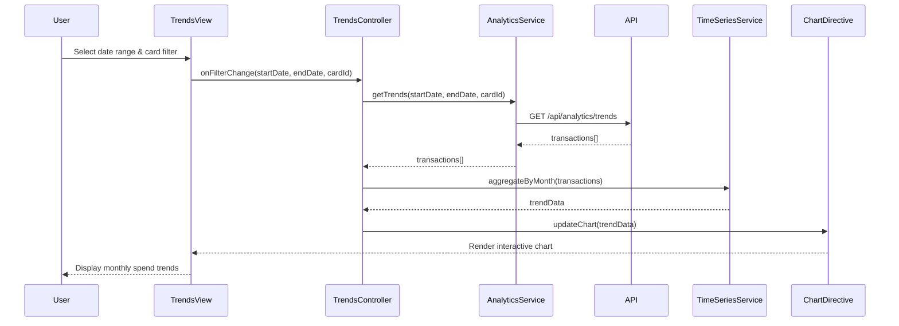

# Low-Level Design: Monthly Spend Trends and Analytics
**Epic ID:** QE-7531

## a. Architecture Mapping

- **Module:** `ccAnalysis.trends` - Main module for trends and analytics feature
- **Controller:** `TrendsController` - Manages trends view state and user interactions
- **Service:** `AnalyticsService` - Handles API calls to retrieve historical spending data
- **Service:** `TimeSeriesService` - Processes and aggregates transaction data by time periods
- **Directive:** `spendTrendChart` - Renders interactive spending trend visualizations

**Folder Structure:**
```
/app
  /modules
    /trends
      trends.module.js
      trends.controller.js
      trends.html
  /services
    analytics.service.js
    time-series.service.js
  /directives
    spend-trend-chart.directive.js
  /models
    transaction.model.js
```

## b. Component Specifications

| Component | Artifact Type | Responsibility | Key Dependencies |
|-----------|--------------|----------------|------------------|
| TrendsController | Controller | Manages trends view, handles date range selection, card filtering, and chart interactions | AnalyticsService, TimeSeriesService, $scope |
| AnalyticsService | Service | Fetches historical transaction data from REST API endpoint `/api/analytics/trends` | $http, $q |
| TimeSeriesService | Service | Aggregates transactions by month/card, calculates totals, formats data for charting | Transaction model |
| spendTrendChart | Directive | Wraps Chart.js to render line/bar charts with responsive behavior and interaction handlers | Chart.js library |
| Transaction | Model | Defines transaction data structure with date, amount, cardId, category properties | None |

## c. Data Model

**Transaction:**
```javascript
{
  id: String,
  date: Date,
  amount: Number,
  cardId: String,
  cardName: String,
  category: String,
  description: String
}
```

**TrendData:**
```javascript
{
  months: Array<String>,      // ['Jan 2024', 'Feb 2024', ...]
  datasets: Array<{
    cardId: String,
    cardName: String,
    data: Array<Number>       // Monthly spend amounts
  }>
}
```

## d. Data Flow

User selects date range and optional card filter in the trends view. TrendsController invokes AnalyticsService to fetch historical transactions via GET `/api/analytics/trends?startDate=X&endDate=Y&cardId=Z`. AnalyticsService returns raw transaction array. TimeSeriesService aggregates transactions by month and card, producing TrendData object. TrendsController passes TrendData to spendTrendChart directive, which renders interactive Chart.js visualization. User interactions (hover, click) trigger chart events handled by the directive, updating the view with detailed tooltips or drill-down data.

## e. Primary Sequence Diagram



## f. Implementation Notes

- Use AngularJS dependency injection to inject AnalyticsService and TimeSeriesService into TrendsController
- Implement AnalyticsService using $http with promise-based API calls; cache results using $cacheFactory for performance
- TimeSeriesService uses ES6 Array methods (map, reduce, filter) for efficient data aggregation
- spendTrendChart directive uses Chart.js with responsive: true and maintainAspectRatio: false for mobile compatibility
- Apply Bootstrap grid system (col-md-12, col-sm-12) for responsive layout of chart container

## g. Error Handling

HTTP interceptor captures API errors; controller displays user-friendly error messages via Bootstrap alerts; try/catch wraps data processing logic.

## h. Security Notes

Standard input validation and secure API calls assumed.