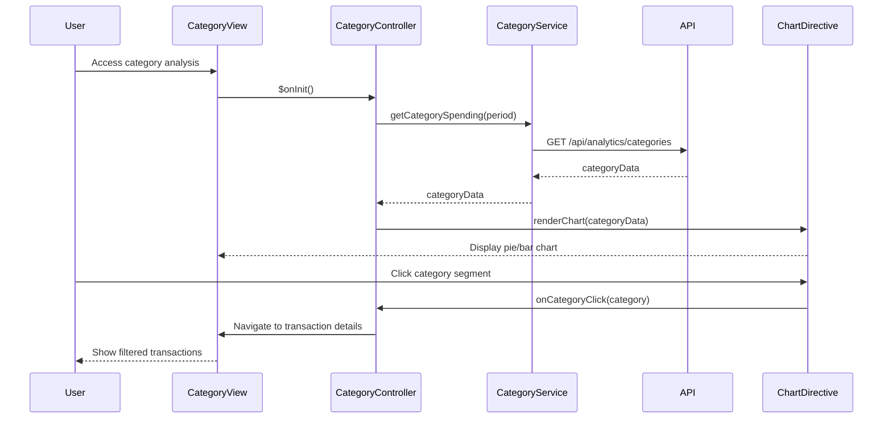

# Low-Level Design: Category-wise Spending Analysis
**Epic ID:** QE-7532

## a. Architecture Mapping

- **Module:** `ccAnalysis.categories` - Main module for category analysis feature
- **Controller:** `CategoryController` - Manages category view state and drill-down interactions
- **Service:** `CategoryService` - Fetches category-aggregated spending data from API
- **Directive:** `categoryPieChart` - Renders interactive pie/donut chart for category distribution
- **Directive:** `categoryBarChart` - Renders bar chart for category comparison

**Folder Structure:**
```
/app
  /modules
    /categories
      categories.module.js
      categories.controller.js
      categories.html
  /services
    category.service.js
  /directives
    category-pie-chart.directive.js
    category-bar-chart.directive.js
  /models
    category-spend.model.js
```

## b. Component Specifications

| Component | Artifact Type | Responsibility | Key Dependencies |
|-----------|--------------|----------------|------------------|
| CategoryController | Controller | Manages category view, handles chart type toggle, drill-down to transaction details | CategoryService, $scope, $state |
| CategoryService | Service | Fetches category-wise spending data from REST API endpoint `/api/analytics/categories` | $http, $q |
| categoryPieChart | Directive | Renders pie/donut chart using Chart.js with click handlers for drill-down | Chart.js library |
| categoryBarChart | Directive | Renders horizontal bar chart for category spending comparison | Chart.js library |
| CategorySpend | Model | Defines category spending data structure with category name, amount, transaction count | None |

## c. Data Model

**CategorySpend:**
```javascript
{
  category: String,           // 'Food & Dining', 'Fuel', etc.
  amount: Number,
  transactionCount: Number,
  percentage: Number,         // % of total spend
  color: String               // Chart color code
}
```

**CategoryData:**
```javascript
{
  categories: Array<CategorySpend>,
  totalSpend: Number,
  period: String              // 'Last 30 days', 'This month', etc.
}
```

## d. Data Flow

User accesses category analysis view. CategoryController invokes CategoryService to fetch category spending data via GET `/api/analytics/categories?period=30days`. CategoryService returns CategoryData object with pre-aggregated category totals and percentages. Controller passes data to categoryPieChart or categoryBarChart directive based on user's chart type selection. Directive renders interactive visualization. When user clicks a category segment, directive emits event to controller, which navigates to transaction detail view filtered by selected category using $state.go('transactions', {category: selectedCategory}).

## e. Primary Sequence Diagram



## f. Implementation Notes

- Use AngularJS $state service for navigation to transaction detail view with category filter parameter
- CategoryService implements caching using $cacheFactory to avoid redundant API calls on view re-entry
- Chart directives use isolated scope with two-way binding for data and callback functions for click events
- Apply ES6 template literals for dynamic API endpoint construction with query parameters
- Use Bootstrap responsive utilities (hidden-xs, visible-md) to toggle between pie and bar charts on mobile vs desktop

## g. Error Handling

HTTP interceptor-based error handling with user notification via Bootstrap toast/alert components.

## h. Security Notes

Standard input validation and secure API calls assumed.