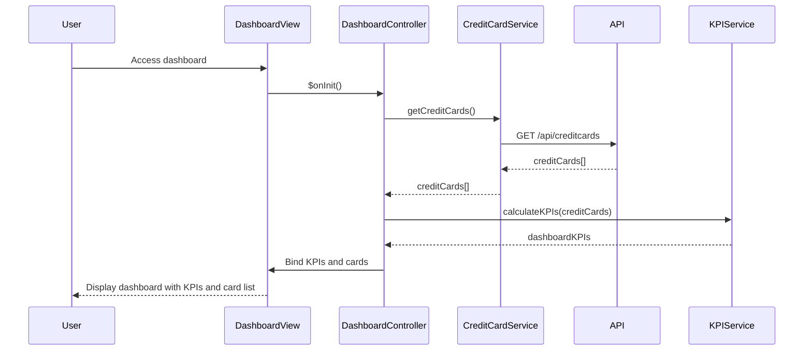

# Low-Level Design: Dashboard KPIs and Credit Card Overview
**Epic ID:** QE-7533

## a. Architecture Mapping

- **Module:** `ccAnalysis.dashboard` - Main module for dashboard feature
- **Controller:** `DashboardController` - Manages dashboard state and KPI data refresh
- **Service:** `CreditCardService` - Fetches credit card details and balances from API
- **Service:** `KPIService` - Aggregates and calculates KPI metrics (total limit, available credit, etc.)
- **Directive:** `kpiCard` - Reusable component for displaying individual KPI metrics

**Folder Structure:**
```
/app
  /modules
    /dashboard
      dashboard.module.js
      dashboard.controller.js
      dashboard.html
  /services
    credit-card.service.js
    kpi.service.js
  /directives
    kpi-card.directive.js
  /models
    credit-card.model.js
```

## b. Component Specifications

| Component | Artifact Type | Responsibility | Key Dependencies |
|-----------|--------------|----------------|------------------|
| DashboardController | Controller | Initializes dashboard, loads credit card data, calculates KPIs, handles refresh | CreditCardService, KPIService, $scope, $interval |
| CreditCardService | Service | Fetches credit card list and details from REST API endpoint `/api/creditcards` | $http, $q |
| KPIService | Service | Aggregates card data to calculate total credit limit, available credit, outstanding amount, monthly spend | CreditCard model |
| kpiCard | Directive | Displays single KPI with icon, label, value, and optional trend indicator | None |
| CreditCard | Model | Defines credit card data structure with cardId, cardName, limit, outstanding, available | None |

## c. Data Model

**CreditCard:**
```javascript
{
  cardId: String,
  cardName: String,
  cardNumber: String,         // Masked: **** **** **** 1234
  creditLimit: Number,
  outstandingAmount: Number,
  availableCredit: Number,
  monthlySpend: Number,
  status: String              // 'Active', 'Blocked', etc.
}
```

**DashboardKPIs:**
```javascript
{
  totalCreditLimit: Number,
  totalAvailableCredit: Number,
  totalOutstanding: Number,
  monthlySpend: Number,
  cardCount: Number
}
```

## d. Data Flow

User accesses dashboard. DashboardController invokes CreditCardService to fetch all credit cards via GET `/api/creditcards`. Service returns array of CreditCard objects. Controller passes card array to KPIService, which aggregates data to calculate DashboardKPIs (sum of limits, available credit, outstanding amounts, monthly spend). Controller binds KPIs and card list to view. kpiCard directives render individual KPI metrics with currency formatting. Controller sets up $interval to auto-refresh data every 5 minutes, re-invoking CreditCardService and recalculating KPIs.

## e. Primary Sequence Diagram



## f. Implementation Notes

- Use AngularJS $interval service for periodic data refresh; cancel interval on $scope.$onDestroy to prevent memory leaks
- CreditCardService uses $http with promise chaining; implement retry logic for transient API failures using $timeout
- KPIService uses ES6 reduce method for efficient aggregation of card data arrays
- kpiCard directive uses isolated scope with @ binding for label and = binding for value; apply AngularJS currency filter for formatting
- Apply Bootstrap grid (col-md-3, col-sm-6, col-xs-12) for responsive KPI card layout

## g. Error Handling

HTTP interceptor captures API errors; controller displays Bootstrap alert with retry button; try/catch in KPIService for calculation errors.

## h. Security Notes

Requires token-based auth via existing SSO; card numbers are masked on backend before API response.