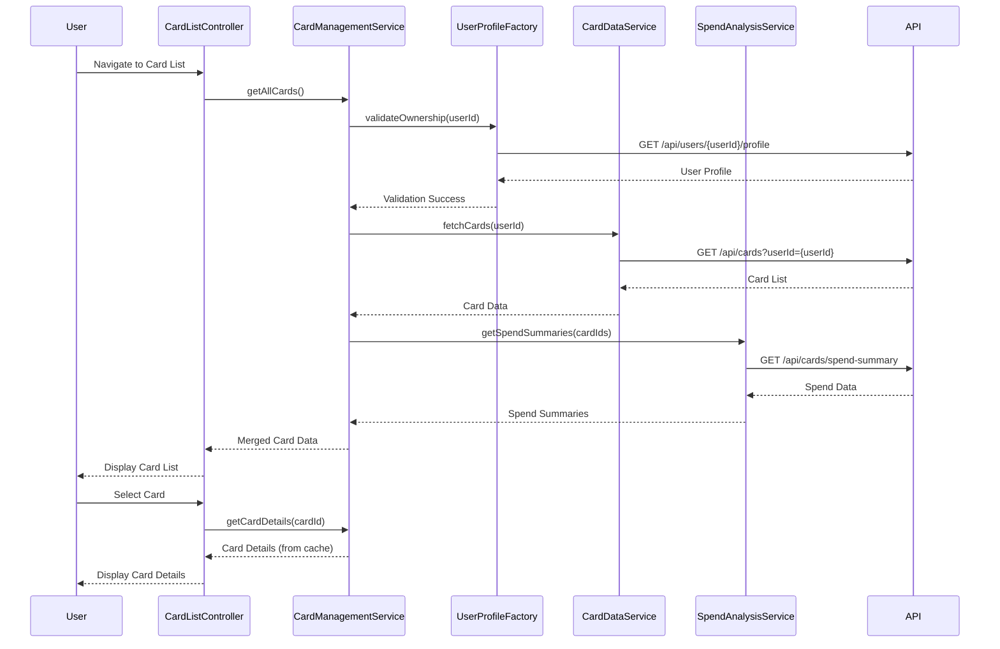

# Low-Level Design: QE-7546 - Multiple Credit Card Management

## a. Architecture Mapping

- **User Interface (Card List View)** → AngularJS Module: `creditCardModule`, Controller: `CardListController`, Directive: `cardTileDirective`
- **Card Management Service** → AngularJS Service: `CardManagementService` (handles CRUD operations and card state)
- **User Profile Service Integration** → AngularJS Factory: `UserProfileFactory` (validates card ownership via REST API)
- **Card Data Repository** → AngularJS Service: `CardDataService` (REST API wrapper for card persistence)
- **Spend Analysis Module** → AngularJS Service: `SpendAnalysisService` (aggregates and calculates card-wise spending)

**Recommended Folder Structure:**
```
app/
├── modules/
│   └── creditCard/
│       ├── controllers/
│       ├── services/
│       ├── directives/
│       ├── factories/
│       └── views/
├── shared/
│   └── services/
└── assets/
```

## b. Component Specifications

| Name | Artifact Type | Responsibility | Key Dependencies |
|------|---------------|----------------|------------------|
| creditCardModule | Module | Root module for credit card management features | ngRoute, ngResource |
| CardListController | Controller | Manages card list display, selection, and comparison logic | CardManagementService, SpendAnalysisService |
| CardDetailController | Controller | Handles individual card view and card-specific operations | CardManagementService, CardDataService |
| CardManagementService | Service | Orchestrates card CRUD operations, caching, and state management | CardDataService, UserProfileFactory, $q |
| CardDataService | Service | REST API client for card data persistence and retrieval | $http, API_ENDPOINTS |
| UserProfileFactory | Factory | Validates card ownership and retrieves user profile data | $http, $cacheFactory |
| SpendAnalysisService | Service | Calculates card-wise spend metrics and aggregations | CardDataService, $filter |
| cardTileDirective | Directive | Reusable card display component with card info and quick actions | None |
| cardCompareDirective | Directive | Side-by-side card comparison view with normalized metrics | $filter |

## c. Data Model

**CreditCard Object:**
```javascript
{
  cardId: String,
  userId: String,
  cardType: String,
  cardNumber: String,
  cardHolderName: String,
  creditLimit: Number,
  availableBalance: Number,
  outstandingAmount: Number,
  expiryDate: String,
  isActive: Boolean,
  lastUpdated: Date
}
```

**CardSpendSummary Object:**
```javascript
{
  cardId: String,
  monthlySpend: Number,
  utilizationRate: Number,
  transactionCount: Number,
  lastTransactionDate: Date
}
```

## d. Data Flow

User navigates to the card management view, triggering CardListController to invoke CardManagementService.getAllCards(). The service first validates ownership via UserProfileFactory, then fetches card data from CardDataService (REST GET /api/cards). Simultaneously, SpendAnalysisService retrieves spend summaries for each card. The controller merges card details with spend data, caches results, and updates the view with card tiles. User card selection triggers CardDetailController to load specific card details from cache or API, and card switching is handled client-side for instant navigation.

## e. Primary Sequence Diagram



## f. Implementation Notes

- Use AngularJS Dependency Injection for all services and controllers; register components via module.controller/service/factory pattern
- Implement client-side caching using $cacheFactory in CardManagementService to enable sub-1-second retrieval and instant card switching
- Use $http interceptors for API authentication, error handling, and loading state management
- Apply ES6 class syntax for services where appropriate; use arrow functions for promise chains to maintain lexical scope
- Implement card comparison using $filter for data normalization and custom directive with isolated scope for reusability

## g. Error Handling

HTTP interceptor-based error handling with user-friendly notifications via toastr; service-level try/catch for data transformation errors with fallback to cached data.

## h. Security Notes

Requires token-based auth via existing SSO; card numbers displayed with masking (last 4 digits only); API calls secured with JWT in Authorization header.