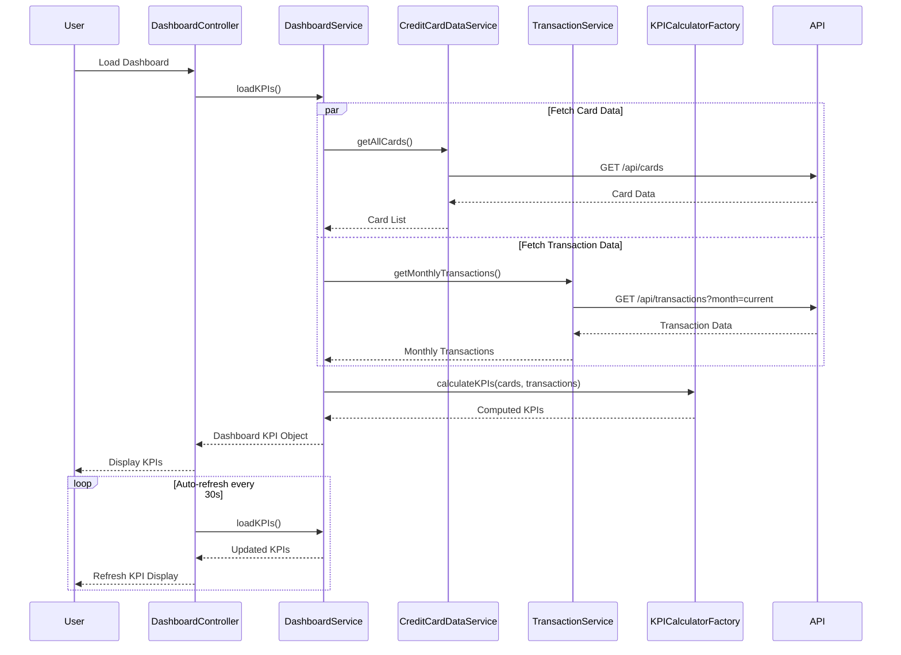

# Low-Level Design: QE-7547 - Credit Card Dashboard and KPI Monitoring

## a. Architecture Mapping

- **User Interface (Dashboard View)** → AngularJS Module: `dashboardModule`, Controller: `DashboardController`, Directive: `kpiCardDirective`
- **Dashboard Service** → AngularJS Service: `DashboardService` (orchestrates KPI aggregation and real-time updates)
- **Credit Card Data Service** → AngularJS Service: `CreditCardDataService` (REST API client for card data)
- **Transaction Service** → AngularJS Service: `TransactionService` (fetches and processes transaction data)
- **KPI Calculation Engine** → AngularJS Factory: `KPICalculatorFactory` (computes KPI metrics from raw data)

**Recommended Folder Structure:**
```
app/
├── modules/
│   └── dashboard/
│       ├── controllers/
│       ├── services/
│       ├── directives/
│       └── views/
├── shared/
│   ├── services/
│   └── factories/
└── assets/
```

## b. Component Specifications

| Name | Artifact Type | Responsibility | Key Dependencies |
|------|---------------|----------------|------------------|
| dashboardModule | Module | Root module for dashboard and KPI monitoring | ngRoute, ngAnimate |
| DashboardController | Controller | Manages dashboard state, KPI display, and real-time refresh logic | DashboardService, $interval |
| DashboardService | Service | Orchestrates data fetching from multiple services and aggregates KPIs | CreditCardDataService, TransactionService, KPICalculatorFactory, $q |
| CreditCardDataService | Service | REST API wrapper for retrieving card information and balances | $http, API_ENDPOINTS |
| TransactionService | Service | Fetches and filters transaction data for monthly spend calculations | $http, $filter |
| KPICalculatorFactory | Factory | Performs KPI calculations (total credit, available credit, utilization, outstanding) | None |
| kpiCardDirective | Directive | Reusable KPI display component with icon, label, value, and trend indicator | $filter |
| dashboardRefreshDirective | Directive | Handles auto-refresh timer and manual refresh trigger | $interval |

## c. Data Model

**DashboardKPI Object:**
```javascript
{
  monthlySpend: Number,
  totalCreditLimit: Number,
  availableCredit: Number,
  outstandingAmount: Number,
  creditUtilization: Number,
  lastUpdated: Date
}
```

**CardSummary Object:**
```javascript
{
  cardId: String,
  creditLimit: Number,
  availableBalance: Number,
  outstandingAmount: Number
}
```

**MonthlySpendData Object:**
```javascript
{
  currentMonth: Number,
  previousMonth: Number,
  percentageChange: Number
}
```

## d. Data Flow

User lands on the dashboard, triggering DashboardController to call DashboardService.loadKPIs(). The service concurrently invokes CreditCardDataService.getAllCards() (REST GET /api/cards) and TransactionService.getMonthlyTransactions() (REST GET /api/transactions?month=current). KPICalculatorFactory processes the raw data to compute aggregated KPIs (total credit limit, available credit, outstanding amount, monthly spend). The controller receives the computed KPIs, updates the view via two-way binding, and initiates a $interval-based auto-refresh every 30 seconds to poll for updated data and re-render KPI cards.

## e. Primary Sequence Diagram



## f. Implementation Notes

- Use $q.all() in DashboardService to parallelize API calls to CreditCardDataService and TransactionService for sub-2-second load time
- Implement real-time refresh using $interval service with configurable refresh rate (default 30 seconds); destroy interval on scope $destroy event
- Apply responsive design using Bootstrap grid system and custom CSS media queries for desktop/tablet/mobile breakpoints
- Use AngularJS $filter service for currency formatting and number precision in KPI display
- Implement stateless service design with no shared mutable state to support concurrent users without performance degradation

## g. Error Handling

HTTP interceptor captures API errors and displays user notifications; service-level try/catch with graceful degradation (show last known KPI values if refresh fails).

## h. Security Notes

Requires token-based auth via existing SSO; all API endpoints secured with JWT validation; sensitive financial data transmitted over HTTPS only.