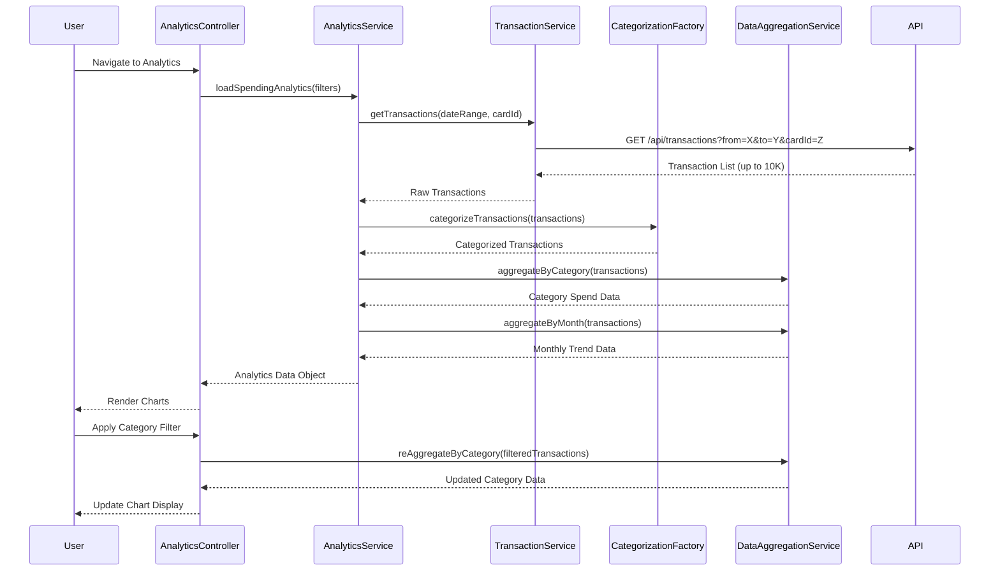

# Low-Level Design: QE-7548 - Spending Analytics and Visualization

## a. Architecture Mapping

- **User Interface (Analytics View)** → AngularJS Module: `analyticsModule`, Controller: `AnalyticsController`, Directive: `categoryChartDirective`
- **Analytics Service** → AngularJS Service: `AnalyticsService` (orchestrates data aggregation and chart data preparation)
- **Transaction Service** → AngularJS Service: `TransactionService` (fetches raw transaction data via REST API)
- **Categorization Engine** → AngularJS Factory: `CategorizationFactory` (classifies transactions into predefined categories)
- **Data Aggregation Layer** → AngularJS Service: `DataAggregationService` (performs grouping, summing, and trend calculations)

**Recommended Folder Structure:**
```
app/
├── modules/
│   └── analytics/
│       ├── controllers/
│       ├── services/
│       ├── directives/
│       ├── factories/
│       └── views/
├── shared/
│   └── services/
└── assets/
    └── charts/
```

## b. Component Specifications

| Name | Artifact Type | Responsibility | Key Dependencies |
|------|---------------|----------------|------------------|
| analyticsModule | Module | Root module for spending analytics and visualization features | ngRoute, chart.js (via angular-chart.js) |
| AnalyticsController | Controller | Manages analytics view state, filter selections, and chart rendering | AnalyticsService, $scope, $filter |
| AnalyticsService | Service | Orchestrates transaction fetching, categorization, and aggregation | TransactionService, CategorizationFactory, DataAggregationService, $q |
| TransactionService | Service | REST API client for retrieving transaction data with date/card filters | $http, API_ENDPOINTS |
| CategorizationFactory | Factory | Applies rule-based or ML-based classification to assign categories to transactions | None |
| DataAggregationService | Service | Groups transactions by category/month, calculates totals, and prepares chart datasets | $filter |
| categoryChartDirective | Directive | Renders interactive pie/bar chart for category-wise spending using Chart.js | chart.js |
| trendChartDirective | Directive | Renders line chart for monthly spend trends with drill-down capability | chart.js |
| categoryFilterDirective | Directive | Multi-select filter for category selection with apply/reset actions | None |

## c. Data Model

**Transaction Object:**
```javascript
{
  transactionId: String,
  cardId: String,
  amount: Number,
  merchantName: String,
  transactionDate: Date,
  category: String,
  description: String
}
```

**CategorySpendData Object:**
```javascript
{
  category: String,
  totalAmount: Number,
  transactionCount: Number,
  percentage: Number
}
```

**MonthlyTrendData Object:**
```javascript
{
  month: String,
  totalSpend: Number,
  categoryBreakdown: Array<CategorySpendData>
}
```

**Predefined Categories:**
```javascript
['Food & Dining', 'Fuel', 'Shopping', 'Travel', 'Entertainment', 'Utilities', 'Healthcare', 'Education', 'Miscellaneous']
```

## d. Data Flow

User navigates to the analytics view, triggering AnalyticsController to invoke AnalyticsService.loadSpendingAnalytics(). The service calls TransactionService.getTransactions() (REST GET /api/transactions) to fetch raw transaction data. CategorizationFactory processes each transaction to assign or validate its category, with uncategorized transactions defaulting to "Miscellaneous". DataAggregationService groups transactions by category and month, calculates totals with 2-decimal precision, and prepares chart-ready datasets. The controller receives the aggregated data, binds it to the scope, and directives (categoryChartDirective, trendChartDirective) render interactive Chart.js visualizations. User interactions (category filter, drill-down) trigger controller methods to re-aggregate and update charts without additional API calls.

## e. Primary Sequence Diagram



## f. Implementation Notes

- Integrate angular-chart.js (AngularJS wrapper for Chart.js) for declarative chart rendering with two-way data binding
- Use $filter service for date formatting, currency display, and number rounding to 2 decimal places in aggregation logic
- Implement client-side caching of raw transaction data to enable instant filter/drill-down operations without re-fetching from API
- Apply ES6 Array methods (map, filter, reduce) in DataAggregationService for efficient transaction processing up to 10K records
- Use AngularJS $watch on filter selections to trigger reactive chart updates; debounce filter changes to avoid excessive re-rendering

## g. Error Handling

HTTP interceptor-based error handling for API failures; service-level try/catch for categorization/aggregation errors with fallback to "Miscellaneous" category and user notification.

## h. Security Notes

Requires token-based auth via existing SSO; transaction data filtered by authenticated user's cardId on backend; sensitive merchant data sanitized before display.