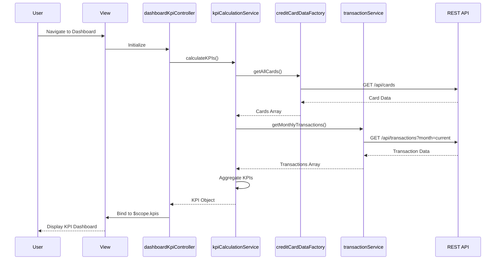

# Low-Level Design: QE-7549 - Dashboard KPIs and Financial Overview

## a. Architecture Mapping

- **Dashboard UI** → AngularJS View Template (HTML5 + Bootstrap responsive grid)
- **Dashboard Controller** → AngularJS Controller (`dashboardKpiController`)
- **KPI Calculation Engine** → AngularJS Service (`kpiCalculationService`)
- **Credit Card Data Service** → AngularJS Factory (`creditCardDataFactory`)
- **Transaction Service** → AngularJS Service (`transactionService`)
- **Main Module** → AngularJS Module (`creditCardDashboardApp`)

**Recommended Folder Structure:**
```
app/
├── modules/
│   └── dashboard/
│       ├── controllers/dashboardKpiController.js
│       ├── services/kpiCalculationService.js
│       ├── views/dashboard-kpi.html
├── shared/
│   ├── factories/creditCardDataFactory.js
│   ├── services/transactionService.js
├── assets/css/
└── app.module.js
```

## b. Component Specifications

| Component Name | Artifact Type | Responsibility | Key Dependencies |
|---|---|---|---|
| dashboardKpiController | Controller | Orchestrates KPI data retrieval and binds to view scope | kpiCalculationService, $scope |
| kpiCalculationService | Service | Computes monthly spend, total credit limit, available credit, outstanding amount | creditCardDataFactory, transactionService |
| creditCardDataFactory | Factory | Fetches credit card details and balances via REST API | $http, $q |
| transactionService | Service | Retrieves monthly transaction data via REST API | $http |
| dashboardKpiView | View | Displays KPI cards with responsive Bootstrap layout | dashboardKpiController |
| dashboardModule | Module | Encapsulates dashboard feature components | angular.module |

## c. Data Model

**CreditCard Object:**
```javascript
{
  cardId: String,
  cardNumber: String,
  cardHolderName: String,
  creditLimit: Number,
  outstandingAmount: Number,
  availableCredit: Number,
  bankName: String,
  cardType: String
}
```

**KPI Object:**
```javascript
{
  monthlySpend: Number,
  totalCreditLimit: Number,
  totalAvailableCredit: Number,
  totalOutstanding: Number,
  lastUpdated: Date
}
```

**Transaction Object:**
```javascript
{
  transactionId: String,
  cardId: String,
  amount: Number,
  transactionDate: Date,
  category: String
}
```

## d. Data Flow

User navigates to the dashboard → View loads and invokes `dashboardKpiController` → Controller calls `kpiCalculationService.calculateKPIs()` → Service fetches all credit cards via `creditCardDataFactory.getAllCards()` and monthly transactions via `transactionService.getMonthlyTransactions()` → REST API calls return card and transaction data → Service aggregates total credit limit, outstanding amounts, available credit, and monthly spend → Computed KPIs are returned to controller → Controller binds KPI data to `$scope` → View renders KPI cards with Bootstrap responsive layout showing monthly spend, total credit limit, available credit, and outstanding amount.

## e. Primary Sequence Diagram



## f. Implementation Notes

- Use AngularJS Dependency Injection to inject services and factories into controllers; follow single responsibility principle for each artifact.
- Implement ES6 classes for services and factories; use arrow functions for callbacks and promise chains.
- Use `$http` service for REST API calls with promise-based error handling; implement response interceptors for global error handling.
- Apply Bootstrap grid system (col-md-3 for KPI cards) for responsive layout; use ng-repeat for dynamic card rendering if needed.
- Cache KPI calculations in service for 5 minutes using `$cacheFactory` to meet 2-second load time requirement; implement manual refresh trigger.

## g. Error Handling

HTTP interceptor captures API errors and displays user-friendly notifications via a global alert service; controller-level try/catch for calculation errors.

## h. Security Notes

Requires token-based authentication via existing SSO; API calls include Authorization header with JWT token.