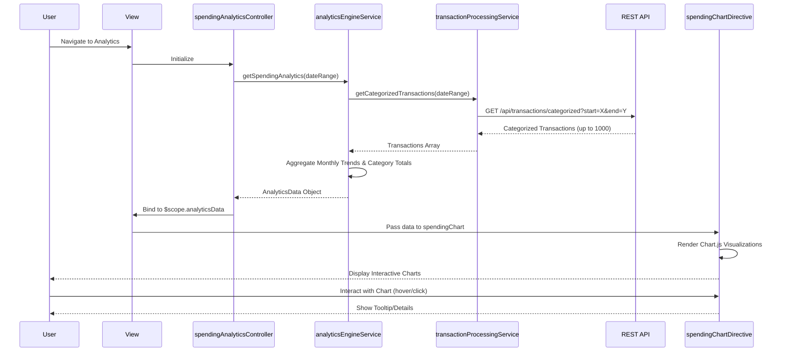

# Low-Level Design: QE-7550 - Spending Analytics and Visualization

## a. Architecture Mapping

- **Analytics UI** → AngularJS View Template (HTML5 + Bootstrap + Chart.js/D3.js integration)
- **Analytics Controller** → AngularJS Controller (`spendingAnalyticsController`)
- **Analytics Engine** → AngularJS Service (`analyticsEngineService`)
- **Transaction Processing Service** → AngularJS Service (`transactionProcessingService`)
- **Visualization Renderer** → AngularJS Directive (`spendingChart`)
- **Main Module** → AngularJS Module (`creditCardDashboardApp.analytics`)

**Recommended Folder Structure:**
```
app/
├── modules/
│   └── analytics/
│       ├── controllers/spendingAnalyticsController.js
│       ├── services/analyticsEngineService.js
│       ├── services/transactionProcessingService.js
│       ├── directives/spendingChartDirective.js
│       ├── views/spending-analytics.html
├── assets/
│   ├── css/analytics.css
│   └── js/libs/chart.min.js
└── app.module.js
```

## b. Component Specifications

| Component Name | Artifact Type | Responsibility | Key Dependencies |
|---|---|---|---|
| spendingAnalyticsController | Controller | Orchestrates analytics data retrieval and manages view state | analyticsEngineService, $scope |
| analyticsEngineService | Service | Computes monthly trends and category-wise spending aggregates | transactionProcessingService, $q |
| transactionProcessingService | Service | Fetches categorized transaction data from REST API | $http |
| spendingChartDirective | Directive | Renders interactive charts using Chart.js or D3.js library | None (isolated scope) |
| analyticsView | View | Displays trend charts and category breakdown with filters | spendingAnalyticsController |
| analyticsModule | Module | Encapsulates analytics feature components | angular.module |

## c. Data Model

**CategorizedTransaction Object:**
```javascript
{
  transactionId: String,
  cardId: String,
  amount: Number,
  transactionDate: Date,
  category: String, // Food & Dining, Fuel, Shopping, Travel, Entertainment, Utilities, Healthcare, Education, Miscellaneous
  merchantName: String
}
```

**MonthlyTrend Object:**
```javascript
{
  month: String,
  year: Number,
  totalSpend: Number
}
```

**CategorySpend Object:**
```javascript
{
  category: String,
  totalAmount: Number,
  transactionCount: Number,
  percentage: Number
}
```

**AnalyticsData Object:**
```javascript
{
  monthlyTrends: Array<MonthlyTrend>,
  categoryBreakdown: Array<CategorySpend>,
  dateRange: { startDate: Date, endDate: Date }
}
```

## d. Data Flow

User navigates to analytics view → View loads and invokes `spendingAnalyticsController` → Controller calls `analyticsEngineService.getSpendingAnalytics(dateRange)` → Service fetches categorized transactions via `transactionProcessingService.getCategorizedTransactions(dateRange)` → REST API returns transaction array (up to 1000 records) → Service aggregates data into monthly trends and category-wise totals using ES6 array methods (reduce, map) → Computed analytics object is returned to controller → Controller binds data to `$scope.analyticsData` → View invokes `spendingChart` directive with bound data → Directive renders interactive Chart.js visualizations (line chart for trends, pie/bar chart for categories) → User interacts with charts to explore spending patterns.

## e. Primary Sequence Diagram



## f. Implementation Notes

- Use AngularJS directive with isolated scope for chart rendering; pass analytics data via two-way binding and configure Chart.js options in directive link function.
- Implement ES6 array methods (reduce, filter, map) in `analyticsEngineService` for efficient aggregation of 1000 transactions within 3-second constraint.
- Use `$http` with promise chaining for REST API calls; implement caching strategy using `$cacheFactory` for repeated date range queries.
- Apply responsive Bootstrap grid for chart containers; use Chart.js responsive configuration to adapt to mobile/tablet/desktop viewports.
- Implement date range picker (e.g., angular-daterangepicker) for user-driven filtering; default to last 12 months on initial load.

## g. Error Handling

HTTP interceptor handles API failures with user notification; controller catches aggregation errors and displays fallback message if data processing exceeds timeout.

## h. Security Notes

Standard input validation and secure API calls assumed; transaction data filtered by authenticated user's card ownership.