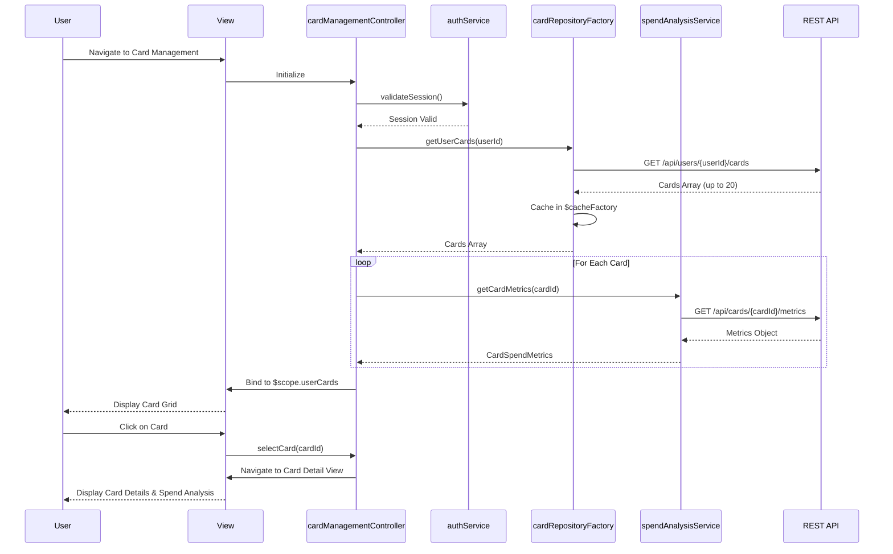

# Low-Level Design: QE-7551 - Multiple Credit Card Management

## a. Architecture Mapping

- **Card Management UI** → AngularJS View Template (HTML5 + Bootstrap card layout)
- **Card Management Controller** → AngularJS Controller (`cardManagementController`)
- **User Authentication Service** → AngularJS Service (`authService`)
- **Card Data Repository** → AngularJS Factory (`cardRepositoryFactory`)
- **Spend Analysis Engine** → AngularJS Service (`spendAnalysisService`)
- **Main Module** → AngularJS Module (`creditCardDashboardApp.cards`)

**Recommended Folder Structure:**
```
app/
├── modules/
│   └── cards/
│       ├── controllers/cardManagementController.js
│       ├── services/spendAnalysisService.js
│       ├── views/card-management.html
│       ├── views/card-detail.html
├── shared/
│   ├── services/authService.js
│   ├── factories/cardRepositoryFactory.js
├── assets/css/
└── app.module.js
```

## b. Component Specifications

| Component Name | Artifact Type | Responsibility | Key Dependencies |
|---|---|---|---|
| cardManagementController | Controller | Manages multi-card display, selection, and switching logic | cardRepositoryFactory, spendAnalysisService, $scope |
| authService | Service | Validates user session and card ownership | $http, $window (for session storage) |
| cardRepositoryFactory | Factory | Fetches and caches user's credit card data via REST API | $http, $q, $cacheFactory |
| spendAnalysisService | Service | Computes card-specific spend metrics and trends | $http |
| cardManagementView | View | Displays card list with individual metrics using Bootstrap cards | cardManagementController |
| cardDetailView | View | Shows detailed view for selected card with spend breakdown | cardManagementController |
| cardsModule | Module | Encapsulates card management feature components | angular.module |

## c. Data Model

**CreditCard Object:**
```javascript
{
  cardId: String,
  cardNumber: String,
  cardHolderName: String,
  creditLimit: Number,
  outstandingAmount: Number,
  availableCredit: Number,
  bankName: String,
  cardType: String,
  expiryDate: String,
  isActive: Boolean
}
```

**CardSpendMetrics Object:**
```javascript
{
  cardId: String,
  currentMonthSpend: Number,
  lastMonthSpend: Number,
  averageMonthlySpend: Number,
  topCategory: String,
  transactionCount: Number
}
```

**UserCardPortfolio Object:**
```javascript
{
  userId: String,
  cards: Array<CreditCard>,
  selectedCardId: String,
  totalCards: Number
}
```

## d. Data Flow

User logs in and navigates to card management view → View loads and invokes `cardManagementController` → Controller calls `authService.validateSession()` to verify user authentication → Controller fetches all user cards via `cardRepositoryFactory.getUserCards()` → REST API returns card array (up to 20 cards) → Factory caches card data in session for 1-second retrieval on subsequent requests → Controller iterates through cards and calls `spendAnalysisService.getCardMetrics(cardId)` for each card → Service returns spend metrics → Controller binds card portfolio and metrics to `$scope.userCards` → View renders Bootstrap card grid with individual card details and metrics → User clicks on a card to view details → Controller updates `$scope.selectedCard` and navigates to card detail view → Detail view displays card-specific spend analysis and transaction history.

## e. Primary Sequence Diagram



## f. Implementation Notes

- Use AngularJS `$cacheFactory` in `cardRepositoryFactory` to cache card data for session duration; ensure sub-second retrieval for repeated requests.
- Implement ES6 Promise.all() to fetch card metrics in parallel for all cards; optimize to meet performance requirement for 20+ cards.
- Use `$http` service with interceptors for REST API calls; include JWT token from `authService` in Authorization header for all requests.
- Apply Bootstrap card component with responsive grid (col-md-4 for desktop, col-sm-6 for tablet, col-xs-12 for mobile) for card list layout.
- Implement card selection state management in controller using `$scope.selectedCardId`; use ng-class for visual highlighting of selected card.

## g. Error Handling

HTTP interceptor handles API errors with user-friendly notifications; session validation failures redirect to login page via $state or $location service.

## h. Security Notes

Requires token-based auth via existing SSO; card ownership validated once per session and enforced via API-level authorization checks.