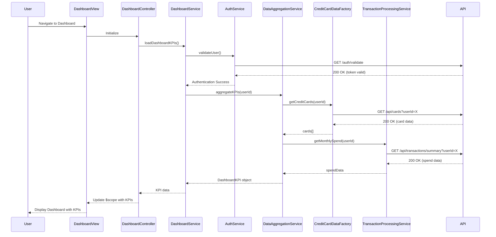

# Low-Level Design: QE-7552 - Dashboard KPIs and Credit Card Overview

## a. Architecture Mapping

**HLD Component → AngularJS Artifact Mapping:**
- User Interface → Module: `creditCardDashboard`, Controller: `DashboardController`, View: `dashboard.html`
- Dashboard Service → Service: `DashboardService` (handles business logic and orchestration)
- Credit Card Data Service → Factory: `CreditCardDataFactory` (REST API integration for card data)
- Transaction Processing System → Service: `TransactionProcessingService` (spend and outstanding calculations)
- User Authentication Service → Service: `AuthService` (authentication and session management)
- Data Aggregation Engine → Service: `DataAggregationService` (aggregates KPIs from multiple sources)

**Recommended Folder Structure:**
```
app/
├── modules/
│   └── dashboard/
│       ├── controllers/
│       │   └── DashboardController.js
│       ├── services/
│       │   ├── DashboardService.js
│       │   ├── DataAggregationService.js
│       │   └── TransactionProcessingService.js
│       ├── factories/
│       │   └── CreditCardDataFactory.js
│       ├── views/
│       │   └── dashboard.html
│       └── dashboard.module.js
├── shared/
│   └── services/
│       └── AuthService.js
└── assets/
    ├── css/
    └── js/
```

## b. Component Specifications

| Component Name | Artifact Type | Responsibility | Key Dependencies |
|----------------|---------------|----------------|------------------|
| creditCardDashboard | Module | Main module registration and dependency injection setup | ngRoute, ngResource |
| DashboardController | Controller | Manages dashboard view state, binds KPI data to UI, handles user interactions | DashboardService, $scope |
| DashboardService | Service | Orchestrates data retrieval and aggregation for dashboard KPIs | DataAggregationService, AuthService |
| CreditCardDataFactory | Factory | REST API calls to retrieve credit card details (limits, balances) | $resource or $http |
| TransactionProcessingService | Service | Calculates monthly spend and outstanding amounts from transaction data | $http |
| DataAggregationService | Service | Aggregates data from multiple sources into consolidated KPI model | CreditCardDataFactory, TransactionProcessingService |
| AuthService | Service | Validates user authentication and manages session tokens | $http, $window |

## c. Data Model

**CreditCard Object:**
```javascript
{
  cardId: String,
  cardNumber: String,
  cardType: String,
  creditLimit: Number,
  availableCredit: Number,
  outstandingAmount: Number,
  monthlySpend: Number
}
```

**DashboardKPI Object:**
```javascript
{
  totalCreditLimit: Number,
  totalAvailableCredit: Number,
  totalOutstanding: Number,
  totalMonthlySpend: Number,
  cards: Array<CreditCard>
}
```

## d. Data Flow

User navigates to the dashboard view, triggering DashboardController initialization. The controller invokes DashboardService, which first authenticates the user via AuthService. Upon successful authentication, DataAggregationService fetches credit card details from CreditCardDataFactory (REST API call) and transaction data from TransactionProcessingService. The aggregation service computes consolidated KPIs (total credit limit, available credit, outstanding, monthly spend) and returns a DashboardKPI object. DashboardController binds this data to $scope, and the view (dashboard.html) renders KPIs using Bootstrap cards and AngularJS data binding, updating the UI within 2 seconds.

## e. Primary Sequence Diagram



## f. Implementation Notes

- Use AngularJS 1.x module pattern with dependency injection for all services, factories, and controllers
- Leverage $resource or $http for REST API integration; configure base URL via app constants
- Implement responsive UI using Bootstrap grid system (col-xs, col-sm, col-md) for mobile/tablet/desktop support
- Use $q promises for asynchronous data aggregation and chaining API calls
- Apply AngularJS filters (currency, number) in views for formatting KPI values

## g. Error Handling

HTTP interceptor-based error handling with user-friendly notifications via Angular toaster or alert service for API failures.

## h. Security Notes

Requires token-based authentication via existing SSO; all API calls include Authorization header with JWT token.