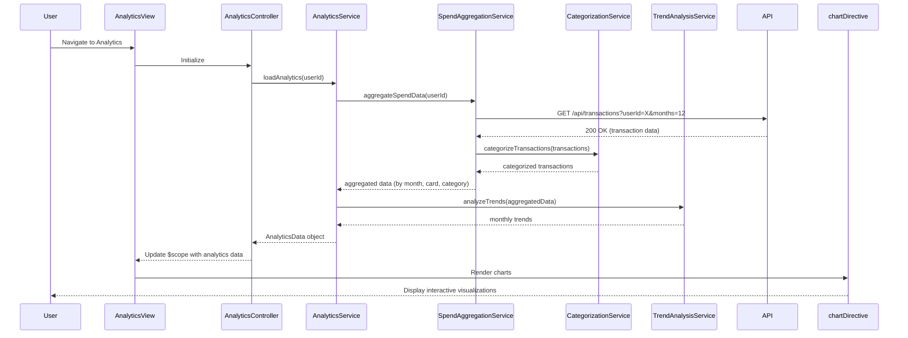

# Low-Level Design: QE-7553 - Spending Analytics and Insights

## a. Architecture Mapping

**HLD Component → AngularJS Artifact Mapping:**
- User Interface → Module: `spendingAnalytics`, Controller: `AnalyticsController`, View: `analytics.html`
- Analytics Service → Service: `AnalyticsService` (orchestrates analytics data retrieval and processing)
- Transaction Categorization Engine → Service: `CategorizationService` (assigns categories to transactions)
- Data Aggregation Service → Service: `SpendAggregationService` (aggregates spend by month, card, category)
- Visualization Library → Directive: `chartDirective` (wraps Chart.js or D3.js for rendering)
- Analytics Processing Engine → Service: `TrendAnalysisService` (computes trends and patterns)

**Recommended Folder Structure:**
```
app/
├── modules/
│   └── analytics/
│       ├── controllers/
│       │   └── AnalyticsController.js
│       ├── services/
│       │   ├── AnalyticsService.js
│       │   ├── CategorizationService.js
│       │   ├── SpendAggregationService.js
│       │   └── TrendAnalysisService.js
│       ├── directives/
│       │   └── chartDirective.js
│       ├── views/
│       │   └── analytics.html
│       └── analytics.module.js
└── assets/
    └── libs/
        └── chart.js
```

## b. Component Specifications

| Component Name | Artifact Type | Responsibility | Key Dependencies |
|----------------|---------------|----------------|------------------|
| spendingAnalytics | Module | Main module registration for analytics feature | ngRoute, chart.js |
| AnalyticsController | Controller | Manages analytics view state, binds chart data to UI, handles filter interactions | AnalyticsService, $scope |
| AnalyticsService | Service | Orchestrates data retrieval for analytics (monthly trends, card-wise, category-wise) | SpendAggregationService, TrendAnalysisService |
| CategorizationService | Service | Categorizes transactions into predefined categories (Food, Fuel, Shopping, etc.) | $http |
| SpendAggregationService | Service | Aggregates transaction data by month, card, and category for visualization | $http, CategorizationService |
| TrendAnalysisService | Service | Computes monthly spend trends and identifies spending patterns | SpendAggregationService |
| chartDirective | Directive | Renders interactive charts (bar, line, pie) using Chart.js library | Chart.js |

## c. Data Model

**CategorySpend Object:**
```javascript
{
  category: String,
  amount: Number,
  percentage: Number
}
```

**MonthlyTrend Object:**
```javascript
{
  month: String,
  totalSpend: Number,
  cardBreakdown: Array<{cardId: String, spend: Number}>
}
```

**AnalyticsData Object:**
```javascript
{
  monthlyTrends: Array<MonthlyTrend>,
  categoryWiseSpend: Array<CategorySpend>,
  cardWiseSpend: Array<{cardId: String, cardName: String, totalSpend: Number}>,
  historicalMonths: Number
}
```

## d. Data Flow

User navigates to the analytics view, triggering AnalyticsController initialization. The controller calls AnalyticsService to load analytics data. AnalyticsService invokes SpendAggregationService, which retrieves transaction data via REST API and uses CategorizationService to assign categories. SpendAggregationService computes aggregated spend by month, card, and category. TrendAnalysisService processes this data to identify trends over 12 months. The aggregated AnalyticsData object is returned to AnalyticsController, which binds it to $scope. The chartDirective consumes this data and renders interactive charts (bar for monthly trends, pie for category-wise, bar for card-wise) using Chart.js, updating the UI within 2 seconds.

## e. Primary Sequence Diagram



## f. Implementation Notes

- Use Chart.js library wrapped in AngularJS directive for responsive, interactive charts with drill-down capability
- Implement category mapping in CategorizationService using ES6 Map or switch-case for nine predefined categories
- Leverage $q.all for parallel API calls if fetching data from multiple endpoints
- Use AngularJS ng-repeat with filters for dynamic category and card selection in UI
- Apply lazy loading or pagination for large transaction datasets to optimize performance

## g. Error Handling

Try/catch blocks in service methods with HTTP interceptor for API errors; display user-friendly error messages via toaster.

## h. Security Notes

Standard input validation and secure API calls assumed; token-based auth via existing SSO for API access.