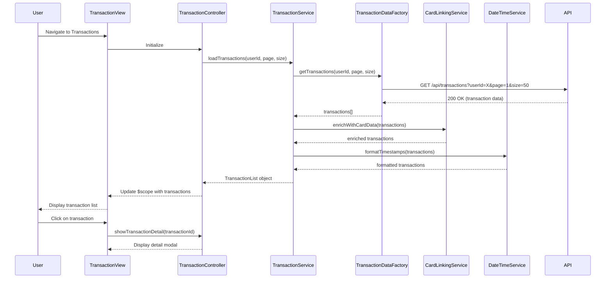

# Low-Level Design: QE-7554 - Transaction Management and Tracking

## a. Architecture Mapping

**HLD Component → AngularJS Artifact Mapping:**
- User Interface → Module: `transactionManagement`, Controller: `TransactionController`, View: `transactions.html`
- Transaction Management Service → Service: `TransactionService` (orchestrates transaction retrieval and display logic)
- Transaction Data Repository → Factory: `TransactionDataFactory` (REST API integration for transaction data)
- Credit Card Management System → Service: `CardLinkingService` (links transactions to specific credit cards)
- Date Time Service → Service: `DateTimeService` (formats and sorts transaction timestamps)

**Recommended Folder Structure:**
```
app/
├── modules/
│   └── transactions/
│       ├── controllers/
│       │   └── TransactionController.js
│       ├── services/
│       │   ├── TransactionService.js
│       │   ├── CardLinkingService.js
│       │   └── DateTimeService.js
│       ├── factories/
│       │   └── TransactionDataFactory.js
│       ├── views/
│       │   └── transactions.html
│       └── transactions.module.js
└── assets/
    └── css/
```

## b. Component Specifications

| Component Name | Artifact Type | Responsibility | Key Dependencies |
|----------------|---------------|----------------|------------------|
| transactionManagement | Module | Main module registration for transaction tracking feature | ngRoute, ngResource |
| TransactionController | Controller | Manages transaction list view, handles pagination, filtering, and detail view navigation | TransactionService, $scope |
| TransactionService | Service | Orchestrates transaction data retrieval, sorting, and filtering logic | TransactionDataFactory, CardLinkingService, DateTimeService |
| TransactionDataFactory | Factory | REST API calls to retrieve transaction records with pagination support | $resource or $http |
| CardLinkingService | Service | Links transactions to specific credit cards and retrieves card metadata | $http |
| DateTimeService | Service | Formats transaction timestamps and provides sorting utilities | moment.js or native Date |

## c. Data Model

**Transaction Object:**
```javascript
{
  transactionId: String,
  cardId: String,
  cardName: String,
  amount: Number,
  merchant: String,
  category: String,
  timestamp: Date,
  description: String
}
```

**TransactionList Object:**
```javascript
{
  transactions: Array<Transaction>,
  totalCount: Number,
  pageSize: Number,
  currentPage: Number
}
```

## d. Data Flow

User navigates to the transactions view, triggering TransactionController initialization. The controller invokes TransactionService to load transactions for the user. TransactionService calls TransactionDataFactory, which makes a paginated REST API call (GET /api/transactions?userId=X&page=1&size=50) to retrieve transaction records. CardLinkingService enriches each transaction with card metadata (card name, type). DateTimeService formats timestamps for display. The resulting TransactionList object is returned to TransactionController, which binds it to $scope. The view (transactions.html) renders the transaction list using ng-repeat with Bootstrap table styling. User can click on a transaction row to view details, triggering a controller method that displays a modal or navigates to a detail view.

## e. Primary Sequence Diagram



## f. Implementation Notes

- Implement pagination using AngularJS ng-repeat with limitTo filter or server-side pagination via API query params
- Use $resource for RESTful transaction API with support for query parameters (page, size, cardId filter)
- Apply AngularJS orderBy filter for client-side sorting by date, amount, or merchant
- Leverage Bootstrap table-responsive class for mobile-friendly transaction list display
- Use AngularJS $uibModal (UI Bootstrap) for transaction detail view in a modal overlay

## g. Error Handling

HTTP interceptor-based error handling with try/catch in service methods; display error notifications to user via toaster service.

## h. Security Notes

Requires token-based auth via existing SSO; all transaction API calls include Authorization header with JWT token.