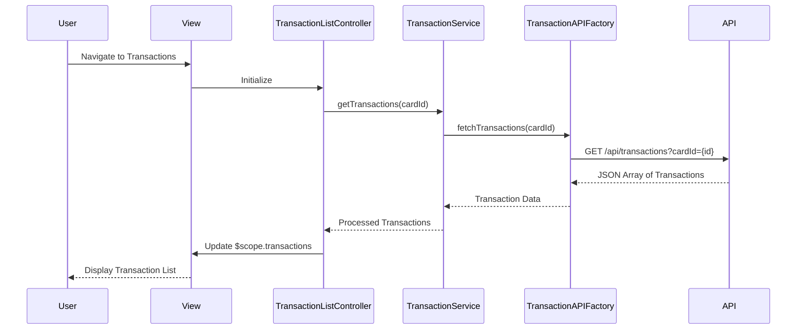

# Low-Level Design: Credit Card Transaction Management
**Epic ID:** QE-7555  
**Technology Stack:** AngularJS 1.x, JavaScript ES6, HTML5, CSS3, Bootstrap, REST APIs, MVC Architecture

---

## a. Architecture Mapping

- **Transaction List Module** → AngularJS Module (`ccTransactionModule`)
- **Transaction List Controller** → AngularJS Controller (`TransactionListController`)
- **Transaction Detail Controller** → AngularJS Controller (`TransactionDetailController`)
- **Transaction Service** → AngularJS Service (`TransactionService`)
- **Transaction API Client** → AngularJS Factory (`TransactionAPIFactory`)
- **Transaction Filter Directive** → AngularJS Directive (`transactionFilter`)

**Recommended Folder Structure:**
```
/app
  /modules
    /transactions
      /controllers
      /services
      /directives
      /views
      /models
```

---

## b. Component Specifications

| Component Name | Artifact Type | Responsibility | Key Dependencies |
|----------------|---------------|----------------|------------------|
| ccTransactionModule | Module | Root module for transaction management functionality | ngRoute, ngResource |
| TransactionListController | Controller | Manages transaction list view, filtering, pagination | TransactionService, $scope, $filter |
| TransactionDetailController | Controller | Displays individual transaction details | TransactionService, $scope, $routeParams |
| TransactionService | Service | Business logic for transaction operations and state management | TransactionAPIFactory, $q |
| TransactionAPIFactory | Factory | REST API calls to transaction data repository | $http, $resource |
| transactionFilter | Directive | Custom filter UI for date range, card, amount | None |
| Transaction | Model | Transaction data structure | None |

---

## c. Data Model

**Transaction Model:**
```javascript
{
  transactionId: String,
  cardId: String,
  cardLastFourDigits: String,
  merchantName: String,
  amount: Number,
  currency: String,
  transactionDate: Date,
  category: String,
  status: String, // 'posted', 'pending'
  description: String
}
```

**TransactionFilter Model:**
```javascript
{
  cardId: String,
  startDate: Date,
  endDate: Date,
  minAmount: Number,
  maxAmount: Number,
  category: String
}
```

---

## d. Data Flow

User navigates to transaction list view → TransactionListController initializes and calls TransactionService.getTransactions() → TransactionService invokes TransactionAPIFactory to fetch data via REST API (GET /api/transactions?cardId={id}) → API returns JSON array of transactions → Service processes and caches data → Controller updates $scope.transactions → View renders transaction list with ng-repeat → User clicks transaction row → TransactionDetailController loads and displays full transaction details from cached or fresh API call.

---

## e. Primary Sequence Diagram



---

## f. Implementation Notes

- Use AngularJS Dependency Injection for all controllers, services, and factories
- Implement pagination using $filter with limitTo and client-side or server-side paging strategy
- Leverage $resource or $http for REST API integration with promise-based error handling
- Apply Bootstrap grid system and responsive utilities for mobile/tablet/desktop layouts
- Use ng-repeat with track by transactionId for efficient DOM rendering

---

## g. Error Handling

HTTP interceptor captures API errors; user-friendly notifications displayed via toast/modal; try/catch in service layer for data processing errors.

---

## h. Security Notes

Standard input validation and secure API calls assumed; token-based authentication via existing SSO for API requests.