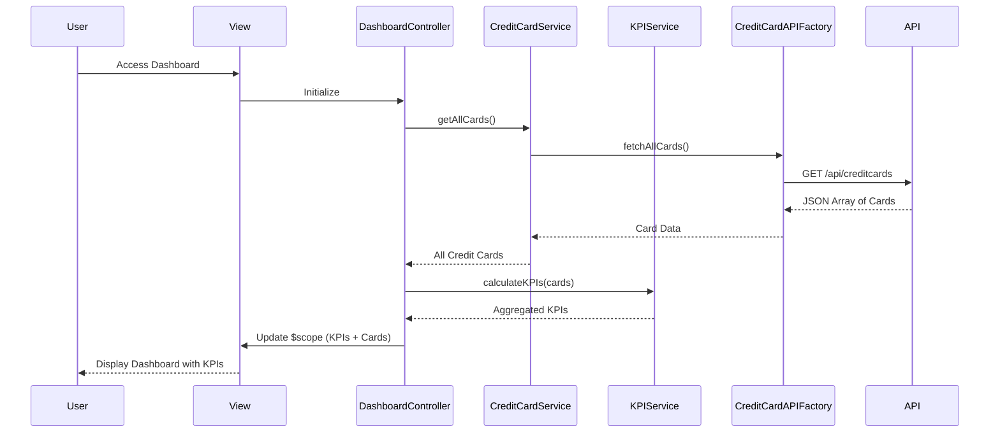

# Low-Level Design: Credit Card Dashboard and KPI Monitoring
**Epic ID:** QE-7556  
**Technology Stack:** AngularJS 1.x, JavaScript ES6, HTML5, CSS3, Bootstrap, REST APIs, MVC Architecture

---

## a. Architecture Mapping

- **Dashboard Module** → AngularJS Module (`ccDashboardModule`)
- **Dashboard Controller** → AngularJS Controller (`DashboardController`)
- **KPI Service** → AngularJS Service (`KPIService`)
- **Credit Card Service** → AngularJS Service (`CreditCardService`)
- **Credit Card API Client** → AngularJS Factory (`CreditCardAPIFactory`)
- **KPI Card Directive** → AngularJS Directive (`kpiCard`)

**Recommended Folder Structure:**
```
/app
  /modules
    /dashboard
      /controllers
      /services
      /directives
      /views
      /models
```

---

## b. Component Specifications

| Component Name | Artifact Type | Responsibility | Key Dependencies |
|----------------|---------------|----------------|------------------|
| ccDashboardModule | Module | Root module for dashboard and KPI functionality | ngRoute |
| DashboardController | Controller | Orchestrates dashboard view and KPI display | KPIService, CreditCardService, $scope |
| KPIService | Service | Aggregates and calculates KPIs from card data | CreditCardService, $q |
| CreditCardService | Service | Manages credit card data retrieval and state | CreditCardAPIFactory, $q |
| CreditCardAPIFactory | Factory | REST API calls for credit card data | $http, $resource |
| kpiCard | Directive | Reusable KPI display card component | None |
| CreditCard | Model | Credit card data structure | None |
| KPI | Model | KPI aggregated data structure | None |

---

## c. Data Model

**CreditCard Model:**
```javascript
{
  cardId: String,
  cardNumber: String, // masked
  cardType: String, // 'Visa', 'MasterCard', etc.
  cardHolderName: String,
  creditLimit: Number,
  availableCredit: Number,
  outstandingAmount: Number,
  currentMonthSpend: Number,
  expiryDate: String
}
```

**KPI Model:**
```javascript
{
  totalMonthlySpend: Number,
  totalCreditLimit: Number,
  totalAvailableCredit: Number,
  totalOutstandingAmount: Number,
  creditUtilizationPercent: Number
}
```

---

## d. Data Flow

User lands on dashboard → DashboardController initializes and calls CreditCardService.getAllCards() → CreditCardService invokes CreditCardAPIFactory to fetch all cards via REST API (GET /api/creditcards) → API returns JSON array of credit cards → Service caches data → KPIService.calculateKPIs() aggregates monthly spend, total limits, available credit, outstanding amounts → Controller updates $scope.kpis and $scope.cards → View renders KPI cards and credit card list using Bootstrap grid and custom directives → Dashboard refreshes on user action or periodic interval.

---

## e. Primary Sequence Diagram



---

## f. Implementation Notes

- Use AngularJS two-way data binding for real-time KPI updates
- Implement responsive Bootstrap grid (col-xs, col-sm, col-md, col-lg) for KPI cards
- Leverage $q.all() for parallel API calls if multiple endpoints are involved
- Use AngularJS filters for currency formatting and number formatting in views
- Apply lazy loading or caching strategy in CreditCardService to minimize API calls

---

## g. Error Handling

HTTP interceptor-based error handling with user notifications via toast; fallback to cached data if API fails.

---

## h. Security Notes

Requires token-based auth via existing SSO; card numbers are masked server-side before transmission.