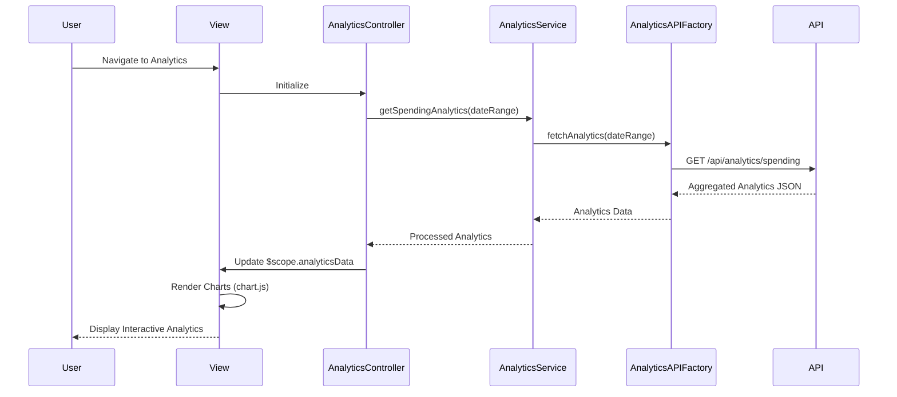

# Low-Level Design: Spending Analytics and Insights
**Epic ID:** QE-7557  
**Technology Stack:** AngularJS 1.x, JavaScript ES6, HTML5, CSS3, Bootstrap, REST APIs, MVC Architecture

---

## a. Architecture Mapping

- **Analytics Module** → AngularJS Module (`ccAnalyticsModule`)
- **Analytics Controller** → AngularJS Controller (`AnalyticsController`)
- **Analytics Service** → AngularJS Service (`AnalyticsService`)
- **Data Aggregation Service** → AngularJS Service (`DataAggregationService`)
- **Analytics API Client** → AngularJS Factory (`AnalyticsAPIFactory`)
- **Chart Directive** → AngularJS Directive (`spendingChart`)
- **Category Filter Directive** → AngularJS Directive (`categoryFilter`)

**Recommended Folder Structure:**
```
/app
  /modules
    /analytics
      /controllers
      /services
      /directives
      /views
      /models
```

---

## b. Component Specifications

| Component Name | Artifact Type | Responsibility | Key Dependencies |
|----------------|---------------|----------------|------------------|
| ccAnalyticsModule | Module | Root module for analytics and insights functionality | ngRoute, chart.js or angular-chart |
| AnalyticsController | Controller | Manages analytics view, chart rendering, filter interactions | AnalyticsService, DataAggregationService, $scope |
| AnalyticsService | Service | Business logic for analytics data processing | AnalyticsAPIFactory, $q |
| DataAggregationService | Service | Aggregates transaction data by category, month, card | None |
| AnalyticsAPIFactory | Factory | REST API calls for transaction and categorized data | $http, $resource |
| spendingChart | Directive | Renders interactive charts (bar, pie, line) | chart.js |
| categoryFilter | Directive | UI component for category and date range selection | None |
| SpendingAnalytics | Model | Analytics data structure | None |

---

## c. Data Model

**SpendingAnalytics Model:**
```javascript
{
  monthlySpendTrend: [
    { month: String, totalSpend: Number }
  ],
  categoryWiseSpend: [
    { category: String, amount: Number, percentage: Number }
  ],
  cardWiseSpend: [
    { cardId: String, cardName: String, totalSpend: Number }
  ]
}
```

**Category Enum:**
```javascript
['Food & Dining', 'Fuel', 'Shopping', 'Travel', 'Entertainment', 'Utilities', 'Healthcare', 'Education', 'Miscellaneous']
```

---

## d. Data Flow

User navigates to analytics view → AnalyticsController initializes and calls AnalyticsService.getSpendingAnalytics() → AnalyticsService invokes AnalyticsAPIFactory to fetch aggregated data via REST API (GET /api/analytics/spending?startDate={date}&endDate={date}) → API returns pre-aggregated JSON with monthly trends, category-wise, and card-wise spend → DataAggregationService processes and formats data for chart rendering → Controller updates $scope.analyticsData → spendingChart directive renders interactive charts using chart.js → User interacts with category filter → Controller re-fetches or filters data and updates charts dynamically.

---

## e. Primary Sequence Diagram



---

## f. Implementation Notes

- Integrate chart.js or angular-chart.js for interactive, responsive visualizations
- Use AngularJS watchers to update charts dynamically when filters change
- Implement client-side data aggregation in DataAggregationService if API returns raw transactions
- Apply ES6 array methods (map, reduce, filter) for efficient data processing
- Ensure charts are responsive using chart.js responsive configuration and Bootstrap containers

---

## g. Error Handling

HTTP interceptor captures API errors; fallback to empty state or cached data; user notified via toast on failure.

---

## h. Security Notes

Standard input validation and secure API calls assumed; token-based authentication via existing SSO for API requests.