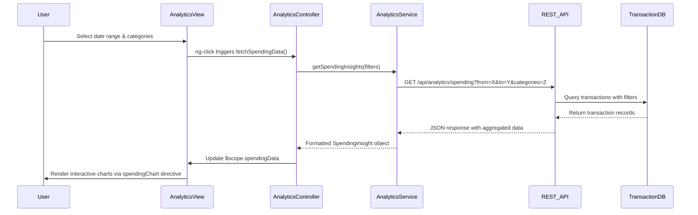

# Low-Level Design: QE-7558 - Analytics and Category-wise Spending Insights

## a. Architecture Mapping

- **User Interface** → AngularJS Module: `analytics.module.js` with Controller: `AnalyticsController`
- **Analytics Service** → AngularJS Service: `AnalyticsService` (handles API calls and data formatting)
- **Data Aggregation Engine** → Backend REST API endpoint: `/api/analytics/spending`
- **Transaction Database** → Backend data layer (accessed via REST API)
- **Visualization Library** → Angular directive wrapping Chart.js: `spendingChart` directive
- **Transaction Categorization Engine** → Backend service (pre-categorizes transactions)

**Recommended Folder Structure:**
```
app/
├── modules/analytics/
│   ├── analytics.module.js
│   ├── controllers/AnalyticsController.js
│   ├── services/AnalyticsService.js
│   ├── directives/spendingChart.directive.js
│   └── views/analytics.html
└── shared/services/ApiService.js
```

## b. Component Specifications

| Name | Artifact Type | Responsibility | Key Dependencies |
|------|---------------|----------------|------------------|
| analytics.module | AngularJS Module | Defines analytics feature module and routing | ngRoute, chart.js |
| AnalyticsController | Controller | Manages analytics view state, handles user interactions, coordinates data fetching | AnalyticsService, $scope |
| AnalyticsService | Service | Fetches spending data from REST API, formats data for visualization | $http, ApiService |
| spendingChart | Directive | Renders interactive Chart.js visualizations for category and trend data | Chart.js library |
| ApiService | Factory | Centralizes HTTP communication with backend REST endpoints | $http, $q |

## c. Data Model

```javascript
// SpendingInsight object
{
  userId: String,
  month: String,              // Format: "YYYY-MM"
  categories: [
    {
      name: String,           // e.g., "Food & Dining", "Fuel", etc.
      amount: Number,         // Total spend in category
      transactionCount: Number
    }
  ],
  totalSpend: Number,
  currency: String            // e.g., "USD"
}

// TrendData object
{
  months: Array<String>,      // ["2024-01", "2024-02", ...]
  spending: Array<Number>     // [1200.50, 1350.75, ...]
}
```

## d. Data Flow

User selects date range and category filters in the analytics view → AnalyticsController captures input and invokes AnalyticsService.getSpendingInsights() → AnalyticsService calls REST API `/api/analytics/spending` with query parameters → Backend Data Aggregation Engine queries Transaction Database, validates categories via Categorization Engine, and returns aggregated JSON → AnalyticsService formats response and updates controller scope → spendingChart directive watches scope data and re-renders Chart.js interactive visualizations → User interacts with responsive charts (hover, filter) triggering UI updates via two-way binding.

## e. Primary Sequence Diagram



## f. Implementation Notes

- Use AngularJS Dependency Injection to inject AnalyticsService into AnalyticsController for testability and modularity.
- Leverage ES6 arrow functions and const/let in service methods for cleaner, block-scoped code.
- Implement Chart.js via custom directive with isolated scope to encapsulate chart rendering logic and enable reusability.
- Use $http interceptors for adding auth tokens and handling global API errors (401, 500).
- Apply Bootstrap grid system (col-md-*, col-sm-*) in analytics.html for responsive layout across devices.

## g. Error Handling

HTTP interceptor captures API errors; controller displays user-friendly notifications via Bootstrap alerts; try/catch in service methods for JSON parsing errors.

## h. Security Notes

Requires token-based auth via existing SSO; API calls include Authorization header with JWT token.