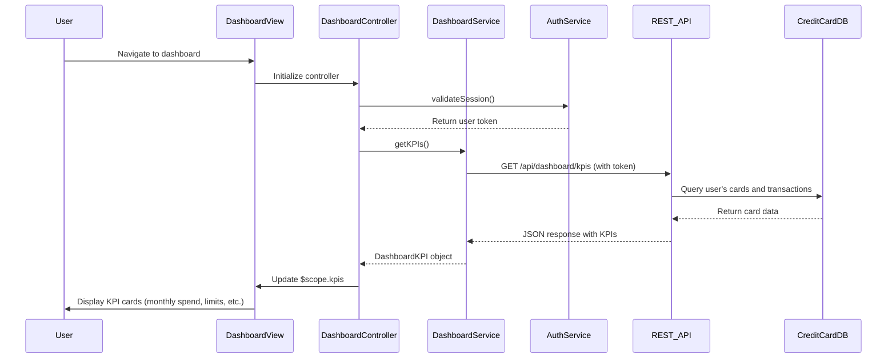

# Low-Level Design: QE-7559 - Dashboard and KPI Management

## a. Architecture Mapping

- **User Web/Mobile Client** → AngularJS Module: `dashboard.module.js` with Controller: `DashboardController`
- **Dashboard Service** → AngularJS Service: `DashboardService` (fetches KPI data via REST API)
- **KPI Aggregation Engine** → Backend REST API endpoint: `/api/dashboard/kpis`
- **Credit Card Database** → Backend data layer (accessed via REST API)
- **Authentication Service** → AngularJS Service: `AuthService` (manages user session and tokens)

**Recommended Folder Structure:**
```
app/
├── modules/dashboard/
│   ├── dashboard.module.js
│   ├── controllers/DashboardController.js
│   ├── services/DashboardService.js
│   └── views/dashboard.html
└── shared/services/AuthService.js
```

## b. Component Specifications

| Name | Artifact Type | Responsibility | Key Dependencies |
|------|---------------|----------------|------------------|
| dashboard.module | AngularJS Module | Defines dashboard feature module and routing | ngRoute, AuthService |
| DashboardController | Controller | Manages dashboard state, fetches and displays KPIs, handles refresh | DashboardService, $scope, $interval |
| DashboardService | Service | Calls REST API to retrieve aggregated KPI data for user's credit card portfolio | $http, AuthService |
| AuthService | Service | Provides authentication state, user token, and session validation | $http, $window |
| dashboard.html | View Template | Renders KPI cards (monthly spend, credit limit, available credit, outstanding) using Bootstrap | Bootstrap CSS |

## c. Data Model

```javascript
// DashboardKPI object
{
  userId: String,
  monthlySpend: Number,
  totalCreditLimit: Number,
  availableCredit: Number,
  outstandingAmount: Number,
  currency: String,           // e.g., "USD"
  lastUpdated: String         // ISO 8601 timestamp
}
```

## d. Data Flow

User navigates to dashboard → AuthService validates session and retrieves user token → DashboardController initializes and calls DashboardService.getKPIs() → DashboardService sends GET request to `/api/dashboard/kpis` with Authorization header → Backend KPI Aggregation Engine queries Credit Card Database for user's cards, calculates totals → REST API returns DashboardKPI JSON → DashboardService updates controller $scope → View renders KPI cards using Bootstrap grid and data binding → Optional: $interval triggers periodic refresh every 30 seconds for real-time updates.

## e. Primary Sequence Diagram



## f. Implementation Notes

- Use AngularJS $interval service in DashboardController to auto-refresh KPIs every 30 seconds for real-time updates.
- Implement DashboardService as singleton using AngularJS service() for shared state across controllers if needed.
- Apply Bootstrap responsive utility classes (hidden-xs, col-md-3) to ensure 2-second load and responsive layout on mobile/tablet/desktop.
- Use $http interceptors to inject Authorization header with JWT token from AuthService on every API call.
- Cache KPI data in service with timestamp; skip API call if cache is fresh (<30s) to optimize load time.

## g. Error Handling

$http interceptor handles 401 (redirect to login), 500 (show error banner); DashboardController displays Bootstrap alert on API failure.

## h. Security Notes

Requires token-based auth via existing SSO; all API calls include Authorization header with JWT token.