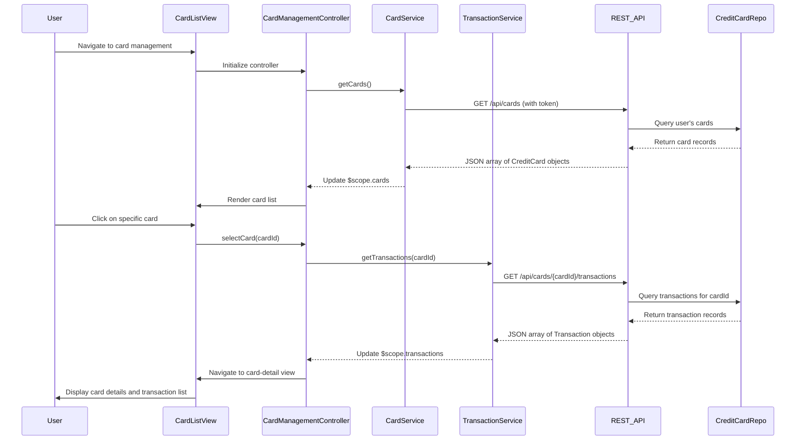

# Low-Level Design: QE-7560 - Multi-Card Management and Transaction Tracking

## a. Architecture Mapping

- **User Interface** → AngularJS Module: `cardManagement.module.js` with Controller: `CardManagementController`
- **Card Management Service** → AngularJS Service: `CardService` (fetches card details via REST API)
- **Transaction Service** → AngularJS Service: `TransactionService` (fetches transaction history via REST API)
- **Credit Card Data Repository** → Backend REST API endpoints: `/api/cards`, `/api/cards/{cardId}/transactions`
- **User Profile Service** → Backend service (validates card ownership; accessed via REST API)

**Recommended Folder Structure:**
```
app/
├── modules/cardManagement/
│   ├── cardManagement.module.js
│   ├── controllers/CardManagementController.js
│   ├── services/CardService.js
│   ├── services/TransactionService.js
│   └── views/
│       ├── card-list.html
│       └── card-detail.html
└── shared/services/AuthService.js
```

## b. Component Specifications

| Name | Artifact Type | Responsibility | Key Dependencies |
|------|---------------|----------------|------------------|
| cardManagement.module | AngularJS Module | Defines card management feature module and routing | ngRoute, AuthService |
| CardManagementController | Controller | Manages card list and detail views, handles card selection and transaction display | CardService, TransactionService, $scope, $routeParams |
| CardService | Service | Fetches user's credit cards from REST API, validates ownership | $http, AuthService |
| TransactionService | Service | Fetches transaction history for a specific card from REST API | $http, AuthService |
| card-list.html | View Template | Displays all user cards in grid using Bootstrap cards component | Bootstrap CSS |
| card-detail.html | View Template | Displays card-specific details and transaction list with pagination | Bootstrap CSS |

## c. Data Model

```javascript
// CreditCard object
{
  cardId: String,
  cardNumber: String,         // Masked, e.g., "**** **** **** 1234"
  cardHolderName: String,
  creditLimit: Number,
  currentBalance: Number,
  availableCredit: Number,
  cardType: String,           // e.g., "Visa", "Mastercard"
  expiryDate: String          // Format: "MM/YY"
}

// Transaction object
{
  transactionId: String,
  cardId: String,
  amount: Number,
  category: String,
  merchant: String,
  transactionDate: String,    // ISO 8601 timestamp
  description: String
}
```

## d. Data Flow

User navigates to card management view → CardManagementController calls CardService.getCards() → CardService sends GET request to `/api/cards` with user token → Backend validates user via User Profile Service and retrieves cards from Credit Card Data Repository → REST API returns array of CreditCard objects → Controller updates $scope.cards and renders card list → User selects a card → Controller captures cardId and calls TransactionService.getTransactions(cardId) → TransactionService sends GET to `/api/cards/{cardId}/transactions` → Backend fetches transaction history → REST API returns Transaction array → Controller updates $scope.transactions and renders card-detail view with transaction list.

## e. Primary Sequence Diagram



## f. Implementation Notes

- Use AngularJS $routeParams to capture cardId from URL when navigating to card-detail view for deep linking support.
- Implement CardService and TransactionService as singletons with caching to avoid redundant API calls when user navigates back.
- Apply Bootstrap card component (card, card-body) for responsive card display in grid layout (col-md-4, col-sm-6).
- Use ng-repeat with track by transactionId for efficient rendering of large transaction lists.
- Implement client-side pagination using AngularJS filter or third-party directive (e.g., angular-ui-pagination) for transaction list.

## g. Error Handling

$http interceptor handles API errors; CardManagementController displays Bootstrap alert on failure; empty state message shown if no cards found.

## h. Security Notes

Requires token-based auth via existing SSO; API calls include Authorization header with JWT token; card numbers are masked on client side.