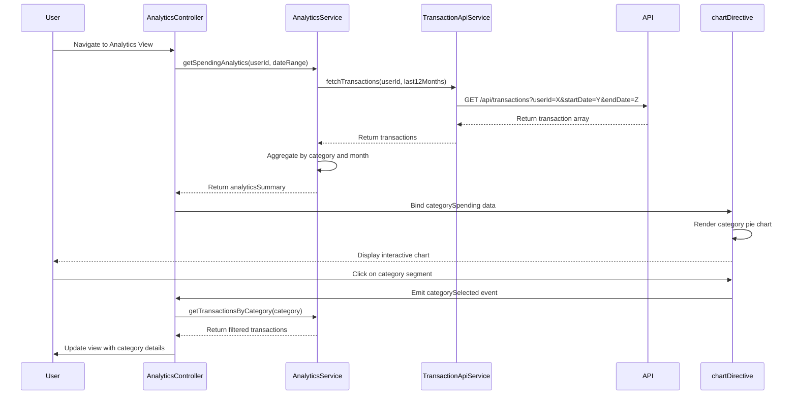

# Low-Level Design: QE-7567 - Analytics and Spending Insights

## a. Architecture Mapping

**AngularJS Artifacts:**
- **analyticsModule** - Main module encapsulating all analytics features
- **AnalyticsController** - Manages analytics view state, user interactions, and data binding
- **AnalyticsService** - Handles business logic for spending aggregation and trend computation
- **CategoryService** - Provides category definitions and mappings
- **TransactionApiService** - REST API integration for historical transaction data retrieval
- **chartDirective** - Custom directive for rendering interactive spending charts
- **trendChartDirective** - Custom directive for monthly trend visualization

**Folder Structure:**
```
app/
├── modules/analytics/
│   ├── analytics.module.js
│   ├── controllers/analytics.controller.js
│   ├── services/analytics.service.js
│   ├── services/category.service.js
│   ├── services/transaction-api.service.js
│   ├── directives/chart.directive.js
│   ├── directives/trend-chart.directive.js
│   ├── views/analytics.html
│   └── styles/analytics.css
```

## b. Component Specifications

| Component Name | Artifact Type | Responsibility | Key Dependencies |
|----------------|---------------|----------------|------------------|
| analyticsModule | Module | Registers all analytics components and configures routing | ngRoute, chart.js |
| AnalyticsController | Controller | Manages view state, handles user filter selections, triggers data refresh | AnalyticsService, CategoryService, $scope |
| AnalyticsService | Service | Aggregates spending by category and month, computes trends, caches results | TransactionApiService, $q, $filter |
| CategoryService | Factory | Provides category list and color mappings for visualization | None |
| TransactionApiService | Service | Fetches historical transactions via REST API with date range filtering | $http, $q |
| chartDirective | Directive | Renders category-wise spending pie/bar chart with interactivity | chart.js, $timeout |
| trendChartDirective | Directive | Renders monthly spend trend line chart with drill-down capability | chart.js, $timeout |

## c. Data Model

**Transaction Model:**
```javascript
{
  transactionId: String,
  cardId: String,
  amount: Number,
  category: String, // One of 9 predefined categories
  date: Date,
  description: String
}
```

**Category Model:**
```javascript
{
  categoryName: String, // 'Food & Dining', 'Fuel', 'Shopping', 'Travel', 'Entertainment', 'Utilities', 'Healthcare', 'Education', 'Miscellaneous'
  color: String, // Hex color for visualization
  icon: String
}
```

**Analytics Summary Model:**
```javascript
{
  categorySpending: [{ category: String, amount: Number, percentage: Number }],
  monthlyTrends: [{ month: String, totalSpend: Number }],
  dateRange: { startDate: Date, endDate: Date },
  totalSpend: Number
}
```

## d. Data Flow

User navigates to analytics view → AnalyticsController initializes and requests last 12 months data via AnalyticsService → AnalyticsService calls TransactionApiService to fetch historical transactions from REST API → Service aggregates transactions by category and month using ES6 array methods (reduce, map) → CategoryService provides category metadata for visualization → Aggregated data bound to $scope → chartDirective and trendChartDirective render interactive charts using Chart.js → User interacts with chart (hover, click) triggering controller methods to update filtered view → On filter change, AnalyticsService recomputes aggregations and updates UI within 3-second constraint.

## e. Primary Sequence Diagram



## f. Implementation Notes

- Use AngularJS dependency injection for all services and controllers to enable testability and modularity
- Leverage ES6 arrow functions and array methods (map, reduce, filter) for data aggregation logic in AnalyticsService
- Integrate Chart.js library via chartDirective with two-way data binding for responsive chart updates
- Implement API calls using $http service with promise-based error handling and loading state management
- Cache analytics results in AnalyticsService for 5 minutes to minimize API calls and meet 3-second processing NFR

## g. Error Handling

HTTP interceptor captures API failures; AnalyticsService uses try/catch with user-friendly error notifications via toast/modal.

## h. Security Notes

Requires token-based auth via existing SSO; API validates user ownership of transaction data before returning results.