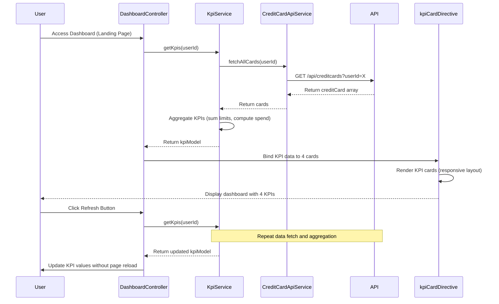

# Low-Level Design: QE-7568 - Dashboard and KPI Management

## a. Architecture Mapping

**AngularJS Artifacts:**
- **dashboardModule** - Main module for dashboard functionality
- **DashboardController** - Manages dashboard state, KPI data binding, and refresh logic
- **KpiService** - Handles KPI computation and aggregation logic
- **CreditCardApiService** - REST API integration for credit card data retrieval
- **kpiCardDirective** - Reusable directive for rendering individual KPI cards
- **refreshService** - Factory for managing real-time data refresh intervals

**Folder Structure:**
```
app/
├── modules/dashboard/
│   ├── dashboard.module.js
│   ├── controllers/dashboard.controller.js
│   ├── services/kpi.service.js
│   ├── services/creditcard-api.service.js
│   ├── services/refresh.service.js
│   ├── directives/kpi-card.directive.js
│   ├── views/dashboard.html
│   └── styles/dashboard.css
```

## b. Component Specifications

| Component Name | Artifact Type | Responsibility | Key Dependencies |
|----------------|---------------|----------------|------------------|
| dashboardModule | Module | Registers dashboard components, configures routing and sets as default landing page | ngRoute, ui.bootstrap |
| DashboardController | Controller | Manages dashboard view state, triggers KPI data load, handles refresh actions | KpiService, RefreshService, $scope, $interval |
| KpiService | Service | Computes Monthly Spend, Total Credit Limit, Available Credit, Outstanding Amount from card data | CreditCardApiService, $q |
| CreditCardApiService | Service | Fetches all user credit cards via REST API with real-time data | $http, $q |
| RefreshService | Factory | Manages auto-refresh intervals and manual refresh triggers | $interval, $rootScope |
| kpiCardDirective | Directive | Renders individual KPI with value, label, icon, and responsive layout | None |

## c. Data Model

**CreditCard Model:**
```javascript
{
  cardId: String,
  cardNumber: String, // Masked
  cardType: String, // Visa, Mastercard, etc.
  creditLimit: Number,
  currentBalance: Number,
  availableCredit: Number,
  outstandingAmount: Number,
  lastUpdated: Date
}
```

**KPI Model:**
```javascript
{
  monthlySpend: Number,
  totalCreditLimit: Number,
  availableCredit: Number,
  outstandingAmount: Number,
  lastRefreshed: Date
}
```

## d. Data Flow

User accesses application → Routing directs to dashboard as landing page → DashboardController initializes and calls KpiService.getKpis(userId) → KpiService invokes CreditCardApiService.fetchAllCards(userId) → API returns array of user's credit cards → KpiService aggregates: totalCreditLimit = sum(card.creditLimit), availableCredit = sum(card.availableCredit), outstandingAmount = sum(card.outstandingAmount), monthlySpend computed from current month transactions → KPI object bound to $scope within 2-second load time → kpiCardDirective renders each KPI in responsive Bootstrap grid → RefreshService triggers auto-refresh every 60 seconds, updating KPIs without page reload → User can manually trigger refresh via UI button.

## e. Primary Sequence Diagram



## f. Implementation Notes

- Use AngularJS $interval service in RefreshService for auto-refresh with configurable intervals (default 60s)
- Implement KPI aggregation using ES6 reduce method for efficient array processing in KpiService
- Leverage Bootstrap grid system (col-md-3) in dashboard.html for responsive 4-KPI layout across devices
- Use $http service with caching disabled for CreditCardApiService to ensure real-time data retrieval
- Apply AngularJS one-time binding (::) for static labels to optimize digest cycle performance

## g. Error Handling

HTTP interceptor-based error handling with fallback to cached KPI data; user notified via Bootstrap alert component on API failure.

## h. Security Notes

Requires token-based auth via existing SSO; sensitive card data masked in UI and transmitted over HTTPS.